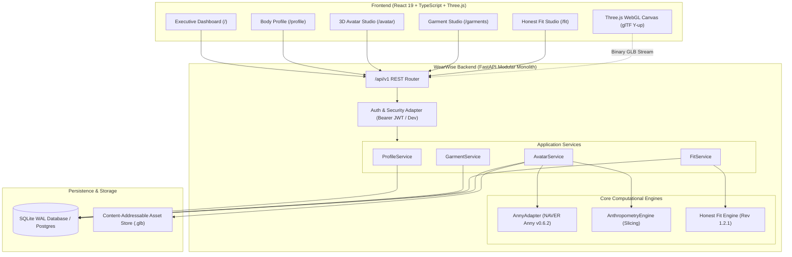

# WearWise — AI Fashion & Honest Fit Platform (MVP Release)

[](#)
[](#)
[](#)
[](#)
[](#)
[](#)
[](#)
[](#)

WearWise is a full-stack, research-grounded AI fashion and deterministic sizing platform. It eliminates sizing guesswork in online apparel shopping by combining parametric 3D human avatar synthesis, bounded computational anthropometry, and an evidence-backed Honest Fit engine.

---

## ✦ System Architecture & Core Modules

WearWise is engineered as a clean Modular Monolith with strict layer isolation, versioned REST APIs, database migration baselines, and a modern TypeScript + Three.js single-page application.



### The 5 Integrated User Journey Modules

1. **Executive Dashboard (`/`):**
   - High-level overview of active body profile, stature, presentation gender, and revision history.
   - Interactive 3D avatar viewport with dynamic bounding-box camera framing and neutral pedestal placement.
   - Consolidated extracted measurements summary (chest, waist, hips, inseam, arm length).
   - Recent Honest Fit evaluations and garment catalog quick-launch.

2. **Body Profile & Anthropometry (`/profile`):**
   - Shopper body profile initialization with canonical stature ($100\text{ cm} \le H \le 230\text{ cm}$) and presentation gender.
   - Revision-tracked provenance system recording each modification timestamp and metadata update.
   - Anthropometric measurement dictionary displaying millimeter-accurate dimensions extracted from the 3D avatar.

3. **3D Avatar Studio (`/avatar`):**
   - Real-time 3D parametric human mesh synthesis powered by **NAVER Anny v0.6.2** (27,420 triangles, 13,718 vertices).
   - Manifold watertight mesh validation and content-addressable binary GLB asset persistence.
   - Canonical $R_x(-90^\circ)$ coordinate transformation mapping native Anny Z-up space to standard glTF Y-up (+Z forward) space.
   - 8 semantic shape controls (shoulder width, chest fullness, belly fullness, waist definition, arm fullness, hip fullness, thigh fullness, calf fullness) driving parametric morph regeneration.

4. **Merchant Garment Studio (`/garments`):**
   - Garment item registration with SKU, brand ownership, category, and target silhouette metadata.
   - Fibre composition breakdown (e.g., 95% Cotton, 5% Elastane) strictly separated from physical mechanical stretch (BS 4952 relaxed/extended dimensions).
   - Multi-size dimensional specifications (XS, S, M, L, XL) with dimensional ease tolerances and grade rules.

5. **Honest Fit Studio (`/fit`):**
   - Deterministic dimensional ease calculation matching finished garment dimensions against extracted shopper anthropometry.
   - Regional fit classification across 5 anatomical zones: Chest, Waist, Hip, Shoulders, and Torso Length.
   - Six-tier fit spectrum: *Very Tight, Tight, Fitted, Regular, Loose, Oversized*.
   - Composite fit scoring ($0-100$) using category-calibrated weighting and asymmetric penalty coefficients.
   - Multi-size evaluation guaranteeing **exactly one** primary recommended size matching shopper silhouette preference.

---

## ✦ Technology Stack & Requirements

| Layer | Technologies |
|---|---|
| **Backend Core** | Python 3.12, FastAPI 0.115+, Uvicorn, Pydantic v2, Starlette |
| **Mesh & Math** | PyTorch 2.14+cu130, Warp-lang 1.19, Trimesh 5.2, SciPy, NumPy 2.5 |
| **Avatar Engine** | NAVER Anny v0.6.2 (Native Topology, 27,420 faces) |
| **Persistence** | SQLAlchemy 2.0, Alembic 1.20 (12 authoritative tables), SQLite WAL |
| **Security** | PyJWT 2.15 (HMAC-SHA256, issuer/audience verification, constant-time checks) |
| **Frontend SPA** | React 19.2, TypeScript 7.0+, Vite 8.2, Lucide React |
| **3D Rendering** | Three.js 0.187+, @react-three/fiber 9.8, @react-three/drei 10.7 |
| **Testing & CI** | Pytest 9.2 (403 backend tests), Vitest 5.1 (8 frontend tests), Playwright 1.65 |

---

## ✦ System Prerequisites

- **Operating System:** Windows 10/11 (64-bit) or Linux (Ubuntu 22.04+).
- **Python:** Version **3.12** (x86-64).
- **Node.js:** Version **20.x** or higher, with **npm 10+**.
- **Hardware Acceleration:**
  - NVIDIA GPU with CUDA 12.x+ (optional, fully supported via `cu130`).
  - CPU Inference: Fully supported and validated ($20.82\text{ ms}$ average latency on Intel Core i5/i7).

---

## ✦ Installation & Setup

### 1. Repository Checkout
Ensure you are on the authoritative release branch:
```bash
git clone https://github.com/SnehaSwarnkar/WearWise.git
cd WearWise
git checkout noTouch
```

### 2. Environment Configuration
Copy the root `.env.example` file to create your local `.env`:
```bash
cp .env.example .env
```
Key configuration settings (see `.env.example` for comprehensive documentation):
- `WEARWISE_ENV`: Set to `development` for local testing (enables dev role switcher) or `production` (strictly enforces signed JWT Bearer credentials).
- `DATABASE_URL`: `sqlite:///data/wearwise.db` (local dev) or `postgresql+psycopg://...` (production).
- `JWT_SECRET_KEY`: 32+ byte cryptographic key for HMAC-SHA256 token signing.

### 3. Backend Setup (`WEARWISE-BODY-ENGINE`)
Navigate to the engine directory and activate your Python 3.12 virtual environment:
```bash
cd WEARWISE-BODY-ENGINE

# If creating a new virtual environment:
python -m venv .venv-anny
# Windows:
.\.venv-anny\Scripts\activate
# Linux/macOS:
source .venv-anny/bin/activate

# Install dependencies:
pip install -r environments/anny/requirements.txt
pip install fastapi uvicorn sqlalchemy alembic pyjwt playwright pytest pytest-cov

# Run Alembic database migrations:
python -m alembic upgrade head
```

### 4. Frontend Setup (`frontend`)
Open a separate terminal, navigate to the `frontend` directory, and install npm packages:
```bash
cd frontend
npm install
```
Verify `frontend/.env` points to the backend server:
```env
VITE_API_URL=http://localhost:8000
```

---

## ✦ Starting the Application

### 1. Launch the Backend API Server
From `WEARWISE-BODY-ENGINE`:
```powershell
.\.venv-anny\Scripts\python.exe -m uvicorn app.api.app:app --host 127.0.0.1 --port 8000
```
- API Healthcheck: `http://127.0.0.1:8000/api/v1/health`
- Interactive Swagger Documentation: `http://127.0.0.1:8000/docs`
- OpenAPI Specification: `http://127.0.0.1:8000/openapi.json`

### 2. Launch the Frontend Development Server
From `frontend`:
```bash
npm run dev -- --host 127.0.0.1 --port 3000
```
- Web Application: `http://127.0.0.1:3000`

---

## ✦ Complete End-to-End User Journey

```
[1. Profile Creation]
   └─ Navigate to /profile -> Enter stature (178.5 cm), gender (Masculine) -> Revision 1 created.

[2. 3D Avatar Studio]
   └─ Navigate to /avatar -> Click "Generate Avatar" -> NAVER Anny v0.6.2 synthesizes 3D mesh.
   └─ Binary GLB streams into Three.js canvas. Upright mannequin displays on pedestal.

[3. Shape Morphing]
   └─ Adjust sliders (Shoulder Width: 0.65, Chest: 0.60, Waist: 0.70) -> Click "Generate Avatar".
   └─ Mesh dynamically regenerates; updated millimeter anthropometry is extracted and saved.

[4. Garment Registration]
   └─ Switch role to Merchant in Navbar -> Navigate to /garments.
   └─ Register T-shirt (TSH-WW-CREW-001) with BS 4952 relaxed dimensions for sizes S, M, L.

[5. Honest Fit Evaluation]
   └─ Switch role to Shopper in Navbar -> Navigate to /fit.
   └─ Select Regular silhouette preference -> Click "Evaluate Honest Fit".
   └─ View regional ease (chest, waist, hip, shoulder, torso) and composite score.
   └─ Exactly one size (e.g., Size M @ 95.3/100) is flagged as Recommended.

[6. Executive Dashboard]
   └─ Navigate to / -> View framed upright 3D avatar, active measurements, and recent fit history.
```

---

## ✦ Verification & Testing

WearWise enforces strict architectural isolation and regression testing across both backend and frontend layers:

### Backend Regression Suite (403 Tests)
```bash
cd WEARWISE-BODY-ENGINE
.\.venv-anny\Scripts\python.exe -m pytest tests/ -q
# Result: 403 passed in ~65s
```
- `tests/architecture/`: Enforces strict layer boundaries (no database models in domain, no domain bypass).
- `tests/avatar_engine/`: Manifold validity, topology invariance, coordinate transforms.
- `tests/anthropometry/`: Bounded planar slicing, degree-four disambiguation, landmark repeatability.
- `tests/fit/`: Honest Fit Rev 1.2.1 formula validation, penalty functions, single recommended size.
- `tests/api/`: End-to-end REST workflows, OpenAPI compliance, JWT security, and production header rejection.
- `tests/db/`: Alembic schema migrations, foreign key cascading, SQLite WAL pragma verification.

### Frontend Unit & Integration Suite (8 Tests)
```bash
cd frontend
npm test
# Result: 8 passed across 3 test suites in ~2.7s
```

### Production Build Validation
```bash
cd frontend
npm run build
# Result: tsc --noEmit && vite build completes with zero errors
```

### Automated Playwright E2E Demonstration
Execute the full browser demonstration script to verify all 5 modules and regenerate verification screenshots:
```bash
cd WEARWISE-BODY-ENGINE
.\.venv-anny\Scripts\python.exe scripts/demo_phase6b_frontend.py
```

---

## ✦ Operational Readiness & Honest Disclosures

In accordance with WearWise engineering standards, the following technical qualifications and deferred production items are formally recorded:

1. **Authentication & Identity Boundary:**
   - The multi-principal switcher in the top navigation is a **development-only adapter**.
   - When running in production mode (`WEARWISE_ENV=production`), development identity headers (`X-User-Id`, `X-Brand-Id`) and fallback UUIDs are strictly rejected (HTTP 401). Production deployments require cryptographically signed Bearer JWT credentials.
   - External OAuth2/OIDC identity-provider integration and self-service account lifecycle are deferred to post-MVP roadmap.

2. **Provisional Anthropometry & Fit Calibration:**
   - Anthropometric circumferential slicing algorithms and symmetric penalty coefficients ($\beta$) implemented in the Honest Fit Engine Rev 1.2.1 are **provisional engineering models**.
   - They demonstrate mathematically consistent ease calculations and ranking, but are **not clinically or scientifically calibrated** against ISO 8559 human subject populations.

3. **Optimization Engine:**
   - The BICE (Body Intelligence Context Engine) iterative inverse-kinematics optimizer is deferred.
   - The MVP uses feedforward semantic parameter synthesis to drive NAVER Anny mesh generation.

4. **Asset Lifecycle & Deletion Outbox:**
   - Avatar GLB assets are stored in a content-addressable local store (`data/assets/glb/`).
   - The asynchronous background worker for processing soft-deleted asset outbox records is deferred; orphan cleanup scripts are provided.

---

## ✦ License & Provenance

- **Application Code:** Proprietary & Confidential — WearWise Engineering Team.
- **Avatar Foundation:** NAVER Anny v0.6.2 (Apache 2.0 / Academic & Engineering Research).
- **Domain Specifications:** WearWise Master Project Brief Rev 2.1 & Honest Fit Engine Spec Rev 1.2.1.
