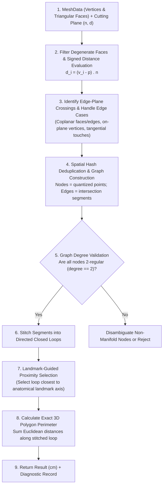

# WearWise Anthropometry Engine & Measurement Specification

**Project:** WearWise AI Fashion & Honest Fit Platform  
**Document:** Anthropometry Specification (ANT-001)  
**Revision:** 1.2.1 (Exact Graph Intersection, Disambiguation & Canonical Protocols)  
**Date:** 2026-11-23  
**Status:** Approved Technical Architecture  

---

## 1. Scope, Coordinate Standards & Model Boundaries

This specification establishes the canonical anthropometric measurement dictionary, coordinate system standards, reference landmarks, and exact geometric intersection algorithms for the WearWise platform.

### Core Architecture & Boundaries:
- **Apparel Sizing Focus:** Definitions are optimized for clothing fit intelligence (tailoring ease, collar/chest/waist/hip room, inseams), **NOT** for orthopedic or clinical diagnosis.
- **Model-Derived Geometric Estimates:** Measurements extracted from the 3D avatar mesh are geometric calculations over surface vertices. They are mathematically deterministic but must **never be represented as externally verified human ground truth** until calibrated against live human subjects in Phase 8.
- **Specification Status:** The exact mesh-plane intersection algorithm specified herein is an **architectural contract and algorithmic design**. In strict accordance with Phase 1 boundaries, it has **not yet been implemented or experimentally validated**. Implementation, edge-case unit testing, and property-based verification will occur in **Phase 4**.
- **Metric Standards:** Coordinate values in 3D geometry are strictly in **METERS ($m$)**. All domain entities, REST APIs, and database tables store dimensions in **CENTIMETERS ($cm$)** using the exact conversion:
  $$\text{value}_{\text{cm}} = \text{value}_{\text{m}} \times 100.0$$
- **Right-Handed Coordinate Axes:** $+X$ = Lateral Left-to-Right; $+Y$ = Posterior-to-Anterior (Forward); $+Z$ = Plantar-to-Cranial (Vertical / Upward).
- **Reference Pose:** Standard Neutral A-Pose (upright, feet resting at $Z \approx -0.839\text{ m}$, head facing $+Y$, arms abducted downward $\sim 30^\circ$ from torso in coronal plane).

---

## 2. Canonical Measurement Dictionary & Historical Evidence

The table below preserves the exact empirical Phase 0 benchmark values on the neutral baseline male mannequin while formally documenting landmark conventions, plane orientations, loop selection rules, and validation states:

| Measurement Code | Common Name | Reference Landmark & Slicing Plane | Loop Selection Rule | Baseline Value (Phase 0) | Validation State |
|---|---|---|---|---|---|
| `stature` | Total Height | Vertical distance from lowest plantar vertex ($Z_{\min}$) to crown vertex ($Z_{\max}$) | Bounding Box $Z$-extent | **$156.83\text{ cm}$** (Template)<br>**$155.97\text{ cm}$** (Posed LBS) | Validated (Model) |
| `chest_circumference` | Chest / Bust Girth | Transverse plane at $72\%$ stature ($Z \approx 0.29\text{ m}$), intersecting bust/nipple apex | Nearest loop to `sternum_lower` landmark | **$111.11\text{ cm}$** | Validated (Model) |
| `chest_high_axillary_circumference` | High Axillary Chest | Transverse plane at $76\%$ stature ($Z \approx 0.35\text{ m}$), through upper axillary armpit folds | Central torso loop; arms excluded via region mask | **$111.73\text{ cm}$** | Provisional |
| `waist_natural_circumference` | Natural Waist (3D) | 3D geodesic surface loop passing through natural waist indentation ($60.83\%$ stature, $Z \approx 0.133\text{ m}$) | Native 3D loop provided via `LandmarkProvider` | **$67.11\text{ cm}$** | Validated (Native Anny) |
| `waist_planar_circumference` | Planar Torso Waist | Transverse plane at natural waist height ($Z = 0.1334\text{ m}$) | Nearest loop to `umbilicus` landmark | **$67.90\text{ cm}$** | Validated (Model) |
| `hip_circumference` | Hip / Seat Girth | Transverse plane at $51\%$ stature ($Z \approx -0.04\text{ m}$), through maximal greater trochanters and gluteal apex | Nearest loop to `sacrum_mid` landmark | **$88.43\text{ cm}$** | **Provisional** |
| `shoulder_biacromial_breadth` | Biacromial Breadth | Euclidean distance between left and right lateral acromial processes of scapula | Landmark pair: `acromion_left` to `acromion_right` ($|Y| \le 0.05\text{ m}$) | **$36.84\text{ cm}$** | Validated (Model) |
| `shoulder_deltoid_outer_breadth` | Outer Shoulder Width | Transverse slab at $82\%$ stature ($Z \approx 0.45\text{ m}$); maximum lateral $X$-span | Lateral extrema across deltoid muscle contours | **$39.17\text{ cm}$** | Validated (Model) |
| `torso_length` | Torso Length | Vertical distance along dorsal spine from C7 cervical vertebra to perineum (crotch level) | Landmark delta: $Z(\text{C7}) - Z(\text{perineum})$ | **$51.75\text{ cm}$** | Validated (Model) |
| `arm_bicep_circumference` | Upper Arm Girth | Plane perpendicular to humerus bone axis at maximal bicep belly | Single loop enclosing left or right upper arm segment | Uncalibrated | Provisional |
| `leg_thigh_circumference` | Thigh Girth | Plane perpendicular to femur bone axis $3\text{ cm}$ below inferior gluteal fold | Single loop enclosing isolated upper leg segment | Uncalibrated | Provisional |
| `leg_calf_circumference` | Calf Girth | Transverse plane at $28\%$ stature through maximal gastrocnemius belly | Single loop enclosing isolated lower leg segment | Uncalibrated | Provisional |

---

## 3. Exact Triangle-Mesh-Plane Intersection Algorithm Specification

The naive Z-slab and 2D convex hull heuristic used during early Phase 0 experiments is formally replaced by the **Exact Triangle-Mesh-Plane Intersection Algorithm** (`algorithm_version: 1.2-mesh-plane-graph`):



### 3.1 Edge-Case & Geometric Robustness Rules

The intersection algorithm must handle all topological singularities and planar configurations deterministically:

1. **Numerical Epsilon ($\epsilon = 10^{-6}\text{ m}$):** Any vertex with signed distance $|d_i| \le \epsilon$ is snapped exactly to the plane ($d_i = 0.0$).
2. **Coplanar Triangles (All 3 Vertices on Plane):**
   - If $|d_0| \le \epsilon$, $|d_1| \le \epsilon$, and $|d_2| \le \epsilon$, the entire face lies on the cutting plane.
   - **Handling Rule:** The face interior is discarded from 2D slicing segments to prevent interior cross-hatched webs. Its boundary edges shared with non-coplanar transversal faces are handled via edge hashing and deduplication.
3. **Coplanar Edges (2 Vertices on Plane, 1 Off-Plane):**
   - If $|d_0| \le \epsilon$ and $|d_1| \le \epsilon$, while $|d_2| > \epsilon$, edge $(v_0, v_1)$ lies on the plane.
   - **Handling Rule:** Generate a line segment between $v_0$ and $v_1$. To prevent duplicate segments generated by the adjacent sharing face, canonical edge hashing ($\min(i, j), \max(i, j)$) is enforced.
4. **Tangential Intersections (1 Vertex on Plane, 2 Vertices on Same Side):**
   - If $|d_0| \le \epsilon$ and $\text{sign}(d_1) == \text{sign}(d_2) \neq 0$, the plane touches the triangle at a single vertex without crossing.
   - **Handling Rule:** Discarded; tangential touches produce zero-length segments and must not enter the graph.
5. **Transverse Crossing with One Vertex On-Plane (1 On-Plane, 1 Positive, 1 Negative):**
   - If $|d_0| \le \epsilon$, $d_1 > \epsilon$, and $d_2 < -\epsilon$:
   - **Handling Rule:** The plane cuts through $v_0$ and transversally intersects edge $(v_1, v_2)$ at:
     $$\mathbf{p}_{12} = \mathbf{v}_1 + \frac{d_1}{d_1 - d_2} (\mathbf{v}_2 - \mathbf{v}_1)$$
   - Generate exactly one intersection segment connecting $\mathbf{v}_0$ directly to $\mathbf{p}_{12}$.
6. **Standard Transverse Crossing (1 Vertex on One Side, 2 on the Other):**
   - If $d_0$ has opposite sign to $d_1$ and $d_2$:
     $$\mathbf{p}_{01} = \mathbf{v}_0 + \frac{d_0}{d_0 - d_1} (\mathbf{v}_1 - \mathbf{v}_0), \quad \mathbf{p}_{02} = \mathbf{v}_0 + \frac{d_0}{d_0 - d_2} (\mathbf{v}_2 - \mathbf{v}_0)$$
   - Generate segment connecting $\mathbf{p}_{01}$ to $\mathbf{p}_{02}$.
7. **Duplicate Segments & Zero-Length Edges:**
   - Segments with length $\|\mathbf{p}_{\text{start}} - \mathbf{p}_{\text{end}}\| < \epsilon_{\text{len}}$ ($10^{-6}\text{ m}$) are discarded as zero-length degeneracies.
   - Duplicate segments (undirected segments sharing identical endpoint hash IDs) are merged into a single unique edge.
8. **Degenerate Faces:** Faces with zero cross-product normal area ($\|(\mathbf{v}_1 - \mathbf{v}_0) \times (\mathbf{v}_2 - \mathbf{v}_0)\| \le 10^{-12}$) are stripped during mesh validation.

### 3.2 Graph-Based Segment Stitching, Spatial Hashing & Degree-2 Validation

```python
import numpy as np
from typing import List, Tuple, Dict, Any, Optional, Set
from dataclasses import dataclass

@dataclass(frozen=True)
class ContourLoop:
    """An ordered, closed 3D polygonal loop on the mesh surface."""
    points_3d_m: np.ndarray       # Shape (K, 3), coordinates in METERS
    is_closed: bool               # True if start and end points meet within tolerance
    centroid_3d_m: List[float]    # (Xc, Yc, Zc) centroid of loop in METERS
    bounding_box_min_m: List[float]
    bounding_box_max_m: List[float]
    perimeter_cm: float

@dataclass(frozen=True)
class ExtractionDiagnostic:
    """Diagnostic metadata for measurement extraction."""
    algorithm_version: str        # "1.2.1-mesh-plane-graph"
    plane_origin_m: List[float]
    plane_normal: List[float]
    intersected_triangles_count: int
    extracted_loops_count: int
    selected_loop_index: int
    closure_error_m: float
    graph_is_2_regular: bool
    is_plausible: bool
    status_code: str              # "SUCCESS", "ANTHRO_NON_MANIFOLD_CONTOUR", "ANTHRO_AMBIGUOUS_CONTOUR_SELECTION", etc.

def stitch_segments_into_loops(
    segments: List[Tuple[np.ndarray, np.ndarray]], 
    tolerance_m: float = 1e-5
) -> List[ContourLoop]:
    """
    Constructs an adjacency graph using spatial quantization hashing.
    Enforces degree == 2 for manifold loops; rejects self-intersecting or branching graphs.
    """
    # 1. Spatial hash to quantize endpoints into discrete cells (epsilon_snap = 1e-5 m):
    #    key = (round(x / eps), round(y / eps), round(z / eps))
    # 2. Build adjacency list: node -> List[neighbor_nodes]
    # 3. Check graph degree: 
    #    - If deg(u) == 1: open boundary (mesh hole) -> reject loop
    #    - If deg(u) > 2: branching / self-intersection -> reject loop with ANTHRO_NON_MANIFOLD_CONTOUR
    #    - Manifold cross-section strictly requires deg(u) == 2 for all nodes.
    # 4. Traverse adjacency graph from unvisited node until loop closes.
    # 5. Handle nested / concentric loops: use 2D point-in-polygon ray casting to separate
    #    outer anatomical surface boundaries from inner hollow voids.
    # 6. Calculate 3D Euclidean perimeter: sum(||p_i - p_{i+1}||) * 100.0 cm
    ...
```

### 3.3 Landmark-Guided Proximity & Disambiguation Rules

When cutting horizontally across the human body, the plane typically extracts **multiple disconnected closed loops** (e.g. at chest/waist level: 1 central torso loop + 2 arm loops; at thigh level: 2 leg loops).

The engine applies **Landmark-Guided Centroid Proximity with Ambiguity Rejection**:
1. The `LandmarkProvider` supplies the 3D coordinate of the designated anatomical axis landmark $\mathbf{p}_{\text{landmark}}$ (e.g. `sternum_lower` for chest, `umbilicus` for waist, `sacrum_mid` for hips).
2. For each extracted closed loop $L_j$, compute its 3D centroid $\mathbf{c}_j = \frac{1}{K} \sum_{k=1}^K \mathbf{p}_k$.
3. Compute the horizontal planar Euclidean distance to the landmark:
   $$D(L_j) = \sqrt{(c_{j, x} - p_{\text{landmark}, x})^2 + (c_{j, y} - p_{\text{landmark}, y})^2}$$
4. **Ambiguity Rejection Gate:**
   The algorithm does **NOT** blindly select the nearest loop if the geometry is ambiguous or implausible:
   - **Ambiguity Margin:** If the two candidate loops with the smallest distances have $|D(L_1) - D(L_2)| < \delta_{\text{ambiguity}}$ ($\delta_{\text{ambiguity}} = 0.02\text{ m} = 2.0\text{ cm}$), the algorithm raises `ANTHRO_AMBIGUOUS_CONTOUR_SELECTION` and fails safely rather than guessing.
   - **Plausibility Guard:** If the selected loop's perimeter falls outside anatomical limits for that site (e.g. Chest girth $< 60.0\text{ cm}$ or $> 200.0\text{ cm}$; Waist $< 50.0\text{ cm}$ or $> 180.0\text{ cm}$), the algorithm raises `ANTHRO_IMPLAUSIBLE_CONTOUR_PERIMETER`.

---

## 4. Landmark Abstraction: The `LandmarkProvider` Protocol

To guarantee that the Anthropometry Engine never couples to Anny's internal vertex numbering, landmark positions and anatomical region masks are resolved through the engine-neutral `LandmarkProvider` interface:

```python
from typing import Protocol, Optional, Dict, Set, List
import numpy as np

class LandmarkData:
    """Anatomical landmark coordinates provided by an adapter."""
    landmark_code: str             # Canonical landmark code (e.g. "acromion_left", "cervicale_c7")
    point_3d_m: List[float]        # (X, Y, Z) coordinate in METERS in standard reference pose
    anatomical_region: str         # e.g. "shoulders", "waist", "hips"

class LandmarkProvider(Protocol):
    """Supplies 3D landmark points and anatomical vertex masks without exposing engine topology."""
    def get_landmark(self, landmark_code: str) -> Optional[LandmarkData]:
        """Returns LandmarkData entity containing 3D coordinates in meters."""
        ...

    def get_landmark_point_m(self, landmark_code: str) -> Optional[np.ndarray]:
        """Returns 3D (X, Y, Z) landmark point as numpy array in METERS in current mesh pose."""
        ...

    def get_all_landmarks(self) -> Dict[str, LandmarkData]:
        """Returns full dictionary of available anatomical landmarks."""
        ...

    def get_region_vertex_mask(self, region_code: str) -> Set[int]:
        """
        Returns the set of mesh vertex indices belonging to the specified anatomical zone.
        During cross-sectional slicing, a triangular face (v0, v1, v2) is included in the slicing
        submesh for region R if at least 2 of its 3 vertices belong to this vertex mask.
        """
        ...
```

The concrete `AnnyLandmarkProvider` in `app/avatar_engine/adapters/anny_adapter.py` maps internal vertex indices to this public interface.

---

## 5. Explicit Measurement Failure States & Diagnostic Reporting

When measurement extraction fails (e.g. unclosed loop, self-intersection, or non-manifold edge), the Anthropometry Engine **never substitutes a bounding-box approximation**. Instead, it records an explicit status and diagnostic record:

| Extraction Status | Condition | Handling Policy |
|---|---|---|
| `ACTIVE` | Clean closed loop; closure error $< 10^{-6}\text{ m}$; plausible dimensions | Recorded as valid active measurement |
| `PROVISIONAL` | Clean closed loop; provisional tailoring landmark (e.g. hip transverse plane) | Recorded with `status: provisional` |
| `UNASSESSED` | Anatomical region not covered by available landmarks | Flagged as `unassessed`; ignored by fit engine |
| `REJECTED` | Unclosed segment chain; node degree $\neq 2$; self-intersection | Flagged as `status: rejected`; error reason logged in diagnostic metadata |
