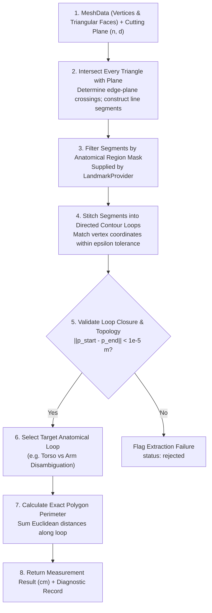

# WearWise Anthropometry Engine & Measurement Specification

**Project:** WearWise AI Fashion & Honest Fit Platform  
**Document:** Anthropometry Specification (ANT-001)  
**Revision:** 1.1 (Exact Mesh-Plane Intersection & Landmark Abstraction)  
**Date:** 2026-11-23  
**Status:** Approved Technical Architecture  

---

## 1. Scope, Coordinate Standards & Model Boundaries

This specification establishes the canonical anthropometric measurement dictionary, coordinate system standards, reference landmarks, and exact geometric intersection algorithms for the WearWise platform.

### Core Architecture & Boundaries:
- **Apparel Sizing Focus:** Definitions are optimized for clothing fit intelligence (tailoring ease, collar/chest/waist/hip room, inseams), **NOT** for orthopedic or clinical diagnosis.
- **Model-Derived Geometric Estimates:** Measurements extracted from the 3D avatar mesh are geometric calculations over surface vertices. They are mathematically deterministic but must **never be represented as externally verified human ground truth** until calibrated against live human subjects in Phase 8.
- **Metric Standards:** Coordinate values in 3D geometry are strictly in **METERS ($m$)**. All domain entities, REST APIs, and database tables store dimensions in **CENTIMETERS ($cm$)** using the exact conversion:
  $$\text{value}_{\text{cm}} = \text{value}_{\text{m}} \times 100.0$$
- **Right-Handed Coordinate Axes:** $+X$ = Lateral Left-to-Right; $+Y$ = Posterior-to-Anterior (Forward); $+Z$ = Plantar-to-Cranial (Vertical / Upward).
- **Reference Pose:** Standard Neutral A-Pose (upright, feet resting at $Z \approx -0.839\text{ m}$, head facing $+Y$, arms abducted downward $\sim 30^\circ$ from torso in coronal plane).

---

## 2. Canonical Measurement Dictionary & Historical Evidence

The table below preserves the exact empirical Phase 0 benchmark values on the neutral baseline male mannequin while formally documenting landmark conventions, plane orientations, loop selection rules, and validation states:

| Measurement Code | Common Name | Reference Landmark & Slicing Plane | Loop Selection Rule | Baseline Value (Phase 0) | Validation State |
|---|---|---|---|---|---|
| `stature` | Total Height | Vertical distance from lowest plantar vertex ($Z_{\min}$) to crown vertex ($Z_{\max}$) | Bounding Box $Z$-extent | **$156.83\text{ cm}$** (Template)<br>**$155.97\text{ cm}$** (Posed LBS) | Validated (Model) |
| `chest_circumference` | Chest / Bust Girth | Transverse plane at $72\%$ stature ($Z \approx 0.29\text{ m}$), intersecting bust/nipple apex | Largest closed loop intersecting anterior sternum & pectoralis | **$111.11\text{ cm}$** | Validated (Model) |
| `chest_high_axillary_circumference` | High Axillary Chest | Transverse plane at $76\%$ stature ($Z \approx 0.35\text{ m}$), through upper axillary armpit folds | Central torso loop excluding detached upper arm loops | **$111.73\text{ cm}$** | Provisional |
| `waist_natural_circumference` | Natural Waist (3D) | 3D geodesic surface loop passing through natural waist indentation ($60.83\%$ stature, $Z \approx 0.133\text{ m}$) | Native 3D loop provided via `LandmarkProvider` | **$67.11\text{ cm}$** | Validated (Native Anny) |
| `waist_planar_circumference` | Planar Torso Waist | Transverse plane at natural waist height ($Z = 0.1334\text{ m}$) | Central torso loop; forearm loops filtered by region mask | **$67.90\text{ cm}$** | Validated (Model) |
| `hip_circumference` | Hip / Seat Girth | Transverse plane at $51\%$ stature ($Z \approx -0.04\text{ m}$), through maximal greater trochanters and gluteal apex | Primary pelvic loop enclosing sacrum and pubis | **$88.43\text{ cm}$** | **Provisional** |
| `shoulder_biacromial_breadth` | Biacromial Breadth | Euclidean distance between left and right lateral acromial processes of scapula | Landmark pair: `acromion_left` to `acromion_right` ($|Y| \le 0.05\text{ m}$) | **$36.84\text{ cm}$** | Validated (Model) |
| `shoulder_deltoid_outer_breadth` | Outer Shoulder Width | Transverse slab at $82\%$ stature ($Z \approx 0.45\text{ m}$); maximum lateral $X$-span | Lateral extrema across deltoid muscle contours | **$39.17\text{ cm}$** | Validated (Model) |
| `torso_length` | Torso Length | Vertical distance along dorsal spine from C7 cervical vertebra to perineum (crotch level) | Landmark delta: $Z(\text{C7}) - Z(\text{perineum})$ | **$51.75\text{ cm}$** | Validated (Model) |
| `arm_bicep_circumference` | Upper Arm Girth | Plane perpendicular to humerus bone axis at maximal bicep belly | Single loop enclosing left or right upper arm segment | Uncalibrated | Provisional |
| `leg_thigh_circumference` | Thigh Girth | Plane perpendicular to femur bone axis $3\text{ cm}$ below inferior gluteal fold | Single loop enclosing isolated upper leg segment | Uncalibrated | Provisional |
| `leg_calf_circumference` | Calf Girth | Transverse plane at $28\%$ stature through maximal gastrocnemius belly | Single loop enclosing isolated lower leg segment | Uncalibrated | Provisional |

---

## 3. Exact Triangle-Mesh-Plane Intersection Algorithm

The naive Z-slab and 2D convex hull heuristic used during early Phase 0 experiments is formally replaced by the **Exact Triangle-Mesh-Plane Intersection Algorithm** (`algorithm_version: 1.1`):



### 3.1 Algorithm Specification

```python
import numpy as np
from typing import List, Tuple, Dict, Any, Optional
from dataclasses import dataclass

@dataclass(frozen=True)
class ContourLoop:
    """An ordered, closed 3D polygonal loop on the mesh surface."""
    points_3d_m: np.ndarray       # Shape (K, 3), coordinates in METERS
    is_closed: bool               # True if start and end points meet within tolerance
    bounding_box_min_m: List[float]
    bounding_box_max_m: List[float]
    perimeter_cm: float

@dataclass(frozen=True)
class ExtractionDiagnostic:
    """Comprehensive diagnostic metadata for measurement extraction."""
    algorithm_version: str        # e.g. "1.1-mesh-plane-stitch"
    plane_origin_m: List[float]
    plane_normal: List[float]
    intersected_triangles_count: int
    extracted_loops_count: int
    selected_loop_index: int
    closure_error_m: float
    is_plausible: bool

def intersect_mesh_with_plane(
    vertices: np.ndarray,         # Shape (N, 3), float32 in METERS
    faces: np.ndarray,            # Shape (M, 3), int32
    plane_point: np.ndarray,      # (3,), point on plane in METERS
    plane_normal: np.ndarray,     # (3,), unit normal vector (e.g. [0, 0, 1] for horizontal)
    tolerance_m: float = 1e-5
) -> List[ContourLoop]:
    """
    Computes exact line-segment intersections for every face,
    and stitches segments into ordered, closed 3D contour loops.
    """
    # 1. Evaluate signed distance from plane for all vertices: d = (v - p) . n
    signed_distances = np.dot(vertices - plane_point, plane_normal)
    
    # 2. Identify intersecting triangles (faces where vertices have mixed signs)
    face_distances = signed_distances[faces] # Shape (M, 3)
    has_positive = np.any(face_distances > tolerance_m, axis=1)
    has_negative = np.any(face_distances < -tolerance_m, axis=1)
    intersecting_face_indices = np.where(has_positive & has_negative)[0]
    
    segments: List[Tuple[np.ndarray, np.ndarray]] = []
    
    for f_idx in intersecting_face_indices:
        f_verts = vertices[faces[f_idx]] # Shape (3, 3)
        f_dists = face_distances[f_idx]  # Shape (3,)
        
        # Intersect the 3 triangle edges with plane
        edge_pts = []
        for i in range(3):
            j = (i + 1) % 3
            d_i, d_j = f_dists[i], f_dists[j]
            if (d_i * d_j) < 0.0: # Edge straddles plane
                t = d_i / (d_i - d_j)
                intersect_pt = f_verts[i] + t * (f_verts[j] - f_verts[i])
                edge_pts.append(intersect_pt)
            elif abs(d_i) <= tolerance_m:
                edge_pts.append(f_verts[i])
                
        if len(edge_pts) == 2:
            segments.append((edge_pts[0], edge_pts[1]))
            
    # 3. Stitch line segments into closed continuous loops
    loops = stitch_segments_into_loops(segments, tolerance_m)
    return loops

def stitch_segments_into_loops(
    segments: List[Tuple[np.ndarray, np.ndarray]], 
    tolerance_m: float = 1e-5
) -> List[ContourLoop]:
    """Stitches unordered segments into connected, ordered closed loops."""
    # Implementation matches endpoints within tolerance_m
    # Returns List[ContourLoop] with exact 3D polygon perimeters in centimeters
    ...
```

### 3.2 Loop Selection & Limb Disambiguation
When cutting horizontally through the torso (e.g. at chest, waist, or hips), the plane cuts through **three distinct anatomical structures**:
1. The **Central Torso Trunk** (target anatomical contour).
2. The **Left Arm / Forearm**.
3. The **Right Arm / Forearm**.

Rather than relying on a brittle global threshold (e.g. `|X| <= 0.20 m`), the Anthropometry Engine resolves the target contour using **Landmark-Guided Loop Selection**:
- The `LandmarkProvider` supplies the 3D coordinate of the anatomical center landmark (e.g. `cervicale_c7`, `sternum_lower`, or `sacrum_mid`).
- The engine calculates the 2D Euclidean centroid of each extracted closed loop.
- The loop whose horizontal centroid $(X_c, Y_c)$ has the minimum distance to the anatomical center axis is selected as the torso loop.
- Arm loops have $|X_c| > 0.25\text{ m}$ and are discarded from torso girth calculation.

---

## 4. Landmark Abstraction: The `LandmarkProvider` Protocol

To guarantee that the Anthropometry Engine never couples to Anny's internal vertex numbering, landmark positions are resolved through the engine-neutral `LandmarkProvider` interface:

```python
class LandmarkProvider(Protocol):
    """Supplies 3D landmark points and anatomical vertex masks without exposing engine topology."""
    def get_landmark_point_m(self, landmark_code: str) -> np.ndarray:
        """Returns 3D (X, Y, Z) landmark point in METERS in current mesh pose."""
        ...
        
    def get_region_mask(self, region_code: str) -> np.ndarray:
        """Returns boolean mask of faces/vertices belonging to specified anatomical zone."""
        ...
```

The concrete `AnnyLandmarkProvider` in `app/avatar_engine/adapters/anny_adapter.py` maps internal vertex indices to this public interface.

---

## 5. Explicit Measurement Failure States & Diagnostic Reporting

When measurement extraction fails (e.g. broken loop, self-intersection, or non-manifold edge), the Anthropometry Engine **never substitutes a bounding-box approximation**. Instead, it records an explicit status and diagnostic record:

| Extraction Status | Condition | Handling Policy |
|---|---|---|
| `ACTIVE` | Clean closed loop; closure error $< 10^{-5}\text{ m}$; plausible dimensions | Recorded as valid active measurement |
| `PROVISIONAL` | Clean closed loop; provisional tailoring landmark (e.g. hip transverse plane) | Recorded with `status: provisional` |
| `UNASSESSED` | Anatomical region not covered by available landmarks | Flagged as `unassessed`; ignored by fit engine |
| `REJECTED` | Unclosed segment chain (gap $> 1\text{ mm}$); multiple overlapping loops; self-intersection | Flagged as `status: rejected`; error reason logged in diagnostic metadata |
