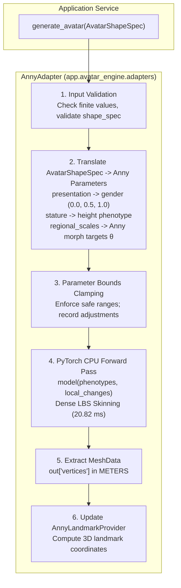

# WearWise Avatar Engine Interface & Anny Adapter Design Specification

**Project:** WearWise AI Fashion & Honest Fit Platform  
**Document:** Avatar Engine Interface Specification (AES-001)  
**Revision:** 1.2.1 (Canonical Shared Protocols, Typed Contracts & Signal Evaluation)  
**Date:** 2026-11-23  
**Status:** Approved Technical Architecture  

---

## 1. Executive Purpose & Strict Engine Isolation

The **Avatar Engine** subsystem is responsible for converting an engine-independent shape specification (`AvatarShapeSpec`) into a verified 3D surface mesh and serialized binary GLB artifact.

### The Inviolable Adapter Boundary:
- NAVER Anny v0.6.2, PyTorch, tensor manipulation, and low-level morph names (e.g. `measure-shoulder-dist-incr`, `l-upperarm-scale-horiz-incr`) are **strictly encapsulated within `app/avatar_engine/adapters/anny_adapter.py`**.
- No other module in the codebase may import `anny` or `torch`.
- Higher-level modules (Orchestration Service, BICE, Anthropometry, API) interact with 3D generation **exclusively via abstract engine protocols** (`AvatarEngine`, `ShapeEvaluationPort`, and `LandmarkProvider`).
- The `AvatarEngine` interface makes **no assumptions of fixed mesh topology** (such as 13,718 vertices or 27,420 faces). Future replacement engines with different mesh topologies are first-class citizens.

---

## 2. Engine-Independent Protocol & Contract Specifications

```python
from typing import Protocol, Dict, Any, List, Optional, Set, Literal
from dataclasses import dataclass, field
import numpy as np

@dataclass(frozen=True)
class RegionalShapeScale:
    """Normalized relative scaling intent for an anatomical zone [-1.0, 1.0]."""
    scale_x: float  # Lateral scaling (breadth / width)
    scale_y: float  # Sagittal scaling (depth / protrusion)
    scale_z: float  # Vertical scaling (segment length)

@dataclass(frozen=True)
class AvatarShapeSpec:
    """
    Engine-independent specification of avatar shape and stature.
    Canonical domain input consumed by AvatarEngine implementations (e.g. AnnyAdapter).
    """
    spec_version: str                                  # e.g. "1.2.1"
    presentation: Literal["masculine", "feminine", "neutral"]
    target_stature_cm: float                           # Target height in cm
    target_measurements: Dict[str, float]              # Canonical constraints {code: value_cm}
    regional_scales: Dict[str, RegionalShapeScale]     # Regional scaling intents
    semantic_controls: Dict[str, float]                # Raw normalized semantic sliders [0.0, 1.0]

@dataclass(frozen=True)
class MeshData:
    """Engine-independent representation of a 3D surface mesh."""
    vertices: np.ndarray           # numpy.ndarray of shape (N, 3), dtype float32, coordinates strictly in METERS
    faces: np.ndarray              # numpy.ndarray of shape (M, 3), dtype int32
    normals: Optional[np.ndarray] = None # numpy.ndarray of shape (N, 3), dtype float32
    metadata: Dict[str, Any] = field(default_factory=dict) # Vertex count, face count, topology identifier

@dataclass(frozen=True)
class LandmarkData:
    """Anatomical landmark coordinates provided by an adapter."""
    landmark_code: str             # Canonical landmark code (e.g. "acromion_left", "cervicale_c7")
    point_3d_m: List[float]        # (X, Y, Z) coordinate in METERS in standard reference pose
    anatomical_region: str         # e.g. "shoulders", "waist", "hips"

class LandmarkProvider(Protocol):
    """Supplies 3D landmark points and anatomical vertex masks without exposing engine topology."""
    def get_landmark(self, landmark_code: str) -> Optional[LandmarkData]:
        """Returns LandmarkData entity containing 3D coordinates in meters."""
        ...

    def get_landmark_point_m(self, landmark_code: str) -> Optional[np.ndarray]:
        """Returns 3D (X, Y, Z) landmark point as numpy array in METERS in current mesh pose."""
        ...

    def get_all_landmarks(self) -> Dict[str, LandmarkData]:
        """Returns full dictionary of available anatomical landmarks."""
        ...

    def get_region_vertex_mask(self, region_code: str) -> Set[int]:
        """
        Returns the set of mesh vertex indices belonging to the specified anatomical zone.
        During cross-sectional slicing, a triangular face (v0, v1, v2) is included in the slicing
        submesh for region R if at least 2 of its 3 vertices belong to this vertex mask.
        """
        ...

@dataclass(frozen=True)
class RegionalDisplacementSummary:
    """Summary of vertex displacements in a specific anatomical zone."""
    region_code: str
    mean_displacement_m: float      # Displacement magnitude in METERS
    max_displacement_m: float       # Peak vertex displacement in METERS
    vertex_count: int

@dataclass(frozen=True)
class ShapeEvaluationResult:
    """
    Geometric feedback returned to BICE for locality regularization.
    RMSR = Regional Mean Spillover Ratio (dimensionless arithmetic mean ratio).
    PVSR = Peak Vertex Spillover Ratio (dimensionless maximum vertex displacement ratio).
    """
    metric_version: str            # "1.2.1-rmsr-pvsr"
    evaluation_status: str         # "success", "insufficient_target_signal", "evaluation_failed"
    regional_displacements: Dict[str, RegionalDisplacementSummary]
    target_region_mean_m: float    # Mean target displacement magnitude in METERS
    max_non_target_mean_m: float   # Max non-target regional displacement magnitude in METERS
    rmsr: Optional[float]          # Regional Mean Spillover Ratio (dimensionless ratio); None if insufficient signal
    pvsr: Optional[float]          # Peak Vertex Spillover Ratio (dimensionless ratio); None if insufficient signal
    is_plausible: bool
    diagnostic_notes: str

class ShapeEvaluationPort(Protocol):
    """Abstract port for evaluating geometric displacements without importing engine internals."""
    def evaluate_shape(
        self, 
        shape_spec: AvatarShapeSpec, 
        target_region: str, 
        requested_regions: List[str]
    ) -> ShapeEvaluationResult:
        """
        Evaluates regional displacements of candidate shape against reference baseline.
        Returns explicit 'insufficient_target_signal' if target displacement < 10^-4 m.
        """
        ...

@dataclass(frozen=True)
class MeshValidationReport:
    """Structural health and geometric validity report."""
    is_valid: bool
    is_watertight: bool
    vertex_count: int
    face_count: int
    has_nans: bool
    has_infs: bool
    has_degenerate_faces: bool
    bounding_box_min_m: List[float]
    bounding_box_max_m: List[float]
    error_message: Optional[str] = None

@dataclass(frozen=True)
class EngineMetadata:
    """Metadata describing the active avatar engine."""
    engine_name: str
    engine_version: str
    topology_identifier: str
    supports_lbs: bool
    supported_capabilities: List[str] # ["mesh_generation", "glb_export", "shape_evaluation", "landmark_provider"]
    device_type: str  # "cpu" or "cuda"

class AvatarEngine(Protocol):
    """Abstract interface for all 3D human avatar generation backends."""
    
    def initialize(self) -> bool:
        """Initialize engine weights, neutral templates, and memory buffers. Idempotent."""
        ...
        
    def is_ready(self) -> bool:
        """Return True if engine is ready for forward inference."""
        ...
        
    def generate_baseline(self, presentation: str, stature_m: float = 1.5683) -> MeshData:
        """Generate unedited neutral baseline mesh for a given presentation."""
        ...
        
    def generate_avatar(self, shape_spec: AvatarShapeSpec) -> MeshData:
        """
        Generate customized 3D human mesh from engine-independent AvatarShapeSpec.
        Consumes AvatarShapeSpec; does not accept raw blendshape dictionaries.
        """
        ...
        
    def validate_mesh(self, mesh_data: MeshData) -> MeshValidationReport:
        """Perform topological, manifold, and coordinate bounds checks."""
        ...
        
    def export_glb(self, mesh_data: MeshData) -> bytes:
        """
        Serialize mesh to web-optimized glTF 2.0 binary container.
        Returns raw GLB bytes directly to caller; does not manage storage paths.
        """
        ...
        
    def get_landmark_provider(self) -> LandmarkProvider:
        """Return neutral landmark query interface for Anthropometry Engine."""
        ...

    def get_shape_evaluation_port(self) -> ShapeEvaluationPort:
        """Return neutral shape evaluation interface for BICE regularized solver."""
        ...
        
    def get_metadata(self) -> EngineMetadata:
        """Return engine identity and active hardware device info."""
        ...
```

---

## 3. Concrete Adapter: `AnnyAdapter` Implementation Specification

The concrete adapter resides in `app/avatar_engine/adapters/anny_adapter.py`.



### 3.1 Parameter Mapping & Traceable Clamping Policy
The adapter never silently changes inputs without traceability:
1. It maps `AvatarShapeSpec.regional_scales` to Anny blendshape weights using a verified internal mapping dictionary:
   - `shoulder_scale.scale_x` $\rightarrow$ `measure-shoulder-dist-incr`
   - `shoulder_scale.scale_y` $\rightarrow$ `l-upperarm-shoulder-muscle-incr` / `r-upperarm-shoulder-muscle-incr`
   - `chest_scale.scale_y` $\rightarrow$ `breast-volume-vert-up`
   - `belly_scale.scale_y` $\rightarrow$ `stomach-pregnant-incr`
   - `waist_scale.scale_x` $\rightarrow$ `measure-waist-circ-incr`
   - `arm_scale.scale_x` $\rightarrow$ `l-upperarm-scale-horiz-incr`, `r-upperarm-scale-horiz-incr`
   - `hip_scale.scale_x` $\rightarrow$ `hip-trans-out`
   - `thigh_scale.scale_x` $\rightarrow$ `l-upperleg-fat-incr`, `r-upperleg-fat-incr`
   - `calf_scale.scale_x` $\rightarrow$ `measure-calf-circ-incr`
2. If any mapped parameter exceeds the adapter's safe hardware boundary, it clamps the value and appends an explicit warning to `GenerationMetadata.clamped_parameters`.
3. If an input contains `NaN`, `Inf`, or violates anatomical structure, it raises a structured `InvalidParameterError`.

### 3.2 PyTorch CPU Execution & Windows Smart App Control
- **Skinning Method:** As proven in Phase 0, Windows 11 Smart App Control blocks native `warp.dll` (`WinError 4551`). `AnnyAdapter` explicitly initializes Anny with `skinning_method="lbs"`.
- **CPU Execution Priority:** Forward passes execute by default on PyTorch CPU tensors ($20.82\text{ ms}$ on AMD Ryzen 7 6800H), completely eliminating GPU kernel launch jitter and avoiding VRAM bottlenecks.
- **CUDA Fallback:** Supported for batch offline tasks.

### 3.3 Neutral Landmark Mapping via `AnnyLandmarkProvider`
To ensure `AnthropometryEngine` does not depend on Anny-specific vertex indices, `AnnyAdapter` implements `AnnyLandmarkProvider`:
- Translates Anny vertex indices (e.g. index $6721$ for C7 vertebra, index $4129$ for left acromion) into engine-independent `LandmarkData` with coordinates in meters.
- Implements `get_region_vertex_mask(region_code: str) -> Set[int]`, exposing anatomical region masks (head, shoulders, torso, arms, hips, thighs, calves) as sets of mesh vertex indices.
- During cross-sectional slicing, Anthropometry uses this mask to filter the submesh: a face is included in the sliced geometry if at least 2 of its 3 vertices belong to the target vertex mask, preventing limb contours (e.g. arms) from bleeding into torso slices.

### 3.4 Shape Evaluation Port via `AnnyShapeEvaluationPort`
`AnnyAdapter` implements `ShapeEvaluationPort` to provide geometric feedback to BICE:
- Executes forward passes with candidate `AvatarShapeSpec` and reference baseline.
- Computes vertex displacement vectors $\Delta \mathbf{x} = \mathbf{x}_{\text{cand}} - \mathbf{x}_{\text{ref}}$ with magnitudes strictly in **METERS ($m$)**.
- Evaluates regional mean displacement magnitudes $\bar{\Delta}_R$ across internal region vertex masks.
- Calculates **Regional Mean Spillover Ratio (RMSR)**, which is a **dimensionless arithmetic ratio**:
  $$\text{RMSR}_R = \frac{\bar{\Delta}_R}{\bar{\Delta}_{R_{\text{target}}}}$$
  *(Note: RMSR is Regional Mean Spillover Ratio, an arithmetic mean ratio across vertices; it is NOT Root Mean Square Residual).*
- Evaluates **Peak Vertex Spillover Ratio (PVSR)**, an extreme-value dimensionless ratio:
  $$\text{PVSR}_R = \frac{\max_{v \in R} \|\Delta \mathbf{x}_v\|}{\max_{u \in R_{\text{target}}} \|\Delta \mathbf{x}_u\|}$$
- **Near-Zero Target Signal Evaluation Policy:**
  When the target region mean displacement is below the numerical evaluation threshold $\epsilon_{\text{threshold}} = 10^{-4}\text{ m}$ ($0.1\text{ mm}$):
  - The adapter returns `evaluation_status = "insufficient_target_signal"`.
  - `rmsr` and `pvsr` are returned as `None` (not $0.0$).
  - `is_plausible` is marked `False`.
  - `diagnostic_notes` records the exact displacement and warning.
  - **Inviolable Invariant:** An unavailable locality measurement is **never interpreted as a perfect locality result**. The solver cannot exploit near-zero target displacements to escape locality regularization. BICE treats this explicit status as an uninformative candidate step and rejects it.

---

## 4. GLB Export & Structured Failure Handling

### 4.1 In-Memory Export Contract
- The `export_glb(mesh_data: MeshData) -> bytes` method returns raw glTF 2.0 binary bytes directly in memory.
- The Avatar Engine is **not responsible for file persistence or storage paths**. Storage is handled by the application-level `AssetStorageService`.

### 4.2 Structured Exception Hierarchy

```python
class AvatarEngineError(Exception):
    """Base exception for avatar engine errors."""
    pass

class EngineNotReadyError(AvatarEngineError):
    """Raised when inference is attempted before successful initialization."""
    pass

class InvalidParameterError(AvatarEngineError):
    """Raised when parameters fail safety bounds or contain non-finite values."""
    pass

class MeshDeformationError(AvatarEngineError):
    """Raised when mesh validation detects NaNs, Infs, or self-intersecting hulls."""
    pass

class GLBExportError(AvatarEngineError):
    """Raised when glTF binary serialization fails."""
    pass
```

---

## 5. Future Replacement Avatar Engine Compliance

Any future avatar engine replacing Anny must satisfy these invariant requirements:
1. **Engine-Neutral Input:** Must consume `AvatarShapeSpec`.
2. **Neutral Mesh Units:** Output mesh coordinates must be strictly in **METERS**.
3. **Reference Pose:** Must generate vertices in the Standard Neutral A-Pose.
4. **Landmark Provider:** Must implement `LandmarkProvider` to supply required anatomical landmarks (acromion, C7, waist, hips).
5. **Shape Evaluation Port:** Must implement `ShapeEvaluationPort` to provide displacement feedback for BICE regularization.
6. **No Topology Restriction:** Does **not** need 13,718 vertices or 27,420 faces. The architecture natively supports arbitrary watertight manifold meshes.
