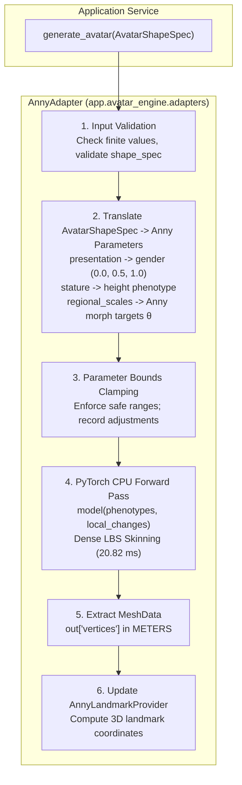

# WearWise Avatar Engine Interface & Anny Adapter Design Specification

**Project:** WearWise AI Fashion & Honest Fit Platform  
**Document:** Avatar Engine Interface Specification (AES-001)  
**Revision:** 1.1 (Engine-Isolated Domain Architecture)  
**Date:** 2026-11-23  
**Status:** Approved Technical Architecture  

---

## 1. Executive Purpose & Strict Engine Isolation

The **Avatar Engine** subsystem is responsible for converting an engine-independent shape specification (`AvatarShapeSpec`) into a verified 3D surface mesh and serialized binary GLB artifact.

### The Inviolable Adapter Boundary:
- NAVER Anny v0.6.2, PyTorch, tensor manipulation, and low-level morph names (e.g. `measure-shoulder-dist-incr`, `l-upperarm-scale-horiz-incr`) are **strictly encapsulated within `app/avatar_engine/adapters/anny_adapter.py`**.
- No other module in the codebase may import `anny` or `torch`.
- Higher-level modules (Orchestration Service, BICE, Anthropometry, API) interact with 3D generation **exclusively via the abstract `AvatarEngine` protocol**.
- The `AvatarEngine` interface makes **no assumptions of fixed mesh topology** (such as 13,718 vertices or 27,420 faces). Future replacement engines with different mesh topologies are first-class citizens.

---

## 2. Engine-Independent Protocol & Contract Specifications

```python
from typing import Protocol, Dict, Any, List, Optional
from dataclasses import dataclass
from uuid import UUID

@dataclass(frozen=True)
class MeshData:
    """Engine-independent representation of a 3D surface mesh."""
    vertices: Any          # numpy.ndarray of shape (N, 3), dtype float32, coordinates strictly in METERS
    faces: Any             # numpy.ndarray of shape (M, 3), dtype int32
    normals: Optional[Any] = None # numpy.ndarray of shape (N, 3), dtype float32
    metadata: Dict[str, Any] = None # Vertex count, face count, topology identifier

@dataclass(frozen=True)
class LandmarkData:
    """Anatomical landmark coordinates provided by an adapter."""
    landmark_code: str     # Canonical landmark code (e.g. "acromion_left", "cervicale_c7")
    point_3d_m: List[float] # (X, Y, Z) coordinate in METERS in standard reference pose
    anatomical_region: str # e.g. "shoulders", "waist", "hips"

class LandmarkProvider(Protocol):
    """Protocol for querying landmark coordinates without exposing engine topology."""
    def get_landmark(self, landmark_code: str) -> Optional[LandmarkData]:
        ...
    def get_all_landmarks(self) -> Dict[str, LandmarkData]:
        ...
    def get_region_vertex_mask(self, region_code: str) -> Any:
        ...

@dataclass(frozen=True)
class MeshValidationReport:
    """Structural health and geometric validity report."""
    is_valid: bool
    is_watertight: bool
    vertex_count: int
    face_count: int
    has_nans: bool
    has_infs: bool
    has_degenerate_faces: bool
    bounding_box_min_m: List[float]
    bounding_box_max_m: List[float]
    error_message: Optional[str] = None

@dataclass(frozen=True)
class EngineMetadata:
    """Metadata describing the active avatar engine."""
    engine_name: str
    engine_version: str
    topology_identifier: str
    supports_lbs: bool
    device_type: str  # "cpu" or "cuda"

class AvatarEngine(Protocol):
    """Abstract interface for all 3D human avatar generation backends."""
    
    def initialize(self) -> bool:
        """Initialize engine weights, neutral templates, and memory buffers. Idempotent."""
        ...
        
    def is_ready(self) -> bool:
        """Return True if engine is ready for forward inference."""
        ...
        
    def generate_baseline(self, presentation: str, stature_m: float = 1.5683) -> MeshData:
        """Generate unedited neutral baseline mesh for a given presentation."""
        ...
        
    def generate_avatar(self, shape_spec: Any) -> MeshData:
        """
        Generate customized 3D human mesh from engine-independent AvatarShapeSpec.
        Consumes AvatarShapeSpec; does not accept raw blendshape dictionaries.
        """
        ...
        
    def evaluate_shape(self, shape_spec: Any, target_landmarks: List[str]) -> Dict[str, LandmarkData]:
        """Engine-independent shape evaluation capability for calibration workflows."""
        ...
        
    def validate_mesh(self, mesh_data: MeshData) -> MeshValidationReport:
        """Perform topological, manifold, and coordinate bounds checks."""
        ...
        
    def export_glb(self, mesh_data: MeshData) -> bytes:
        """
        Serialize mesh to web-optimized glTF 2.0 binary container.
        Returns raw GLB bytes directly to caller; does not manage storage paths.
        """
        ...
        
    def get_landmark_provider(self) -> LandmarkProvider:
        """Return neutral landmark query interface for Anthropometry Engine."""
        ...
        
    def get_metadata(self) -> EngineMetadata:
        """Return engine identity and active hardware device info."""
        ...
```

---

## 3. Concrete Adapter: `AnnyAdapter` Implementation Specification

The concrete adapter resides in `app/avatar_engine/adapters/anny_adapter.py`.



### 3.1 Parameter Mapping & Traceable Clamping Policy
The adapter never silently changes inputs without traceability:
1. It maps `AvatarShapeSpec.regional_scales` to Anny blendshape weights using a verified internal mapping dictionary.
2. If any parameter exceeds the adapter's safe hardware boundary, it clamps the value and appends an explicit warning to `GenerationMetadata.clamped_parameters`.
3. If an input contains `NaN`, `Inf`, or violates anatomical structure, it raises a structured `InvalidParameterError`.

### 3.2 PyTorch CPU Execution & Windows Smart App Control
- **Skinning Method:** As proven in Phase 0, Windows 11 Smart App Control blocks native `warp.dll` (`WinError 4551`). `AnnyAdapter` explicitly initializes Anny with `skinning_method="lbs"`.
- **CPU Execution Priority:** Forward passes execute by default on PyTorch CPU tensors ($20.82\text{ ms}$ on AMD Ryzen 7 6800H), completely eliminating GPU kernel launch jitter and avoiding VRAM bottlenecks.
- **CUDA Fallback:** Supported for batch offline tasks.

### 3.3 Neutral Landmark Mapping via `AnnyLandmarkProvider`
To ensure `AnthropometryEngine` does not depend on Anny-specific vertex indices, `AnnyAdapter` provides an internal `AnnyLandmarkProvider`:
- Translates Anny vertex indices (e.g. index $6721$ for C7 vertebra, index $4129$ for left acromion) into engine-independent `LandmarkData` with coordinates in meters.
- Exposes anatomical region masks (head, shoulders, torso, arms, hips, thighs, calves) as boolean masks without exposing raw mesh indices to Anthropometry.

---

## 4. GLB Export & Structured Failure Handling

### 4.1 In-Memory Export Contract
- The `export_glb(mesh_data: MeshData) -> bytes` method returns raw glTF 2.0 binary bytes directly.
- The Avatar Engine is **not responsible for file persistence or storage paths**. Storage is handled by the application-level `AssetStorageService`.

### 4.2 Structured Exception Hierarchy

```python
class AvatarEngineError(Exception):
    """Base exception for avatar engine errors."""
    pass

class EngineNotReadyError(AvatarEngineError):
    """Raised when inference is attempted before successful initialization."""
    pass

class InvalidParameterError(AvatarEngineError):
    """Raised when parameters fail safety bounds or contain non-finite values."""
    pass

class MeshDeformationError(AvatarEngineError):
    """Raised when mesh validation detects NaNs, Infs, or self-intersecting hulls."""
    pass

class GLBExportError(AvatarEngineError):
    """Raised when glTF binary serialization fails."""
    pass
```

---

## 5. Future Replacement Avatar Engine Compliance

Any future avatar engine replacing Anny must satisfy these invariant requirements:
1. **Engine-Neutral Input:** Must consume `AvatarShapeSpec`.
2. **Neutral Mesh Units:** Output mesh coordinates must be strictly in **METERS**.
3. **Reference Pose:** Must generate vertices in the Standard Neutral A-Pose.
4. **Landmark Provider:** Must implement `LandmarkProvider` to supply required anatomical landmarks (acromion, C7, waist, hips).
5. **No Topology Restriction:** Does **not** need 13,718 vertices or 27,420 faces. The architecture natively supports arbitrary watertight manifold meshes.
