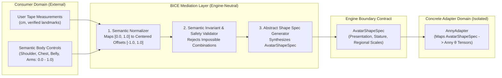

# WearWise Body Intelligence & Calibration Engine (BICE) Design Specification

**Project:** WearWise AI Fashion & Honest Fit Platform  
**Document:** BICE & Domain Entities Specification (BICE-001)  
**Revision:** 1.1 (Engine-Isolated Domain Architecture)  
**Date:** 2026-11-23  
**Status:** Approved Technical Architecture  

---

## 1. Executive Overview & Architectural Isolation

The **Body Intelligence & Calibration Engine (BICE)** is the mathematical mediation and constraint layer of WearWise. It establishes a complete decoupling between consumer-facing semantic representations and 3D avatar engine implementations.

### Strict Architectural Boundaries:
1. **Engine Independence:** BICE contains **zero** references to NAVER Anny, PyTorch, tensor operations, or engine-specific blendshape names (such as `measure-shoulder-dist-incr`, `stomach-pregnant-incr`, or `l-upperleg-fat-incr`). BICE does not import or depend on `avatar_engine`.
2. **Separation of Concepts:**
   - **Body Measurements:** Real-world physical dimensions in centimeters (`BodyMeasurement`), grounded in standard anatomical tailoring landmarks.
   - **Semantic Body-Shape Controls:** Intuitive, normalized consumer sliders (`BodyShapeControls`, $[0.0, 1.0]$) representing visible human form variation.
   - **Engine-Independent Shape Intent:** The output of BICE is an abstract, neutral **`AvatarShapeSpec`** describing target stature, presentation morphology, and normalized regional dimensional scaling factors.
   - **Avatar Engine Parameters:** Low-level blendshape displacement vectors ($\mathbf{\theta}$) exist solely inside the concrete engine adapter (`AnnyAdapter`) and are strictly forbidden from leaking into BICE, domain entities, or public REST contracts.



---

## 2. Canonical Domain Models

### 2.1 Model Classification Discipline
WearWise strictly separates three model representations:
- **Domain Entities:** In-memory domain objects encapsulating business invariants and domain methods.
- **Transport Contracts (Pydantic):** Schemas for HTTP request/response serialization (defined in `API_CONTRACTS.md`).
- **Persistence Records (SQLAlchemy):** Relational tables and database entities (defined in `DATABASE_SCHEMA.md`).

### 2.2 Decoupled Measurement Provenance and Validation State
To eliminate the conflation of data origin with data credibility, WearWise separates **Acquisition Method** from **Validation State**:

```python
from enum import Enum
from decimal import Decimal
from typing import Optional, Dict, Any
from datetime import datetime
from uuid import UUID

class MeasurementAcquisitionMethod(str, Enum):
    """How the physical measurement value was originally captured."""
    USER_REPORTED = "user_reported"          # Unverified self-report by user
    TAPE_MEASURED = "tape_measured"          # Measured by customer with physical tape measure
    GEOMETRY_EXTRACTED = "geometry_extracted" # Computed algorithmically from 3D mesh surface
    MODEL_ESTIMATED = "model_estimated"      # Statistically derived from demographic/height priors

class MeasurementValidationState(str, Enum):
    """The formal verification status of the measurement value."""
    UNVALIDATED = "unvalidated"              # No verification check performed
    INTERNALLY_CONSISTENT = "internally_consistent" # Passes anatomical consistency checks
    EXTERNALLY_VALIDATED = "externally_validated"   # Validated in controlled ground-truth study (Phase 8)
    DISPUTED = "disputed"                    # Conflicts with other authoritative measurements

class MeasurementStatus(str, Enum):
    """Lifecycle status of the measurement record."""
    ACTIVE = "active"             # Current active measurement used in sizing
    SUPERSEDED = "superseded"     # Historical record superseded by newer revision
    PROVISIONAL = "provisional"   # Metric from provisional landmark (e.g. hip planar slice)
    REJECTED = "rejected"         # Rejected due to anatomical impossibility
```

### 2.3 Quality and Uncertainty Representation
Automatic assignment of `confidence_score = 1.00` to tape measurements is strictly prohibited. Quality is represented through:
1. **`tolerance_cm`:** Physical measurement uncertainty based on capture protocol (e.g. $\pm 0.5\text{ cm}$ for professional tape, $\pm 1.5\text{ cm}$ for self-tape, $\pm 3.0\text{ cm}$ for user-reported).
2. **`reliability_weight`:** An explicit, versioned engineering policy weight ($w_k \in [0.1, 1.0]$) used by BICE when resolving conflicting constraints.

---

## 3. Domain Entity Definitions

### 3.1 `BodyProfile`
Represents the persistent identity and anthropometric profile of an individual shopper.

- **`profile_id`:** `UUID` (Immutable unique identifier).
- **`user_id`:** `UUID` (Derived strictly from authenticated principal; never from client payload).
- **`current_revision`:** `int` (Monotonically increasing sequence number).
- **`presentation_gender`:** `Literal["masculine", "feminine", "neutral"]` (Visual presentation style; strictly decoupled from gender identity).
- **`stature_cm`:** `Decimal` (Derived convenience projection of active `stature` measurement).
- **`reported_weight_kg`:** `Optional[Decimal]` (Self-reported weight; stored strictly as non-apparel metadata; never enters ease calculations or mass estimation).
- **`measurements`:** `Dict[str, BodyMeasurement]` (Keyed by canonical measurement code).
- **`shape_controls`:** `BodyShapeControls` (Active semantic slider state).
- **`current_avatar_id`:** `Optional[UUID]` (Reference to current active avatar artifact).
- **`created_at`:** `datetime` (UTC).
- **`updated_at`:** `datetime` (UTC).

### 3.2 `BodyMeasurement`
Represents a single body dimension.

- **`measurement_id`:** `UUID`.
- **`profile_id`:** `UUID`.
- **`revision_number`:** `int`.
- **`measurement_code`:** `str` (Canonical code from `ANTHROPOMETRY_SPECIFICATION.md`).
- **`value_cm`:** `Decimal` (Precision $0.01\text{ cm}$).
- **`unit`:** `Literal["cm"]`.
- **`acquisition_method`:** `MeasurementAcquisitionMethod`.
- **`validation_state`:** `MeasurementValidationState`.
- **`status`:** `MeasurementStatus`.
- **`landmark_convention`:** `str`.
- **`tolerance_cm`:** `Decimal` (Measurement uncertainty).
- **`reliability_weight`:** `Decimal` (BICE optimization weight).
- **`captured_at`:** `datetime`.

### 3.3 `BodyShapeControls`
Consumer-facing semantic adjustment sliders. All controls are normalized floats in $[0.0, 1.0]$, where $0.50$ represents neutral baseline:

| Control Code | Display Name | Target Anatomical Zone | Default | Safe Range |
|---|---|---|---|---|
| `shoulder_width` | Shoulder Width | Biacromial / deltoid breadth | `0.50` | `[0.10, 0.90]` |
| `chest_fullness` | Chest Fullness | Bust / pectoral protrusion | `0.50` | `[0.10, 0.90]` |
| `belly_fullness` | Belly Fullness | Anterior abdominal protrusion | `0.50` | `[0.10, 0.85]` |
| `waist_definition` | Waist Definition | Torso taper / natural waist indentation | `0.50` | `[0.15, 0.85]` |
| `arm_fullness` | Arm Fullness | Upper/lower arm girth | `0.50` | `[0.10, 0.90]` |
| `hip_fullness` | Hip Fullness | Pelvic breadth & gluteal depth | `0.50` | `[0.15, 0.85]` |
| `thigh_fullness` | Thigh Fullness | Upper leg girth | `0.50` | `[0.20, 0.80]` |
| `calf_fullness` | Calf Fullness | Lower leg / gastrocnemius girth | `0.50` | `[0.15, 0.85]` |

---

## 4. Engine-Neutral Shape Specification: `AvatarShapeSpec`

The formal contract returned by BICE and passed to `AvatarEngine` is `AvatarShapeSpec`. It is completely free of Anny blendshapes or mesh topology assumptions:

```python
from dataclasses import dataclass
from typing import Dict, Literal

@dataclass(frozen=True)
class RegionalShapeScale:
    """Normalized relative scaling intent for an anatomical zone [-1.0, 1.0]."""
    scale_x: float  # Lateral scaling (breadth / width)
    scale_y: float  # Sagittal scaling (depth / protrusion)
    scale_z: float  # Vertical scaling (segment length)

@dataclass(frozen=True)
class AvatarShapeSpec:
    """
    Engine-independent specification of avatar shape and stature.
    Consumed by AvatarEngine implementations (e.g. AnnyAdapter).
    """
    spec_version: str                                  # e.g. "1.1"
    presentation: Literal["masculine", "feminine", "neutral"]
    target_stature_cm: float                           # Target height in cm
    target_measurements: Dict[str, float]              # Canonical constraints {code: value_cm}
    regional_scales: Dict[str, RegionalShapeScale]     # Regional scaling intents
    semantic_controls: Dict[str, float]                # Raw normalized semantic sliders [0.0, 1.0]
```

---

## 5. BICE Regularization & Constraint Formulation

### 5.1 Semantic Normalization
A semantic slider $c_i \in [0.0, 1.0]$ is converted into an engine-neutral regional intent offset:
$$\Delta c_i = 2.0 \cdot (c_i - 0.5) \in [-1.0, 1.0]$$

### 5.2 Locality Regularization & Spillover Penalty
To prevent localized slider adjustments from inducing unwanted collateral deformation in distant body regions, BICE evaluates the **Regional Mean Spillover Ratio (RMSR)** across defined anatomical zones ($R \in \mathcal{R}$):

$$\text{RMSR}_R(\mathbf{s}) = \frac{\bar{\Delta}_R(\mathbf{s})}{\bar{\Delta}_{R_{\text{target}}}(\mathbf{s}) + \epsilon}$$

Where $\epsilon = 10^{-6}\text{ m}$ protects against division-by-zero when target displacement is near zero.

The BICE locality loss function $\mathcal{L}_{\text{locality}}$ aggregates the maximum regional leakage across non-target zones:
$$\mathcal{L}_{\text{locality}}(\mathbf{s}) = \max_{R \neq R_{\text{target}}} \text{RMSR}_R(\mathbf{s})$$

### 5.3 Provisional Engineering Bounds
Pending Phase 3 empirical solver tests and Phase 4 mesh validity integration, the regional shape scales are constrained to **provisional engineering safe bounds**:
- `thigh_scale`: Restricted to $[-0.50, +0.50]$ (protects pelvic/groin geometry from severe RMSR leakage of $4.04$ observed at extreme values in Phase 0).
- `belly_scale`: Restricted to $[-0.50, +0.70]$ (protects lower ribs from excessive anterior flare).
- `shoulder_scale`: Restricted to $[-0.75, +0.75]$ (protects clavicle mesh smoothness).

These bounds are explicit engineering baselines and will be refined during Phase 3 parameter tuning.

---

## 6. Ethical, Identity & Governance Boundaries

1. **Decoupling Morphology from Social Identity:** The `presentation_gender` attribute determines the visual template (`masculine`, `feminine`, or `neutral`). It is strictly decoupled from user identity, legal gender, or platform privileges.
2. **Strict Prohibition of Ethnicity Morph Controls:** Anny's artist-defined ethnicity morphs encode subjective stereotypes and are **permanently barred from BICE**. Avatar generation is governed solely by objective physical geometry (stature, bone breadths, circumferences).
3. **Exclusion of Mass & BMI from Health Claims:** Enclosed mesh volume multiplied by uniform water density ($\rho = 980\text{ kg/m}^3$) is an ungrounded model calculation. It must never be exposed as health advice or used in clothing fit algorithms.
