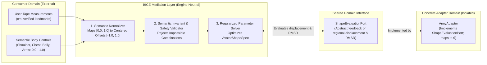

# WearWise Body Intelligence & Calibration Engine (BICE) Design Specification

**Project:** WearWise AI Fashion & Honest Fit Platform  
**Document:** BICE & Domain Entities Specification (BICE-001)  
**Revision:** 1.2.1 (Canonical Shared Protocols, Decoupled Taxonomies & Signal Evaluation)  
**Date:** 2026-11-23  
**Status:** Approved Technical Architecture  

---

## 1. Executive Overview & Architectural Isolation

The **Body Intelligence & Calibration Engine (BICE)** is the mathematical mediation and constraint layer of WearWise. It establishes a complete decoupling between consumer-facing semantic representations and 3D avatar engine implementations.

### Strict Architectural Boundaries:
1. **Engine Independence:** BICE contains **zero** references to NAVER Anny, PyTorch, tensor operations, or engine-specific blendshape names (such as `measure-shoulder-dist-incr`, `stomach-pregnant-incr`, or `l-upperleg-fat-incr`). BICE does not import or depend on `avatar_engine`.
2. **Separation of Concepts:**
   - **Body Measurements:** Real-world physical dimensions in centimeters (`BodyMeasurement`), grounded in standard anatomical tailoring landmarks.
   - **Semantic Body-Shape Controls:** Intuitive, normalized consumer sliders (`BodyShapeControls`, $[0.0, 1.0]$) representing visible human form variation.
   - **Engine-Independent Shape Intent:** The output of BICE is an abstract, neutral **`AvatarShapeSpec`** describing target stature, presentation morphology, and normalized regional dimensional scaling factors.
   - **Geometric Evaluation via `ShapeEvaluationPort`:** When BICE requires feedback on geometric mesh displacements or regional spillover during iterative optimization, it queries an injected domain interface (`ShapeEvaluationPort`). It never interacts with 3D mesh vertices directly.
   - **Avatar Engine Parameters:** Low-level blendshape displacement vectors ($\mathbf{\theta}$) exist solely inside the concrete engine adapter (`AnnyAdapter`) and are strictly forbidden from leaking into BICE, domain entities, or public REST contracts.



---

## 2. Canonical Domain Models

### 2.1 Model Classification Discipline
WearWise strictly separates three model representations across distinct layers:
- **Domain Entities & Value Objects (`app.domain.entities`):** Pure in-memory domain objects encapsulating business invariants and domain methods. Framework-independent.
- **Transport Contracts (`app.schemas`):** Pydantic models for HTTP request/response serialization across API boundaries (defined in `API_CONTRACTS.md`).
- **Persistence Records (`app.infrastructure.models`):** SQLAlchemy ORM models mapped to physical database tables (defined in `DATABASE_SCHEMA.md`).

### 2.2 Orthogonal Measurement Taxonomies
To eliminate the conflation of data origin, scientific verification, database persistence lifecycle, and apparel fit eligibility, WearWise separates these concepts into four orthogonal enums:

```python
from enum import Enum
from decimal import Decimal
from typing import Optional, Dict, Any, List
from datetime import datetime
from uuid import UUID

class MeasurementAcquisitionMethod(str, Enum):
    """How the physical measurement value was originally captured."""
    USER_REPORTED = "user_reported"          # Unverified self-report by user
    TAPE_MEASURED = "tape_measured"          # Measured by customer with physical tape measure
    GEOMETRY_EXTRACTED = "geometry_extracted" # Computed algorithmically from 3D mesh surface
    MODEL_ESTIMATED = "model_estimated"      # Statistically derived from demographic/height priors

class MeasurementValidationState(str, Enum):
    """The formal scientific verification status of the measurement value."""
    UNVALIDATED = "unvalidated"              # No external verification performed
    INTERNALLY_CONSISTENT = "internally_consistent" # Passes anatomical consistency checks
    EXTERNALLY_VALIDATED = "externally_validated"   # Validated in controlled ground-truth study (Phase 8)
    DISPUTED = "disputed"                    # Conflicts with other authoritative measurements

class MeasurementLifecycleStatus(str, Enum):
    """Database persistence and active lifecycle state."""
    ACTIVE = "active"             # Current active measurement in profile revision
    SUPERSEDED = "superseded"     # Historical record superseded by newer revision
    DRAFT = "draft"               # In-progress entry not yet finalized
    PURGED = "purged"             # Soft-deleted / flagged for purge

class MeasurementAssessmentState(str, Enum):
    """Apparel sizing eligibility state for Honest Fit evaluation."""
    ELIGIBLE = "eligible"         # Fully assessed and valid for sizing calculations
    PROVISIONAL = "provisional"   # Geometry-extracted from provisional landmark (e.g. hip planar slice)
    UNASSESSED = "unassessed"     # Landmark not measured or evaluated
    REJECTED = "rejected"         # Rejected due to anatomical impossibility or extraction failure
```

### 2.3 Quality and Uncertainty Representation
Automatic assignment of `confidence_score = 1.00` to tape measurements is strictly prohibited. Quality is represented through:
1. **`tolerance_cm`:** Physical measurement uncertainty based on capture protocol (e.g. $\pm 0.5\text{ cm}$ for professional tape, $\pm 1.5\text{ cm}$ for self-tape, $\pm 3.0\text{ cm}$ for user-reported). Must be non-negative ($\ge 0.0\text{ cm}$).
2. **`reliability_weight`:** An explicit, versioned engineering policy weight ($w_k \in [0.0, 1.0]$, default $1.00$) used by BICE when resolving conflicting constraints, matching the database constraint `CHECK (reliability_weight BETWEEN 0.0 AND 1.0)`.

---

## 3. Domain Entity Definitions

### 3.1 `BodyProfile`
Represents the persistent identity and anthropometric profile of an individual shopper.

- **`profile_id`:** `UUID` (Immutable unique identifier).
- **`user_id`:** `UUID` (Derived strictly from authenticated principal; never from client payload).
- **`current_revision`:** `int` (Monotonically increasing sequence number).
- **`presentation_gender`:** `Literal["masculine", "feminine", "neutral"]` (Visual presentation style; strictly decoupled from gender identity).
- **`stature_cm`:** `Decimal` (Derived convenience projection of active canonical `stature` measurement in `body_measurements`).
- **`reported_weight_kg`:** `Optional[Decimal]` (Self-reported weight; stored strictly as non-apparel metadata; never enters ease calculations or mass estimation).
- **`measurements`:** `Dict[str, BodyMeasurement]` (Keyed by canonical measurement code).
- **`shape_controls`:** `BodyShapeControls` (Active semantic slider state).
- **`current_avatar_id`:** `Optional[UUID]` (Reference to current active avatar artifact).
- **`is_deleted`:** `bool` (Soft-delete flag).
- **`created_at`:** `datetime` (UTC).
- **`updated_at`:** `datetime` (UTC).

### 3.2 `BodyMeasurement`
Represents a single body dimension. Single canonical source of truth for body height (code: `"stature"`).

- **`measurement_id`:** `UUID`.
- **`profile_id`:** `UUID`.
- **`revision_number`:** `int`.
- **`measurement_code`:** `str` (Canonical code from `ANTHROPOMETRY_SPECIFICATION.md`).
- **`value_cm`:** `Decimal` (Precision $0.01\text{ cm}$).
- **`unit`:** `Literal["cm"]`.
- **`acquisition_method`:** `MeasurementAcquisitionMethod`.
- **`validation_state`:** `MeasurementValidationState`.
- **`lifecycle_status`:** `MeasurementLifecycleStatus`.
- **`assessment_state`:** `MeasurementAssessmentState`.
- **`landmark_convention`:** `str`.
- **`tolerance_cm`:** `Decimal` ($\ge 0.0\text{ cm}$).
- **`reliability_weight`:** `Decimal` ($0.00$ to $1.00$, default $1.00$).
- **`captured_at`:** `datetime`.

### 3.3 `BodyShapeControls`
Consumer-facing semantic adjustment sliders. All controls are normalized floats in $[0.0, 1.0]$, where $0.50$ represents neutral baseline:

| Control Code | Display Name | Target Anatomical Zone | Default | Safe Range |
|---|---|---|---|---|
| `shoulder_width` | Shoulder Width | Biacromial / deltoid breadth | `0.50` | `[0.10, 0.90]` |
| `chest_fullness` | Chest Fullness | Bust / pectoral protrusion | `0.50` | `[0.10, 0.90]` |
| `belly_fullness` | Belly Fullness | Anterior abdominal protrusion | `0.50` | `[0.10, 0.85]` |
| `waist_definition` | Waist Definition | Torso taper / natural waist indentation | `0.50` | `[0.15, 0.85]` |
| `arm_fullness` | Arm Fullness | Upper/lower arm girth | `0.50` | `[0.10, 0.90]` |
| `hip_fullness` | Hip Fullness | Pelvic breadth & gluteal depth | `0.50` | `[0.15, 0.85]` |
| `thigh_fullness` | Thigh Fullness | Upper leg girth | `0.50` | `[0.20, 0.80]` |
| `calf_fullness` | Calf Fullness | Lower leg / gastrocnemius girth | `0.50` | `[0.15, 0.85]` |

---

## 4. Engine-Neutral Shape Specification: `AvatarShapeSpec`

The formal contract returned by BICE and passed to `AvatarEngine` is `AvatarShapeSpec`. It is completely free of Anny blendshapes or mesh topology assumptions:

```python
from dataclasses import dataclass
from typing import Dict, Literal

@dataclass(frozen=True)
class RegionalShapeScale:
    """Normalized relative scaling intent for an anatomical zone [-1.0, 1.0]."""
    scale_x: float  # Lateral scaling (breadth / width)
    scale_y: float  # Sagittal scaling (depth / protrusion)
    scale_z: float  # Vertical scaling (segment length)

@dataclass(frozen=True)
class AvatarShapeSpec:
    """
    Engine-independent specification of avatar shape and stature.
    Consumed by AvatarEngine implementations (e.g. AnnyAdapter).
    """
    spec_version: str                                  # e.g. "1.2"
    presentation: Literal["masculine", "feminine", "neutral"]
    target_stature_cm: float                           # Target height in cm
    target_measurements: Dict[str, float]              # Canonical constraints {code: value_cm}
    regional_scales: Dict[str, RegionalShapeScale]     # Regional scaling intents
    semantic_controls: Dict[str, float]                # Raw normalized semantic sliders [0.0, 1.0]
```

---

## 5. Geometric Feedback Contract: `ShapeEvaluationPort`

To enable BICE to calculate a locality loss without importing or depending on Anny or PyTorch, the shared domain layer defines the abstract `ShapeEvaluationPort`:

```python
from typing import Protocol, List, Dict, Optional
from dataclasses import dataclass

@dataclass(frozen=True)
class RegionalDisplacementSummary:
    """Summary of vertex displacements in a specific anatomical zone in METERS."""
    region_code: str
    mean_displacement_m: float      # Displacement magnitude in METERS
    max_displacement_m: float       # Peak vertex displacement in METERS
    vertex_count: int

@dataclass(frozen=True)
class ShapeEvaluationResult:
    """
    Geometric feedback returned to BICE for regularized solving.
    RMSR = Regional Mean Spillover Ratio (dimensionless arithmetic ratio).
    PVSR = Peak Vertex Spillover Ratio (dimensionless maximum vertex displacement ratio).
    """
    metric_version: str            # "1.2.1-rmsr-pvsr"
    evaluation_status: str         # "success", "insufficient_target_signal", "evaluation_failed"
    regional_displacements: Dict[str, RegionalDisplacementSummary]
    target_region_mean_m: float    # Mean target displacement magnitude in METERS
    max_non_target_mean_m: float   # Max non-target regional displacement magnitude in METERS
    rmsr: Optional[float]          # Regional Mean Spillover Ratio (dimensionless ratio); None if insufficient signal
    pvsr: Optional[float]          # Peak Vertex Spillover Ratio (dimensionless ratio); None if insufficient signal
    is_plausible: bool
    diagnostic_notes: str

class ShapeEvaluationPort(Protocol):
    """Abstract interface for evaluating candidate shapes against reference baselines."""
    def evaluate_shape(
        self, 
        shape_spec: AvatarShapeSpec, 
        target_region: str, 
        requested_regions: List[str]
    ) -> ShapeEvaluationResult:
        """
        Evaluates regional displacements of candidate shape against baseline.
        Implemented by engine adapter; injected into BICE by orchestration service.
        """
        ...
```

### 5.1 Locality Regularization, Spillover Metrics & Near-Zero Signal Handling

Using feedback from `ShapeEvaluationPort`, BICE evaluates the **Regional Mean Spillover Ratio (RMSR)** across defined anatomical zones ($R \in \mathcal{R}$):

$$\text{RMSR}_R(\mathbf{s}) = \frac{\bar{\Delta}_R(\mathbf{s})}{\bar{\Delta}_{R_{\text{target}}}(\mathbf{s})}$$

#### Mathematical Invariants & Unit Definitions:
1. **Displacement Magnitudes ($\bar{\Delta}_R, \bar{\Delta}_{R_{\text{target}}}$):** Regional arithmetic mean displacements are measured strictly in **METERS ($m$)**.
2. **Dimensionless Ratio:** $\text{RMSR}_R$ is an arithmetic ratio of means and is strictly **DIMENSIONLESS** ($[0.0, \infty)$).
3. **Terminology Rule:** RMSR stands for **Regional Mean Spillover Ratio**. It is **NOT** Root Mean Square Residual ($L_2$ error). It measures cross-regional geometric spillover.
4. **Extreme-Value Ratio (PVSR):** Peak Vertex Spillover Ratio is an $L_\infty$ ratio comparing the single maximal displaced vertex in region $R$ to that in the target zone:
   $$\text{PVSR}_R(\mathbf{s}) = \frac{\max_{v \in R} \|\Delta \mathbf{x}_v\|}{\max_{u \in R_{\text{target}}} \|\Delta \mathbf{x}_u\|}$$

#### Near-Zero Target Signal Evaluation Policy:
When the target region mean displacement is below the numerical evaluation threshold $\epsilon_{\text{threshold}} = 10^{-4}\text{ m}$ ($0.1\text{ mm}$):
- `ShapeEvaluationPort` returns `evaluation_status = "insufficient_target_signal"`, with `rmsr = None` and `is_plausible = False`.
- **Inviolable Solver Rule:** BICE does **NOT** interpret an unavailable locality measurement as a perfect locality result ($0.0$). Zero target movement cannot be exploited to report zero spillover.
- **Solver Handling:**
  - The solver **rejects the candidate step** as an uninformative gradient direction.
  - The candidate is assigned a maximal penalty ($\mathcal{L}_{\text{locality}} = \mathcal{L}_{\text{penalty\_max}} = 10.0$).
  - The optimization routine contracts the search step size or reverts to prior valid iterates.

When signal is sufficient ($\bar{\Delta}_{R_{\text{target}}} \ge 10^{-4}\text{ m}$), the BICE locality loss function aggregates the maximum regional leakage across non-target zones:
$$\mathcal{L}_{\text{locality}}(\mathbf{s}) = \max_{R \neq R_{\text{target}}} \text{RMSR}_R(\mathbf{s})$$

### 5.2 Provisional Engineering Bounds
Pending Phase 3 empirical solver tests and Phase 4 mesh validity integration, the regional shape scales are constrained to **provisional engineering safe bounds**:
- `thigh_scale`: Restricted to $[-0.50, +0.50]$ (protects pelvic/groin geometry from severe RMSR leakage of $4.04$ observed at extreme values in Phase 0).
- `belly_scale`: Restricted to $[-0.50, +0.70]$ (protects lower ribs from excessive anterior flare).
- `shoulder_scale`: Restricted to $[-0.75, +0.75]$ (protects clavicle mesh smoothness).

These bounds are explicit engineering baselines and will be refined during Phase 3 parameter tuning.

---

## 6. Ethical, Identity & Governance Boundaries

1. **Decoupling Morphology from Social Identity:** The `presentation_gender` attribute determines the visual template (`masculine`, `feminine`, or `neutral`). It is strictly decoupled from user identity, legal gender, or platform privileges.
2. **Strict Prohibition of Ethnicity Morph Controls:** Anny's artist-defined ethnicity morphs encode subjective stereotypes and are **permanently barred from BICE**. Avatar generation is governed solely by objective physical geometry (stature, bone breadths, circumferences).
3. **Exclusion of Mass & BMI from Health Claims:** Enclosed mesh volume multiplied by uniform water density ($\rho = 980\text{ kg/m}^3$) is an ungrounded model calculation. It must never be exposed as health advice or used in clothing fit algorithms.
