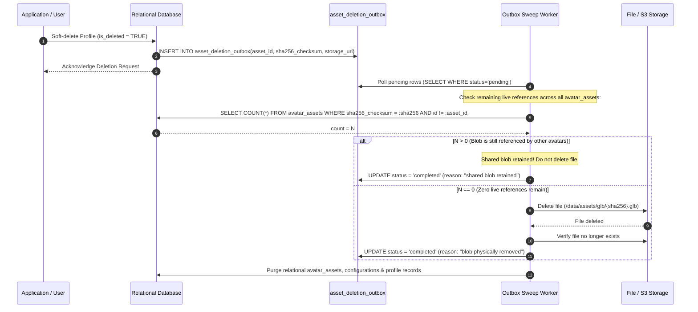

# WearWise Relational Database Schema & Persistence Specification

**Project:** WearWise AI Fashion & Honest Fit Platform  
**Document:** Database Schema & Persistence Design (DBS-001)  
**Revision:** 1.2 (Exact 12-Table Agreement, Blob Reference Safety & Outbox Pattern)  
**Date:** 2026-11-23  
**Status:** Approved Technical Architecture  

---

## 1. Storage Architecture & Identity Boundary

### 1.1 Database Engine Strategy
- **Local Development & ₹0 Budget:** SQLite 3 with Write-Ahead Logging (WAL) mode enabled (`PRAGMA journal_mode=WAL;`). Requires zero infrastructure daemons while supporting ACID transactions.
- **Production Standard:** Authored in standard ANSI SQL / SQLAlchemy ORM compatible with PostgreSQL 16+.
- **Identity Boundary:** Authentication and user accounts are handled externally. Tables reference `user_id UUID NOT NULL` as an authenticated principal boundary without creating dummy local user tables in this schema.

### 1.2 Binary 3D Asset Storage Strategy
- Binary `.glb` files (~$482\text{ KB}$ each) are **never stored as SQL BLOBs**.
- Files are stored in external content-addressable storage using their **SHA-256 content digest as the storage key**:
  - Local path: `data/assets/glb/{sha256_checksum}.glb`
  - Cloud path (Future): `s3://wearwise-assets/avatars/{sha256_checksum}.glb`
- Database tables store strictly metadata (`size_bytes`, `sha256_checksum`, `storage_uri`, validation status).

---

## 2. Complete Entity Relationship Diagram (ERD)

All **12 entities** in the ERD correspond 1:1 with the DDL specifications below. Notice that `ASSET_DELETION_OUTBOX` maintains an unconstrained reference to `asset_id` so it can survive the deletion of the associated `AVATAR_ASSETS` row:

```mermaid
erDiagram
    BODY_PROFILES ||--o{ PROFILE_REVISIONS : maintains
    PROFILE_REVISIONS ||--o{ BODY_MEASUREMENTS : records
    PROFILE_REVISIONS ||--o{ BODY_SHAPE_CONTROLS : records
    PROFILE_REVISIONS ||--o{ AVATAR_CONFIGURATIONS : generates
    
    AVATAR_CONFIGURATIONS ||--o{ AVATAR_ASSETS : produces
    
    GARMENT_PROFILES ||--o{ GARMENT_REVISIONS : maintains
    GARMENT_REVISIONS ||--o{ GARMENT_SIZES : defines
    GARMENT_SIZES ||--o{ GARMENT_MEASUREMENTS : specifies
    
    PROFILE_REVISIONS ||--o{ FIT_RECOMMENDATIONS : requests
    GARMENT_REVISIONS ||--o{ FIT_RECOMMENDATIONS : evaluates
    
    AVATAR_ASSETS ..o{ ASSET_DELETION_OUTBOX : "triggers cleanup"

    BODY_PROFILES {
        uuid id PK
        uuid user_id "Auth Principal"
        int current_revision
        varchar presentation_gender
        decimal stature_cm "Derived projection"
        decimal reported_weight_kg "Metadata"
        boolean is_deleted
        timestamp created_at
        timestamp updated_at
    }

    PROFILE_REVISIONS {
        uuid id PK
        uuid profile_id FK
        int revision_number
        timestamp created_at
    }

    BODY_MEASUREMENTS {
        uuid id PK
        uuid revision_id FK
        varchar measurement_code
        decimal value_cm
        varchar unit
        varchar acquisition_method
        varchar validation_state
        varchar lifecycle_status
        varchar assessment_state
        varchar landmark_convention
        decimal tolerance_cm
        decimal reliability_weight
        timestamp captured_at
    }

    BODY_SHAPE_CONTROLS {
        uuid id PK
        uuid revision_id FK
        decimal shoulder_width
        decimal chest_fullness
        decimal belly_fullness
        decimal waist_definition
        decimal arm_fullness
        decimal hip_fullness
        decimal thigh_fullness
        decimal calf_fullness
    }

    AVATAR_CONFIGURATIONS {
        uuid id PK
        uuid revision_id FK
        varchar engine_name
        varchar engine_version
        json shape_spec_json
        json adapter_metadata_json
        timestamp created_at
    }

    AVATAR_ASSETS {
        uuid id PK
        uuid config_id FK
        varchar format
        int size_bytes
        varchar sha256_checksum
        varchar storage_uri
        decimal generation_ms
        int vertex_count
        boolean is_valid
        timestamp created_at
    }

    GARMENT_PROFILES {
        uuid id PK
        uuid brand_id "Merchant Principal"
        varchar sku
        varchar title
        varchar category
        int current_revision
        boolean is_deleted
        timestamp created_at
    }

    GARMENT_REVISIONS {
        uuid id PK
        uuid garment_id FK
        int revision_number
        json fabric_properties_json
        timestamp created_at
    }

    GARMENT_SIZES {
        uuid id PK
        uuid garment_revision_id FK
        varchar size_label
        int sort_order
    }

    GARMENT_MEASUREMENTS {
        uuid id PK
        uuid size_id FK
        varchar dimension_code
        decimal value_cm
        decimal tolerance_cm
        varchar measurement_procedure
        varchar provenance
    }

    FIT_RECOMMENDATIONS {
        uuid id PK
        uuid profile_revision_id FK
        uuid garment_revision_id FK
        varchar recommended_size
        decimal composite_score
        json explanations_json
        varchar rulebook_version
        timestamp created_at
    }

    ASSET_DELETION_OUTBOX {
        uuid id PK
        uuid asset_id "Unconstrained ref"
        varchar sha256_checksum
        varchar storage_uri
        varchar status
        int retry_count
        timestamp created_at
    }
```

---

## 3. Authoritative DDL Specifications (Exactly 12 Tables)

```sql
-- 1. Body Profiles (Identity anchor)
CREATE TABLE body_profiles (
    id UUID PRIMARY KEY,
    user_id UUID NOT NULL,
    current_revision INTEGER NOT NULL DEFAULT 1,
    presentation_gender VARCHAR(16) NOT NULL CHECK (presentation_gender IN ('masculine', 'feminine', 'neutral')),
    stature_cm NUMERIC(5, 2) NOT NULL CHECK (stature_cm BETWEEN 100.0 AND 230.0), -- Derived projection of canonical measurement
    reported_weight_kg NUMERIC(5, 2) NULL CHECK (reported_weight_kg IS NULL OR reported_weight_kg BETWEEN 30.0 AND 300.0), -- Non-apparel metadata
    is_deleted BOOLEAN NOT NULL DEFAULT FALSE,
    created_at TIMESTAMP WITH TIME ZONE NOT NULL DEFAULT CURRENT_TIMESTAMP,
    updated_at TIMESTAMP WITH TIME ZONE NOT NULL DEFAULT CURRENT_TIMESTAMP
);
CREATE INDEX idx_body_profiles_user_id ON body_profiles(user_id);

-- 2. Profile Revisions (Immutable history)
CREATE TABLE profile_revisions (
    id UUID PRIMARY KEY,
    profile_id UUID NOT NULL REFERENCES body_profiles(id) ON DELETE CASCADE,
    revision_number INTEGER NOT NULL,
    created_at TIMESTAMP WITH TIME ZONE NOT NULL DEFAULT CURRENT_TIMESTAMP,
    CONSTRAINT uq_profile_revision UNIQUE (profile_id, revision_number)
);

-- 3. Body Measurements (Canonical source of truth)
CREATE TABLE body_measurements (
    id UUID PRIMARY KEY,
    revision_id UUID NOT NULL REFERENCES profile_revisions(id) ON DELETE CASCADE,
    measurement_code VARCHAR(64) NOT NULL,
    value_cm NUMERIC(5, 2) NOT NULL CHECK (value_cm > 0.0),
    unit VARCHAR(8) NOT NULL DEFAULT 'cm' CHECK (unit = 'cm'),
    acquisition_method VARCHAR(32) NOT NULL CHECK (acquisition_method IN (
        'user_reported', 'tape_measured', 'geometry_extracted', 'model_estimated'
    )),
    validation_state VARCHAR(32) NOT NULL CHECK (validation_state IN (
        'unvalidated', 'internally_consistent', 'externally_validated', 'disputed'
    )),
    lifecycle_status VARCHAR(16) NOT NULL CHECK (lifecycle_status IN ('active', 'superseded', 'draft', 'purged')),
    assessment_state VARCHAR(16) NOT NULL CHECK (assessment_state IN ('eligible', 'provisional', 'unassessed', 'rejected')),
    landmark_convention VARCHAR(128) NOT NULL,
    tolerance_cm NUMERIC(4, 2) NOT NULL DEFAULT 1.00 CHECK (tolerance_cm >= 0.0),
    reliability_weight NUMERIC(3, 2) NOT NULL DEFAULT 1.00 CHECK (reliability_weight BETWEEN 0.0 AND 1.0),
    captured_at TIMESTAMP WITH TIME ZONE NOT NULL DEFAULT CURRENT_TIMESTAMP,
    CONSTRAINT uq_rev_measurement_code UNIQUE (revision_id, measurement_code)
);
CREATE INDEX idx_measurements_rev_id ON body_measurements(revision_id);
CREATE INDEX idx_measurements_code ON body_measurements(measurement_code);

-- 4. Body Shape Controls (Semantic sliders)
CREATE TABLE body_shape_controls (
    id UUID PRIMARY KEY,
    revision_id UUID NOT NULL REFERENCES profile_revisions(id) ON DELETE CASCADE,
    shoulder_width NUMERIC(3, 2) NOT NULL DEFAULT 0.50 CHECK (shoulder_width BETWEEN 0.0 AND 1.0),
    chest_fullness NUMERIC(3, 2) NOT NULL DEFAULT 0.50 CHECK (chest_fullness BETWEEN 0.0 AND 1.0),
    belly_fullness NUMERIC(3, 2) NOT NULL DEFAULT 0.50 CHECK (belly_fullness BETWEEN 0.0 AND 1.0),
    waist_definition NUMERIC(3, 2) NOT NULL DEFAULT 0.50 CHECK (waist_definition BETWEEN 0.0 AND 1.0),
    arm_fullness NUMERIC(3, 2) NOT NULL DEFAULT 0.50 CHECK (arm_fullness BETWEEN 0.0 AND 1.0),
    hip_fullness NUMERIC(3, 2) NOT NULL DEFAULT 0.50 CHECK (hip_fullness BETWEEN 0.0 AND 1.0),
    thigh_fullness NUMERIC(3, 2) NOT NULL DEFAULT 0.50 CHECK (thigh_fullness BETWEEN 0.0 AND 1.0),
    calf_fullness NUMERIC(3, 2) NOT NULL DEFAULT 0.50 CHECK (calf_fullness BETWEEN 0.0 AND 1.0),
    CONSTRAINT uq_controls_revision UNIQUE (revision_id)
);

-- 5. Avatar Configurations (Internal generation recipe)
CREATE TABLE avatar_configurations (
    id UUID PRIMARY KEY,
    revision_id UUID NOT NULL REFERENCES profile_revisions(id) ON DELETE CASCADE,
    engine_name VARCHAR(64) NOT NULL,
    engine_version VARCHAR(32) NOT NULL,
    shape_spec_json JSON NOT NULL,
    adapter_metadata_json JSON NOT NULL,
    created_at TIMESTAMP WITH TIME ZONE NOT NULL DEFAULT CURRENT_TIMESTAMP
);

-- 6. Avatar Assets (Binary artifact metadata)
CREATE TABLE avatar_assets (
    id UUID PRIMARY KEY,
    config_id UUID NOT NULL REFERENCES avatar_configurations(id) ON DELETE CASCADE,
    format VARCHAR(8) NOT NULL DEFAULT 'glb' CHECK (format = 'glb'),
    size_bytes INTEGER NOT NULL CHECK (size_bytes > 0),
    sha256_checksum VARCHAR(64) NOT NULL,
    storage_uri VARCHAR(512) NOT NULL,
    generation_duration_ms NUMERIC(7, 2) NOT NULL,
    vertex_count INTEGER NOT NULL,
    is_valid_manifold BOOLEAN NOT NULL DEFAULT TRUE,
    created_at TIMESTAMP WITH TIME ZONE NOT NULL DEFAULT CURRENT_TIMESTAMP
);
CREATE INDEX idx_avatar_assets_sha256 ON avatar_assets(sha256_checksum);

-- 7. Garment Profiles
CREATE TABLE garment_profiles (
    id UUID PRIMARY KEY,
    brand_id UUID NOT NULL, -- Authenticated merchant principal
    sku VARCHAR(64) NOT NULL,
    title VARCHAR(256) NOT NULL,
    category VARCHAR(64) NOT NULL,
    current_revision INTEGER NOT NULL DEFAULT 1,
    is_deleted BOOLEAN NOT NULL DEFAULT FALSE,
    created_at TIMESTAMP WITH TIME ZONE NOT NULL DEFAULT CURRENT_TIMESTAMP,
    CONSTRAINT uq_brand_sku UNIQUE (brand_id, sku)
);

-- 8. Garment Revisions
CREATE TABLE garment_revisions (
    id UUID PRIMARY KEY,
    garment_id UUID NOT NULL REFERENCES garment_profiles(id) ON DELETE CASCADE,
    revision_number INTEGER NOT NULL,
    fabric_properties_json JSON NOT NULL,
    created_at TIMESTAMP WITH TIME ZONE NOT NULL DEFAULT CURRENT_TIMESTAMP,
    CONSTRAINT uq_garment_revision UNIQUE (garment_id, revision_number)
);

-- 9. Garment Sizes
CREATE TABLE garment_sizes (
    id UUID PRIMARY KEY,
    garment_revision_id UUID NOT NULL REFERENCES garment_revisions(id) ON DELETE CASCADE,
    size_label VARCHAR(32) NOT NULL,
    sort_order INTEGER NOT NULL DEFAULT 0,
    CONSTRAINT uq_garment_size_label UNIQUE (garment_revision_id, size_label)
);

-- 10. Garment Measurements
CREATE TABLE garment_measurements (
    id UUID PRIMARY KEY,
    size_id UUID NOT NULL REFERENCES garment_sizes(id) ON DELETE CASCADE,
    dimension_code VARCHAR(64) NOT NULL,
    value_cm NUMERIC(5, 2) NOT NULL CHECK (value_cm > 0.0),
    tolerance_cm NUMERIC(4, 2) NOT NULL DEFAULT 1.00 CHECK (tolerance_cm >= 0.0),
    measurement_procedure VARCHAR(64) NOT NULL,
    provenance VARCHAR(32) NOT NULL DEFAULT 'brand_size_chart',
    CONSTRAINT uq_size_dimension UNIQUE (size_id, dimension_code)
);

-- 11. Fit Recommendations
CREATE TABLE fit_recommendations (
    id UUID PRIMARY KEY,
    profile_revision_id UUID NOT NULL REFERENCES profile_revisions(id) ON DELETE CASCADE,
    garment_revision_id UUID NOT NULL REFERENCES garment_revisions(id) ON DELETE CASCADE,
    recommended_size VARCHAR(32) NOT NULL,
    composite_score NUMERIC(5, 2) NOT NULL CHECK (composite_score BETWEEN 0.0 AND 100.0),
    explanations_json JSON NOT NULL,
    rulebook_version VARCHAR(32) NOT NULL,
    created_at TIMESTAMP WITH TIME ZONE NOT NULL DEFAULT CURRENT_TIMESTAMP
);

-- 12. Asset Deletion Outbox (Survives asset row deletion; manages blob reference counting)
CREATE TABLE asset_deletion_outbox (
    id UUID PRIMARY KEY,
    asset_id UUID NOT NULL, -- Unconstrained reference (no FK) to survive relational asset purge
    sha256_checksum VARCHAR(64) NOT NULL,
    storage_uri VARCHAR(512) NOT NULL,
    status VARCHAR(16) NOT NULL DEFAULT 'pending' CHECK (status IN ('pending', 'processing', 'completed', 'failed')),
    retry_count INTEGER NOT NULL DEFAULT 0,
    created_at TIMESTAMP WITH TIME ZONE NOT NULL DEFAULT CURRENT_TIMESTAMP
);
CREATE INDEX idx_deletion_outbox_status ON asset_deletion_outbox(status);
```

---

## 4. Privacy Design & Reliable Deletion Workflow

### 4.1 Canonical Source-of-Truth Resolution
- `body_measurements` (with code `'stature'`) is the **single canonical source of truth for body height**.
- `body_profiles.stature_cm` is a derived, denormalized read-projection kept synchronized on revision save to avoid repeated joins.

### 4.2 Shared Content-Addressable Blob Safety & Deletion Workflow
Because storage is content-addressable, multiple avatar configurations or different profiles with identical shapes can produce identical SHA-256 digests. Deleting one avatar must **never delete a physical `.glb` blob that is still referenced by another live asset**:



5. **Legal Boundary:** These privacy mechanisms represent architectural designs to support future compliance audits (GDPR / DPDP) and do not constitute formal legal certification.
