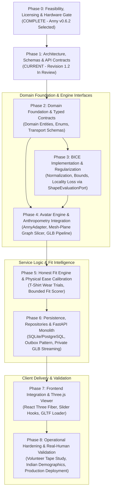

# WearWise Implementation Roadmap & Dependency Architecture

**Project:** WearWise AI Fashion & Honest Fit Platform  
**Document:** Technical Roadmap & Testing Gates (ROA-001)  
**Revision:** 1.2 (Explicit Package Boundaries & Measurable Validation Targets)  
**Date:** 2026-11-23  
**Status:** Approved Technical Architecture  

---

## 1. Authoritative Implementation Dependency Graph

---

## 2. Phase-by-Phase Breakdown, Package Boundaries & Exit Gates

### Phase 2: Domain Foundation, Schemas & Core Interfaces
- **Objective:** Translate approved Revision 1.2 Markdown designs into executable domain entities, transport schemas, and abstract interfaces.
- **Strict Package Boundaries:**
  - `app/domain/entities/`: Pure framework-independent domain models and value objects (`BodyProfile`, `BodyMeasurement`, `AvatarShapeSpec`, `GarmentProfile`). Zero framework dependencies.
  - `app/domain/interfaces/`: Abstract protocols (`AvatarEngine`, `ShapeEvaluationPort`, `LandmarkProvider`, `StorageProvider`).
  - `app/domain/taxonomies/`: Orthogonal enum definitions (`MeasurementAcquisitionMethod`, `MeasurementValidationState`, `MeasurementLifecycleStatus`, `MeasurementAssessmentState`).
  - `app/schemas/`: Separate Pydantic v2 transport models for HTTP validation (`ProfileCreateRequest`, `AvatarGenerationResponse`). Transport concerns are strictly barred from domain entities.
  - `app/infrastructure/models/`: SQLAlchemy persistence models are **deferred to Phase 6**.
- **Measurable Exit Gate:**
  - 100% test coverage over domain invariant rules (e.g. rejection of invalid units, stature bounds $[100, 230]\text{ cm}$, semantic control ranges $[0, 1]$).
  - Round-trip serialization determinism tests for all domain models.
  - Zero imports of FastAPI, SQLAlchemy, Anny, or PyTorch in domain packages.

### Phase 3: BICE Implementation & Parameter Regularization
- **Objective:** Implement `BICE` semantic normalization, parameter solver, and locality regularization consuming `ShapeEvaluationPort`.
- **Key Deliverables:**
  - `app/bice/normalizer.py`: Map $[0.0, 1.0]$ sliders to centered offsets $[-1.0, 1.0]$.
  - `app/bice/bounds.py`: Provisional parameter-specific clamps (thighs $[-0.5, +0.5]$).
  - `app/bice/solver.py`: Regularized solver optimizing `AvatarShapeSpec` via injected `ShapeEvaluationPort`.
- **Measurable Exit Gate:**
  - Property-based tests (Hypothesis) proving that for $1,000$ randomly generated slider combinations, all output `AvatarShapeSpec` regional scales remain within defined bounds.
  - Regression tests proving locality penalty $\mathcal{L}_{\text{locality}}$ correctly identifies simulated parameter spillover via `ShapeEvaluationPort`.

### Phase 4: Avatar Engine & Anthropometry Integration
- **Objective:** Implement `AnnyAdapter` behind `AvatarEngine` and exact triangle-mesh-plane slicing in `AnthropometryEngine`.
- **Key Deliverables:**
  - `app/avatar_engine/adapters/anny_adapter.py`: CPU LBS skinning; `AnnyLandmarkProvider`; `AnnyShapeEvaluationPort`.
  - `app/anthropometry/slicer.py`: Exact mesh-plane intersection, segment stitching, degree-2 graph validation, and loop perimeter calculator.
- **Measurable Exit Gate:**
  - Intersection correctness: 100% closure rate ($\|\mathbf{p}_{\text{start}} - \mathbf{p}_{\text{end}}\| < 10^{-6}\text{ m}$) on baseline neutral meshes.
  - Landmark-guided loop selection validated across test phenotypes without hardcoded coordinate bounds.
  - Benchmark target: Avatar generation pipeline completes in $<50\text{ ms}$ on CPU worker threads.
  - Zero vertex index dependencies inside `AnthropometryEngine`.

### Phase 5: Honest Fit Engine & Physical Garment Calibration
- **Objective:** Implement dimensional ease calculation, 6-tier classification, and execute physical wear trials.
- **Key Deliverables:**
  - `app/fit_engine/ease_calculator.py`: Measurement compatibility registry and dimensional ease math.
  - `app/fit_engine/scorer.py`: Bounded composite fit scoring ($[0, 100]$) with normalized weight denominator.
  - `docs/calibration/PHASE_5_CALIBRATION_REPORT.md`: Physical wear trial report across 5 T-shirt sizes.
- **Measurable Exit Gate:**
  - Transition of T-shirt ease thresholds from `PROVISIONAL` to `CALIBRATED` supported by physical wear feedback from 20 test trials.
  - 100% test coverage over half-open interval boundaries preventing classification overlap.

### Phase 6: Persistence Layer, Orchestration & FastAPI Monolith
- **Objective:** Implement `AvatarOrchestrationService`, SQLAlchemy repositories, SQLite WAL configuration, asynchronous `asset_deletion_outbox` worker, and versioned `/api/v1` routes.
- **Measurable Exit Gate:**
  - Passing automated API test suite covering all endpoints with authenticated requests.
  - Concurrency & load-test gate: 10 concurrent requests handled with $<150\text{ ms}$ p95 latency.
  - Content-addressable blob safety test proving shared `.glb` files are not deleted when active references remain.

### Phase 7: Frontend Integration & Three.js Viewer
- **Objective:** Connect the React 19 + Vite frontend to `/api/v1` and render binary GLBs via React Three Fiber.
- **Measurable Exit Gate:**
  - Authenticated streaming of `.glb` directly into Three.js `GLTFLoader` with `withCredentials = true`.
  - Smooth interactive 3D avatar rotation at 60 FPS in Google Chrome.

### Phase 8: Operational Hardening & Real-Human Measurement Validation
- **Objective:** Conduct formal anthropometric validation study with consenting adult volunteers to evaluate model accuracy against real human bodies (including varied Indian demographics).
- **Measurable Exit Gate:**
  - Statistical error analysis (Mean Absolute Error, 95% confidence intervals) comparing avatar-derived dimensions to physical tailoring tape measurements.
  - Final operational hardening report.
