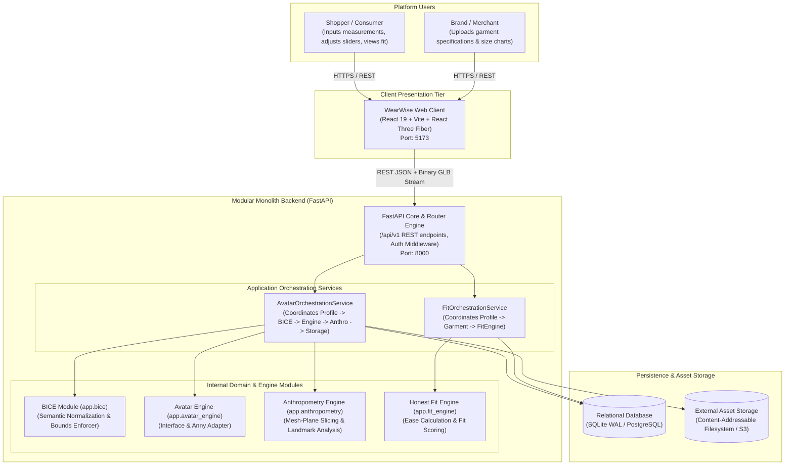
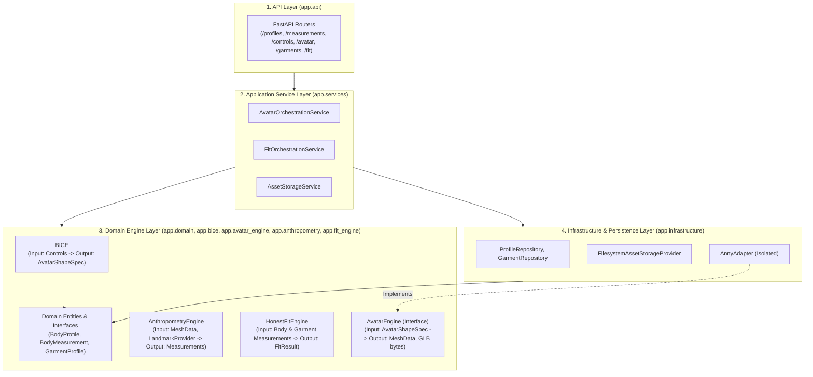
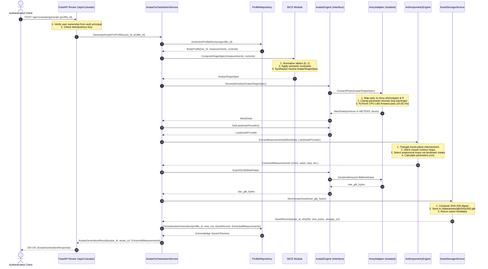
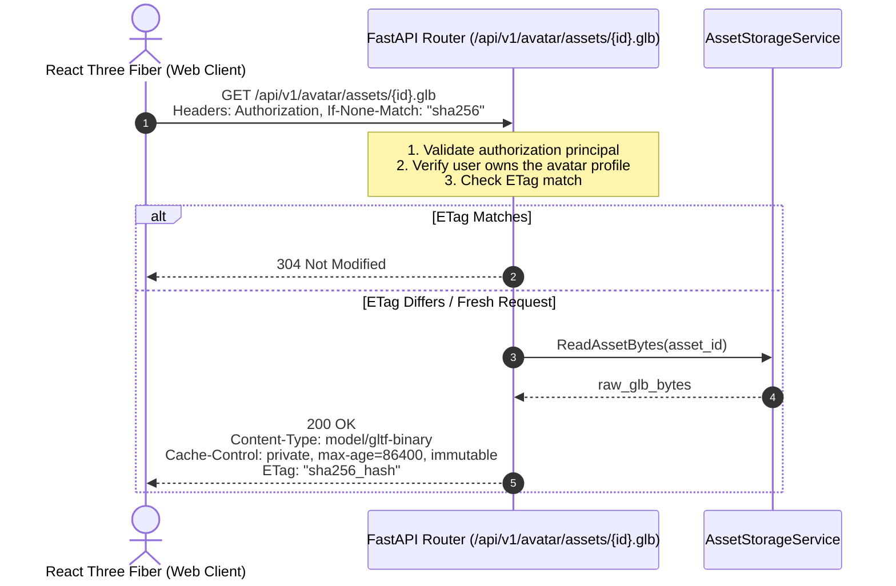

# WearWise System Architecture & Component Specification

**Project:** WearWise AI Fashion & Honest Fit Platform  
**Document:** System Architecture Specification (SAS-001)  
**Revision:** 1.1 (Engine-Isolated Modular Monolith)  
**Date:** 2026-11-23  
**Status:** Approved Technical Architecture  

---

## 1. Context and Architectural Goals

WearWise is an AI fashion and honest-fit intelligence platform designed to eliminate apparel sizing uncertainty by providing measurement-grounded 3D avatars and transparent garment ease calculations without requiring photographs, body scans, or mobile depth sensors.

### Architectural Constraints & Invariants:
1. **Python Modular Monolith (FastAPI):** A single unified deployable backend process with strictly decoupled internal module boundaries. No microservices, distributed message brokers, or Kubernetes orchestration are permitted at this stage.
2. **Strict Unidirectional Dependency Direction:** API routers invoke application-level services. Low-level domain engines (Avatar Engine, Anthropometry, BICE, Fit Engine) never orchestrate higher-level modules or each other.
3. **Engine-Neutral Avatar Generation:** NAVER Anny v0.6.2 is encapsulated completely behind an engine-independent `AvatarEngine` interface in `app/avatar_engine/adapters/anny_adapter.py`. BICE and Anthropometry communicate with the engine solely via neutral contracts (`AvatarShapeSpec`, `MeshData`, `LandmarkProvider`).
4. **Local Hardware Budget Compliance (₹0 Mandate):** Real-time interactive avatar previews run on CPU PyTorch tensors ($20.82\text{ ms}$ model latency on an AMD Ryzen 7 6800H), achieving ₹0 infrastructure viability.
5. **Frontend Preservation:** The existing frontend is a decoupled React 19 + Vite application. It renders 3D avatar assets using Three.js / React Three Fiber. The backend provides an authenticated, private binary GLB streaming contract (`/api/v1/avatar/assets/{avatar_id}.glb`).

---

## 2. System Context Diagram

---

## 3. Backend Component Architecture & Dependency Rules

### 3.1 Strict Authoritative Dependency Hierarchy
Dependencies flow strictly downward. Lower layers have zero knowledge of higher layers:

### 3.2 Authoritative Module Responsibilities & Dependency Matrix

| Module | Core Responsibility | Inbound Dependencies (Allowed Callers) | Outbound Dependencies (Allowed Callees) | Forbidden Dependencies |
|---|---|---|---|---|
| `app.api` | Request parsing, authentication context extraction, response serialization, HTTP error translation. | Client (Browser) | `app.services`, `app.domain` | Zero direct calls to `app.avatar_engine`, `app.bice`, or DB models. |
| `app.services.avatar_orchestration` | Coordinates end-to-end avatar workflow: fetching profile, generating `AvatarShapeSpec`, invoking engine, extracting measurements, saving GLB, persisting revisions. | `app.api` | `app.bice`, `app.avatar_engine`, `app.anthropometry`, `app.infrastructure`, `app.domain` | No Anny-specific or PyTorch dependencies. |
| `app.services.fit_orchestration` | Coordinates fit recommendation flow: fetching active profile measurements and garment sizing data, running fit evaluation, formatting advice. | `app.api` | `app.fit_engine`, `app.infrastructure`, `app.domain` | No avatar or 3D rendering dependencies. |
| `app.bice` | Normalizes semantic sliders; enforces semantic invariants; computes engine-independent `AvatarShapeSpec`. | `app.services.avatar_orchestration` | `app.domain` | Strictly zero Anny imports, zero PyTorch imports, zero mesh imports. |
| `app.avatar_engine` | Encapsulates 3D mesh generation. Exposes `AvatarEngine` protocol. Concrete `AnnyAdapter` handles PyTorch LBS forward pass and binary GLB serialization. | `app.services.avatar_orchestration` | `app.domain` | Must NOT depend on `app.anthropometry`, `app.fit_engine`, or DB persistence. |
| `app.anthropometry` | Performs triangle-mesh-plane intersections; stitches closed contour loops; extracts perimeters and lengths using `LandmarkProvider`. | `app.services.avatar_orchestration` | `app.domain` | Must NOT depend on Anny topology, vertex indices, or `app.avatar_engine`. |
| `app.fit_engine` | Calculates dimensional ease ($G - B$); evaluates non-overlapping regional fit classifications; computes bounded fit scores. | `app.services.fit_orchestration` | `app.domain` | Strictly zero 3D mesh, geometry, or avatar dependencies. |
| `app.infrastructure` | Relational persistence (SQLAlchemy / SQLite / PostgreSQL), external binary file storage, and isolated concrete engine adapters. | `app.services` | `app.domain` | Domain logic must not leak into SQL queries. |

---

## 4. End-to-End Orchestrated Data Flows

### 4.1 Avatar Generation Sequence Diagram (Orchestration Service Driven)

### 4.2 Authenticated GLB Delivery Flow

---

## 5. Architectural Decision Records (Revision 1.1)

### ADR-01: Modular Monolith Architecture
- **Status:** Approved.
- **Context:** Initial infrastructure budget is ₹0. Single-process execution eliminates network serialization and distributed deployment overhead.
- **Decision:** Build a single deployable Python FastAPI application structured into decoupled layers. In-process calls use typed domain models.

### ADR-02: CPU-Primary Inference Strategy
- **Status:** Approved.
- **Context:** Phase 0 proved single-mesh inference on an AMD Ryzen 7 6800H CPU takes **$20.82\text{ ms}$**, whereas single-mesh GPU inference on the RTX 3050 takes $74.45\text{ ms}$ due to CUDA kernel launch overhead.
- **Decision:** Default interactive avatar generation worker threads to run on CPU PyTorch tensors. CUDA execution is reserved for batch offline jobs.

### ADR-03: Two-Phase Authenticated GLB Asset Delivery Contract
- **Status:** Approved (Revision 1.1).
- **Context:** Avatar assets represent personal 3D body representations. Public shared CDN caching violates user privacy.
- **Decision:** Avatar generation returns metadata and asset URL: `/api/v1/avatar/assets/{avatar_id}.glb`. Serving requires authentication and returns `Cache-Control: private, max-age=86400, immutable` with content-derived ETag (SHA-256).

### ADR-04: Strict Isolation of Avatar Engine & Application-Level Orchestration
- **Status:** Approved (Revision 1.1).
- **Context:** Coupling BICE or Anthropometry to Anny creates severe vendor lock-in. Avatar Engine must not orchestrate measurement extraction.
- **Decision:** `AvatarOrchestrationService` coordinates the workflow. BICE outputs `AvatarShapeSpec`. AnnyAdapter translates `AvatarShapeSpec` to Anny parameters and provides `LandmarkProvider`. Anthropometry operates strictly on neutral meshes and landmark coordinates.
