# WEARWISE — MASTER PROJECT DOSSIER
## Technical Architecture, Anthropometric Calibration, Pattern-First Garment Twin Engineering, Dual-Mode Virtual Try-On & Evidence-Grounded Evaluation

---

## 1. Document Metadata & Executive Project Summary

| Field | Verified Value |
| :--- | :--- |
| **Project Title** | **WearWise** — Explainable Anthropometric Sizing, Interactive 3D Cloth Simulation & Dual-Mode Virtual Try-On Marketplace |
| **Repository Root** | `C:\Users\Lenovo\Documents\Major Project\WearWise` |
| **Git Branch & Baseline** | `remediation/m2r-a-pattern-prototype` — HEAD `c9ad918` (*Phase 12/12.1 committed & pushed to origin*); **Phase 13 (Separate Shopper & Seller Portals, HTTP-Only Cookie Sessions, Double-Submit CSRF & RBAC) + Lazy PyTorch Loader Fix** implemented and verified in the current staging working tree |
| **Primary Stack** | React `19.2.8` + TypeScript `~7.0.2` + Vite `8.2.2` + Three.js `0.187.0` / React Three Fiber `9.8.2` + FastAPI `>=0.115` + SQLAlchemy `>=2.0` + MongoDB (`pymongo >=4.9.0`) + PyTorch `2.14.1+cu130` + NAVER Anny `0.6.2` |
| **Runtime Topology** | Frontend SPA (`:5173` dev / `:4173` preview / `:3000`) ↔ Commerce Backend (`:8001`) ↔ Body & Garment Engine (`:8000`) |
| **Active Staging Databases** | `wearwise_commerce_staging` (MongoDB), `wearwise_body_engine_staging` (MongoDB), `WEARWISE-BODY-ENGINE/data/wearwise_staging.db` (SQLite WAL) — *production DBs & Rev3 S/M/L baseline untouched* |
| **Target Validation Host** | Windows 11 Home 64-bit (`NT 10.0.26300`), AMD Ryzen 7 6800H (8C/16T), `15.19` GB RAM, NVIDIA GeForce RTX 3050 Laptop GPU (`4096` MiB VRAM), Python `3.12.10`, Node `v24.22.1` |

### 1.1 Executive Project Summary

**WearWise** is a full-stack virtual apparel fitting and e-commerce platform engineered around a strict scientific boundary: **visual synthesis must never be conflated with physical garment fit**. Rather than asking online shoppers to infer clothing fit from static studio photographs, generic S/M/L letter labels, or opaque generative diffusion images, WearWise separates apparel decision support into three distinct, verifiable engineering pillars:

1. **Deterministic & Measurement-Grounded Body/Garment Fit Intelligence (`WEARWISE-BODY-ENGINE`):** Uses the Apache-2.0 licensed parametric body model **NAVER Anny v0.6.2** (`13,718` vertices, `27,420` faces, `104`-bone skeleton) behind a model-agnostic Python Modular Monolith (`FastAPI`) to synthesize neutral 3D human meshes in meters, extract exact cross-sectional circumferences via deterministic triangle-mesh-plane graph intersection (`AnthropometryEngine`), mediate consumer semantic sliders safely (`BICE`), and evaluate physical garment-versus-body ease across a 6-tier non-overlapping interval rulebook (`HonestFitEngine`).
2. **Pattern-First 3D Garment Digital Twins & Browser Web Worker Cloth Physics:** Merchants author apparel sizes through explicit 2D-to-3D pattern construction (`PatternGarmentBuilder` / `ParametricPatternBuilder`) audited across five orthogonal QA gates (`pattern_seam_qa`, `geometry_topology_qa` checking Euler characteristic $\chi = -2$ and $4$ manifold openings, `material_uv_qa`, `dimensional_qa`, and `fit_clearance_qa`). On the client, shoppers inspect S/M/L garment GLBs fitted over calibrated rigged avatars (`PROFILE_A..E.glb`) driven by an off-main-thread Web Worker **Extended Position-Based Dynamics (XPBD)** solver (`WeldedClothSolver.ts`, `3,145` welded cloth particles, `18,288` warp/weft/shear/bend constraints) paired with `11` anatomical capsule broad-phase colliders, swept midpoint Continuous Collision Detection (CCD), and narrow-phase skinned-mesh signed-distance projection (`AnatomicalCollider.ts`).
3. **Dual-Mode Marketplace & Portal-Separated RBAC E-Commerce (`backend/` + `frontend/`):** Recognising that 3D pattern-first garment twins require structured tailoring assets whereas many catalogue categories (`Skirts`, `Dresses`, `Jeans`, `Jackets`, `Shirts`) begin as 2D photographs, WearWise implements an explicit **`tryOnCapabilities`** marketplace contract (`IMAGE_ONLY`, `THREE_D_ONLY`, `IMAGE_AND_THREE_D`) separating **seller intent** from **live platform readiness**, backed in Phase 13 by isolated **Shopper** and **Seller** portals (`shopper`, `seller`, `admin`), salted PBKDF2 password hashing, shared `HS256` JWTs with HTTP-only `ww_auth_session` cookies, double-submit `ww_csrf_token` CSRF protection, and MongoDB-backed session revocation (`auth_sessions` `jti`).

### 1.2 Honest Implementation Status Matrix

To preserve strict academic and engineering integrity, every subsystem in this dossier is classified according to its verified runtime state on the target host and staging environment:

| Subsystem / Capability | Honest Classification | Verified Evidence & Boundaries |
| :--- | :--- | :--- |
| **Separate Shopper & Seller Portals, Cookie/CSRF Auth & RBAC (Phase 13)** | **Implemented & Tested (Staging)** | Uncommitted working tree on `remediation/m2r-a-pattern-prototype`; verified by `10` Commerce pytest cases, `16` Body Engine API RBAC/VTON pytest cases, `26` Vitest UI/solver tests, and headless Chromium Desktop/Mobile E2E (`0` page errors). |
| **Dual-Mode Marketplace (`/explore`, `/product/:sku`, `tryOnCapabilities`)** | **Implemented & Tested (Staging)** | Committed at `c9ad918`; validates `IMAGE_ONLY`, `THREE_D_ONLY`, and `IMAGE_AND_THREE_D` gating, real reviews (`"No customer reviews yet"` when empty), zero AI recommendations, and disabled-reason visibility prior to upload. |
| **Pattern-First M2R-C Graded Garments (`TSH-WW-CREW-001` Rev3 S/M/L) & QA Engine** | **Implemented & Tested** | `S` (`249,156` B), `M` (`249,100` B), and `L` (`249,160` B) GLBs pass all 5 QA gates (`0` penetrating vertices, $\chi = -2$, SHA-256 verified). Limited to boxy crewneck T-shirt construction (`PatternGarmentBuilder`). |
| **Browser Web Worker XPBD Cloth Simulation & Calibrated Avatar Fitting Room (`/experimental-try-on`)** | **Implemented & Tested (Pre-Built Avatars)** | Sustained `60` FPS rAF / `2.36–2.67 ms` mean browser frame time across 4–10 substeps; Phase 11.5 collision fix yields `0–17` residual penetrating particles (`<= 0.54%`) across `P0/P3/P6/P8/P11` using pre-exported calibrated `PROFILE_A..E.glb` avatars. |
| **Cart (`ww-session-id`), Reviews, Wishlist, Wardrobe & Demo Checkout** | **Implemented & Tested (Demo Payment Only)** | Shared canonical session across Shopper pages; checkout explicitly marks every order `is_demo_checkout: true`, `payment_status: "DEMO_NO_PAYMENT_CAPTURED"` (no real payment gateway). |
| **Image-Based AI VTON Pipeline (`POST /api/v1/try-on/vton/jobs`, `HonestVTONProviderAdapter`)** | **Implemented & Contract-Tested; Awaiting Provider Keys** | Consent gate, `10 KB–10 MB` & `>=256x256` validation, EXIF pixel stripping, synthetic-image rejection (`<16` colors), temp photo `finally` deletion, ownership isolation, and FASHN AI v1 adapter implemented; fails closed with HTTP `503` because `.env` has no `FASHN_API_KEY` or `VTON_API_URL` and local RTX 3050 `4 GB` VRAM cannot host local diffusion (`12–24 GB`). |
| **Live PyTorch Anny Generation (`POST /api/v1/avatar/generate`) on Target Windows Host** | **Implemented; Currently OS-Blocked on Target Host (`[WinError 4551]`)** | Lazy loader keeps `:8000` operational (`200 OK`); `AnnyAdapter` + BICE + Anthropometry unit/integration suites previously passed (`409 passed` under prior session & `20.82 ms` CPU benchmarked), while on this host Windows Application Control blocks unsigned `torch_python.dll` (`9` errors in `test_real_extraction.py` during Phase 13 non-Torch regression run; `375` non-Torch tests passed). |
| **CAD 2D DXF/SVG Auto-3D Extrusion & Image-to-3D AI Pattern Reconstruction** | **Structural Validation / Provisional Stub** | `CADPatternValidator` validates closed `DXF`/`SVG` panel loops structurally; 3D mesh synthesis still executes `ParametricPatternBuilder`. `AIReconstructionAdapter` (`SwiftTailor-Vision-v1.4`) returns M baseline panels as a labelled provisional stub (`0.82`). |
| **External Human Volunteer Ground-Truth Study, Non-Tee 3D Patterns & iOS Safari Runner** | **Deferred / Future Scope** | Ease thresholds (`PROVISIONAL_EASE_INTERVALS`), non-T-shirt 3D garment builders, deferred collar/inseam/sleeve measurements, physical KES-F fabric bench calibration, and physical iOS Safari testing remain open. |

---

## 2. Problem Statement, Motivation, Research Gap Analysis & Industry Context

### 2.1 Core E-Commerce Apparel Failures

Apparel e-commerce faces a structural accuracy crisis documented across internal WearWise engineering specifications (`HFE-001`, `WEARWISE_MASTER_PROJECT_BRIEF.md`):

1. **Sizing Label Non-Standardization & Return Rates:** E-commerce fashion suffers typical **30%–40% return rates**, predominantly driven by fit uncertainty and "vanity sizing," where identical categorical labels (`"Medium"`) correspond to incompatible garment dimensions across brands and cuts.
2. **Conflation of Visual Plausibility with Physical Fit:** First-generation virtual try-on demos warp 2D garment pixels onto user photographs or invoke generative diffusion models. While visually persuasive, 2D pixel warping ignores real circumferential ease ($G_{\text{chest}} - B_{\text{chest}}$), sleeve seam placement relative to the acromion bone, and woven vs. knit tensile behavior—misleading customers into ordering unwearable sizes.
3. **Mandatory Photograph Friction & Privacy Exposure:** Many commercial try-on startups force shoppers to upload full-body photographs before browsing or sizing guidance can even begin. Conversely, WearWise's product loop—**DISCOVER → UNDERSTAND → VISUALIZE → COMPARE → STYLE → DECIDE → LEARN**—insists that browsing remain frictionless without mandatory camera scans.
4. **Proprietary Model Lock-In & Licensing Barriers:** Academic 3D body models (SMPL, SMPL-X) and popular open-weights VTON diffusion checkpoints (e.g., IDM-VTON under `CC BY-NC-SA 4.0`) prohibit zero-budget commercial SaaS deployment without paid enterprise licensing.
5. **Under-Specified Anthropometry vs. Clinical Density Proxies:** Inferring chest, shoulder, hip, or thigh girths from height and weight alone is an ill-posed inverse problem, while multiplying enclosed body mesh volume by constant tissue density ($\rho \approx 980\text{ kg/m}^3$) yields synthetic "BMI" estimates that must never be represented as medical or garment-fit truth.

### 2.2 Technical Research Gaps Addressed by WearWise

| Industry / Academic Gap | Conventional Failure Mode | WearWise Engineering Solution |
| :--- | :--- | :--- |
| **2D Generative VTON vs. Dimensional Fit** | Photorealistic output hides `-4 cm` chest constriction or overly tight sleeve cuffs. | Decouples **2D Image Try-On** (`HonestVTONProviderAdapter`) from **3D Interactive XPBD Fit** (`/experimental-try-on`) and **Deterministic Ease Engine** (`HonestFitEngine`). |
| **Restricted Body Mesh Licenses (SMPL/SMPL-X)** | Non-commercial research licenses block student/startup SaaS transfer. | Adopts **NAVER Anny v0.6.2** (`Apache-2.0`) over CC0 MakeHuman meshes behind strict `AvatarEngine` / `ShapeEvaluationPort` adapter protocols. |
| **Naive Horizontal Torso Slicing** | Planar $Z$-slices clip resting arms (`+7.80 cm` waist error observed in Phase 0). | Implements region vertex masks (`>= 2/3` face vertex membership) + exact triangle-mesh-plane graph stitching with topology & tangent 4-regular junction disambiguation. |
| **Arbitrary Uniform GLB Scaling for Sizes S/M/L** | Uniform $0.95\times / 1.05\times$ scaling distorts collar heights, pocket reliefs, and sleeve seam alignment. | Implements **Pattern-First M2R-C Grading** (`PatternGarmentBuilder`), preserving collar/hem band heights, seam-allowance allowances, and $>0.25\text{ cm}$ avatar clearance independently per size. |
| **Main-Thread Cloth Physics Blocking UI** | High-constraint cloth loops freeze React camera orbit & frame rates on CPU laptops. | Executes XPBD simulation (`4` substeps, `3,145` welded particles, `18,288` constraints) inside a dedicated ES-module Web Worker (`clothWorker.ts`) using transferable `ArrayBuffer` ping-pong buffers & epoch fencing (`2.36 ms` mean frame time at `60` FPS). |

---

## 3. Academic Foundation & Formal Literature Review

### 3.1 Evolution of 2D Image-Based Virtual Try-On (VTON)

Image-based virtual try-on progressed from Thin-Plate Spline (TPS) geometric warping and UNet composition in **VITON** [1] and **CP-VTON** [2] (which introduced learned Geometric Matching Modules to align clothing textures before try-on synthesis), to semantic layout-aware **ACGPN** [3] (predicting target clothing-agnostic body parsing maps to preserve non-target anatomy) and high-resolution **HR-VITON** [4] (unifying warping and segmentation generation to eliminate misalignment artifacts at $1024 \times 768$). Most recently, diffusion-based architectures such as **IDM-VTON** [5] leverage dual UNet Attention modules (`TryonNet` + `GarmentNet`) and IP-Adapter semantics for in-the-wild realism—at the computational cost of $12\text{--}24\text{ GB}$ GPU VRAM and non-commercial (`CC BY-NC-SA 4.0`) weight licenses. Consequently, WearWise pairs an honest hardware-aware adapter boundary (`HonestVTONProviderAdapter`) with commercially licensed cloud APIs (**FASHN AI API v1** [12] and **Google Vertex AI `virtual-try-on-001`** [13]) while never deploying un-licensed local weights or faking diffusion outputs with image overlays.

### 3.2 Parametric 3D Human Body Modeling

Data-driven articulated models such as **SMPL** [6] (Linear Blend Skinning with identity $\beta$ and pose $\theta$ blendshapes), **FLAME** [7] (expressive craniofacial head/neck articulation), and **SMPL-X** [8] (unified $10,475$-vertex body, hands, and face) dominate academic 3D vision benchmarks, but depend on proprietary CAESAR/registered scan datasets with restrictive commercial terms. In contrast, **Anny** [9] (Brégier et al., NAVER LABS Europe, 2025/2026) constructs an open, continuous, scan-free differentiable human body model grounded in CC0 MakeHuman anthropometry and calibrated to WHO demographic statistics (`Apache-2.0`). Anny provides phenotypic age/gender/height/weight/muscle/proportions axes alongside dense anatomical local morphs—enabling WearWise's zero-budget CPU inference (`20.82 ms` warm latency vs. `74.45 ms` CUDA launch-dominated latency on RTX 3050) while remaining legally deployable for SaaS [9].

### 3.3 Position-Based & Extended Position-Based Cloth Simulation

Real-time browser garment draping requires unconditional stability under coarse interactive time steps ($\Delta t \le 1/30\text{ s}$) and large user articulation swings (`P0–P11`). Classical **Position-Based Dynamics (PBD)** [10] eliminates explicit velocity-force stiffness explosions by projecting positional constraints directly, though effective stiffness remains coupled to iteration count and timestep size. **Extended Position-Based Dynamics (XPBD)** [11] resolves this limitation through a compliant constraint formulation incorporating inverse time-step-scaled compliance $\tilde{\alpha} = \alpha / \Delta t^2$ and cumulative Lagrange multipliers $\lambda$, allowing physically meaningful differentiation between compliant rib/waffle knits (`waffle_knit_240`) and stiff woven poplins (`rigid_poplin_140`). WearWise implements this exact XPBD projection inside `WeldedClothSolver.ts` with a critical Phase 11.5 stabilization refinement: executing a second XPBD constraint projection pass *prior to* the final `pushFactor = 0.96` narrow-phase collision projection (`resolveCollisions`), preventing late constraint pulls from dragging garment vertices back beneath the anatomical torso/shoulder surface.

### 3.4 Apparel Sizing Standards, 3D Web Delivery & Provenance

WearWise grounds its measurement vocabulary in **ISO 8559-1:2017** [15] (anthropometric body landmark definitions—stature, chest/bust girth, waist girth, hip girth, biacromial breadth) and **ISO 8559-2:2017** [16] (primary/secondary dimension size designation principles), serializes lightweight 3D mannequin and pattern-first garment twins using the **Khronos glTF 2.0 / ISO/IEC 12113:2022** binary `.glb` specification [14] (with top-4 WebGL bone weights retaining `99.532%` skinning mass across Anny's `104`-bone rig), and adopts the **Coalition for Content Provenance and Authenticity (C2PA)** [17] disclosure stance by keeping synthetic imagery (`tryon-v1.6` / Vertex AI C2PA assertions) explicitly labeled and strictly segregated from physical measurement claims.

### 3.5 Comparative Matrix Against Prior Art

| Prior System / Approach | Primary Strength | Limitation for Apparel E-Commerce | How WearWise Differs |
| :--- | :--- | :--- | :--- |
| **SMPL / SMPL-X** [6], [8] | High-precision scan-fitted shape & pose PCA | Restrictive academic licensing; commercial SaaS fees | Uses **NAVER Anny v0.6.2** (`Apache-2.0` + `CC0` base mesh) [9] |
| **VITON / HR-VITON / IDM-VTON** [1], [4], [5] | Photorealistic 2D garment texture transfer | No dimensional ease, size comparison, or commercial local GPU viability (`<12 GB` VRAM) | Routes image try-on strictly via external API (`503` fail-closed) + pairs with separate 3D/fit decision support |
| **Static Size Charts** | Simple merchant authoring (`S/M/L` tables) | Ignores posture, fabric stretch, landmark alignment, and personalized ease preferences | Automates zone-by-zone ease scoring (`HonestFitEngine`) + coverage-gated explanations (`C >= 0.70`) |
| **XPBD Reference Formulations** [11] | Timestep-independent compliance control | Single-pass main-thread CPU implementations stall WebGL UI or penetrate under fast shoulder elevation | Offloads 4-substep XPBD + swept CCD + narrow-phase mesh push to ES-module **Web Worker** (`2.36 ms` browser frame) |

### 3.6 Formal IEEE Reference List

[1] X. Han, Z. Wu, Z. Wu, R. Yu, and L. S. Davis, "VITON: An Image-Based Virtual Try-On Network," in *Proc. IEEE/CVF Conf. Comput. Vis. Pattern Recognit. (CVPR)*, Salt Lake City, UT, USA, Jun. 2018, pp. 7543–7552. Available: https://arxiv.org/abs/1711.08447  
[2] B. Wang, H. Zheng, X. Liang, Y. Chen, L. Lin, and M. Yang, "Toward Characteristic-Preserving Image-based Virtual Try-On Network," in *Proc. Eur. Conf. Comput. Vis. (ECCV)*, Munich, Germany, Sep. 2018, pp. 589–604. Available: https://arxiv.org/abs/1807.07688  
[3] H. Yang, R. Zhang, X. Guo, W. Liu, W. Zuo, and P. Luo, "Towards Photo-Realistic Virtual Try-On by Adaptively Generating↔Preserving Image Content," in *Proc. IEEE/CVF Conf. Comput. Vis. Pattern Recognit. (CVPR)*, Seattle, WA, USA, Jun. 2020, pp. 7847–7856, doi: 10.1109/CVPR42600.2020.00787.  
[4] S. Lee, G. Gu, S. Park, S. Choi, and J. Choo, "High-Resolution Virtual Try-On with Misalignment and Occlusion-Handled Conditions," in *Proc. Eur. Conf. Comput. Vis. (ECCV)*, Tel Aviv, Israel, Oct. 2022, pp. 204–219. Available: https://arxiv.org/abs/2206.14180  
[5] Y. Choi, S. Kwak, K. Lee, H. Choi, and J. Shin, "Improving Diffusion Models for Authentic Virtual Try-on in the Wild," in *Proc. Eur. Conf. Comput. Vis. (ECCV)*, Milan, Italy, Sep.–Oct. 2024. Available: https://arxiv.org/abs/2403.05139  
[6] M. Loper, N. Mahmood, J. Romero, G. Pons-Moll, and M. J. Black, "SMPL: A Skinned Multi-Person Linear Model," *ACM Trans. Graph. (SIGGRAPH Asia)*, vol. 34, no. 6, Art. 248, Nov. 2015, doi: 10.1145/2816795.2818013.  
[7] T. Li, T. Bolkart, M. J. Black, H. Li, and J. Romero, "Learning a model of facial shape and expression from 4D scans," *ACM Trans. Graph. (SIGGRAPH Asia)*, vol. 36, no. 6, Art. 194, Nov. 2017, doi: 10.1145/3130800.3130813.  
[8] G. Pavlakos, V. Choutas, N. Ghorbani, T. Bolkart, A. A. A. Osman, D. Tzionas, and M. J. Black, "Expressive Body Capture: 3D Hands, Face, and Body from a Single Image," in *Proc. IEEE/CVF Conf. Comput. Vis. Pattern Recognit. (CVPR)*, Long Beach, CA, USA, Jun. 2019, pp. 10967–10977, doi: 10.1109/CVPR.2019.01123.  
[9] R. Brégier, G. Fiche, L. Bravo-Sánchez, T. Lucas, M. Armando, P. Weinzaepfel, G. Rogez, and F. Baradel, "Human Mesh Modeling for Anny Body," NAVER LABS Europe, Tech. Rep. arXiv:2511.03589 (accepted at ECCV 2026), 2025/2026, doi: 10.48550/arXiv.2511.03589.  
[10] M. Müller, B. Heidelberger, M. Hennix, and J. Ratcliff, "Position based dynamics," *J. Vis. Commun. Image Represent.*, vol. 18, no. 2, pp. 109–118, Apr. 2007, doi: 10.1016/j.jvcir.2007.01.005.  
[11] M. Macklin, M. Müller, and N. Chentanez, "XPBD: position-based simulation of compliant constrained dynamics," in *Proc. 9th Int. Conf. Motion in Games (MiG '16)*, Burlingame, CA, USA, Oct. 2016, pp. 49–54, doi: 10.1145/2994258.2994272.  
[12] FASHN AI, *FASHN API v1 Documentation — Try-On v1.6 & Endpoints Reference*. [Online]. Available: https://docs.fashn.ai/  
[13] Google Cloud, *Vertex AI Virtual Try-On (`virtual-try-on-001`) Overview & Documentation*. [Online]. Available: https://cloud.google.com/vertex-ai/generative-ai/docs/image-generation/infographics/virtual-try-on  
[14] The Khronos Group Inc., *glTF 2.0 Specification (ISO/IEC 12113:2022)*. Geneva, Switzerland: ISO/IEC, Aug. 2022. [Online]. Available: https://registry.khronos.org/glTF/specs/2.0/glTF-2.0.html  
[15] International Organization for Standardization, *Size designation of clothes — Part 1: Anthropometric definitions for body measurement*, ISO 8559-1:2017, Mar. 2017.  
[16] International Organization for Standardization, *Size designation of clothes — Part 2: Primary and secondary dimension indicators*, ISO 8559-2:2017, Mar. 2017.  
[17] Coalition for Content Provenance and Authenticity (C2PA), *C2PA Content Credentials Technical Specification*. [Online]. Available: https://c2pa.org/specifications/

---

## 4. System Requirements & Feasibility Study

### 4.1 Functional Requirements

| ID | Category | Verified System Capability | Implementation Anchors |
| :--- | :--- | :--- | :--- |
| **FR-1** | **Portal-Separated Auth & RBAC** | Distinct Shopper (`/login`, `/signup`) and Seller (`/seller/login`, `/seller/register`) journeys, HTTP-only cookie sessions, CSRF protection, `jti` revocation, and backend-enforced role guards (`shopper`, `seller`, `admin`). | `backend/app/core/security.py`, `backend/app/routers/auth.py`, `WEARWISE-BODY-ENGINE/app/api/auth.py`, `frontend/src/App.tsx` |
| **FR-2** | **Parametric Body & BICE Mediation** | Create versioned body profiles (`stature`, `presentation_gender`), record measurement revisions with orthogonal provenance enums, adjust 8 bounded semantic sliders, and solve `AvatarShapeSpec`. | `app/api/v1/profiles.py`, `app/bice/`, `app/services/avatar_service.py` |
| **FR-3** | **Anthropometric Extraction & Calibration** | Extract core dimensions from 3D meshes (`stature`, `shoulder_biacromial_breadth`, `chest_circumference`, `waist_planar_circumference`, provisional `hip_circumference`) + 5-iteration closed-loop Anny calibration. | `app/anthropometry/`, `AnnyAdapter.generate_avatar` |
| **FR-4** | **Deterministic Honest Fit Engine** | Compute regional ease deltas across 6 half-open tiers, penalize silhouette mismatches via quadratic loss, apply `0.5x` weight discounting for provisional data, and enforce `C(s) >= 0.70` before recommending sizes. | `app/fit/`, `app/api/v1/fit.py` |
| **FR-5** | **Merchant Digital Garment Studio** | Upload dual-role images (`storefront_gallery`, `technical_reference`, `both`), validate DXF/SVG CAD, generate S/M/L pattern-first GLBs, pass 5 QA gates, approve, publish/rollback, and manage store orders. | `app/api/v1/merchant_garments.py`, `lifecycle_store.py`, `backend/app/routers/seller.py`, `frontend/src/pages/seller/` |
| **FR-6** | **Dual-Mode Marketplace & VTON** | Independently configure `IMAGE_ONLY`, `THREE_D_ONLY`, `IMAGE_AND_THREE_D` per listing, evaluate live VTON readiness before upload, validate/EXIF-strip shopper photos, and dispatch FASHN AI v1 / fail-closed `503`. | `backend/app/routers/products.py`, `vton_provider.py`, `person_image_service.py`, `vton_job_service.py` |
| **FR-7** | **Interactive 3D XPBD Fitting Room & Commerce** | Render calibrated rigged avatar + graded GLB in Three.js, run Web Worker XPBD cloth physics across articulated poses, compare S/M/L fit, submit real product reviews, persist `ww-session-id` bag, and execute demo checkout. | `frontend/src/experimental_phase10/`, `ProductDetailPage.tsx`, `Cart.jsx`, `Checkout.jsx` |

### 4.2 Non-Functional Requirements

| Attribute | Target / Measured Metric | Observed Verification |
| :--- | :--- | :--- |
| **Zero-Budget Infrastructure** | Run complete development/staging stack locally at `₹0` recurring GPU cost | CPU Anny inference `20.82 ms` warm mean, `+334 MB` RAM delta, zero local GPU dependency for inference (`HARDWARE_BENCHMARKS.md`). |
| **WebGL Client Frame Budget** | Sustain `60` FPS (`<= 16.6 ms` frame budget) during interactive XPBD cloth simulation | Measured `2.36 ms` (4 substeps), `2.49 ms` (6 substeps), `2.67 ms` (10 substeps) mean browser frame time across 300 frames (`xpbd_benchmark_reconciliation.json`). |
| **Responsive Layout Integrity** | Clean desktop (`1440x900`) and mobile (`390x844`) viewports with minimal/zero overflow | Verified across 10 Phase 13 Playwright screenshots (`mobile horizontal overflow <= 2 px`, `0` page errors). |
| **Security & Tenant Isolation** | Fail-closed cross-role/cross-merchant denial, HTTP-only cookies, double-submit CSRF | Verified `401/403` isolation between two seller brands (`slr-official-001` vs `slr-studio2-002`), shoppers, unapproved sellers, and anonymous requests. |
| **Privacy & Asset Confidentiality** | No raw personal GLB public caching; no EXIF leakage; temp upload auto-purge | GLBs streamed with `Cache-Control: private, no-store` + `ETag`; uploaded photos stripped to clean RGB JPEG and unlinked in `finally`. |

### 4.3 Technical, Economic, Operational & Legal Feasibility

- **Technical Feasibility (Hardware Benchmarked):** Local benchmarking on the AMD Ryzen 7 6800H + RTX 3050 (`4 GB` VRAM) host (`HARDWARE_BENCHMARKS.md`, 2026-11-23) proved that Anny (`13,718` vertices) runs **`3.5x` faster on CPU (`20.82 ms` warm mean, `28.9 ms` init) than CUDA (`74.45 ms` warm mean, `748.0 ms` init, `113.4 MB` VRAM)** because PCIe host-to-device staging and CUDA kernel launch dominate compute for $\approx 8.7 \times 10^5$ FLOPs. Over 100 sequential runs, CPU memory grew by only `+0.08 MB` with zero crashes. Conversely, hosting local diffusion VTON (e.g., IDM-VTON requiring $12\text{--}24\text{ GB}$ VRAM) is technically infeasible on a `4 GB` RTX 3050—dictating external VTON API integration. *(Note: At the time of Phase 13 verification on 2026-11-25, Windows Application Control blocked loading unsigned `torch_python.dll` with `[WinError 4551]`, making lazy PyTorch import essential so `:8000` remains live and pre-built `.glb` assets continue serving cleanly.)*
- **Economic Feasibility (India Developer Reality):** While 3D avatar and Web Worker cloth execution incur `₹0` inference cost, commercial image VTON pricing creates a sharp billing distinction (`WEARWISE_PHASE12_1_CONSOLIDATED_REPORT.md` / `docs/ARCHITECTURE.md`):
  - **FASHN AI API v1:** `~$0.075` / generation credit; fast category integration, **requires USD Stripe card with international transactions enabled** (no native INR/UPI).
  - **Google Vertex AI (`virtual-try-on-001`):** `~$0.06` / image; **Google Cloud India supports INR billing, UPI/NetBanking, and 18% GST invoicing**, making Vertex AI the most practical Indian production option behind `VTON_API_URL`, whereas FASHN is directly wired for international card access.
- **Legal & Licensing Feasibility (`LICENSE_AUDIT.md`):** Automated `pip-licenses` auditing of all `34` packages inside `.venv-anny` confirmed zero copyleft (GPL/AGPL) or non-commercial licenses (`anny 0.6.2` Apache-2.0, MakeHuman base mesh & morph targets `CC0-1.0`, `torch 2.14.1+cu130` BSD-3-Clause, `trimesh 5.2.2` MIT, `pygltflib 1.16.5` MIT, `roma 1.8.0` Apache-2.0, `warp-lang 1.19.0` Apache-2.0). Candidate B (**OxiHuman**) was disqualified due to its transition to `BUSL-1.1` on 2026-11-17, yanked crates, returning `404` on GitHub, and missing shoulder/arm/abdomen/leg regional targets. SMPL/SMPL-X (`smplx`, `chumpy`) are verified absent.

---

## 5. Full System Architecture & Engineering Design

### 5.1 Service Topology & Inter-Process Boundaries

WearWise deliberately organizes its backend into two modular FastAPI services under a unified React 19 SPA so storefront commerce concerns (`products`, `cart`, `orders`, `reviews`, `auth`, `seller dashboard`) scale independently from compute-heavy 3D geometry and image pipelines (`BICE`, `AnnyAdapter`, `AnthropometryEngine`, `HonestFitEngine`, `PatternGarmentBuilder`, `GarmentQAEngine`, `HonestVTONProviderAdapter`), unified by shared JWT keys, shared MongoDB collections (`wearwise_commerce_staging` / `wearwise_body_engine_staging`), and HTTP-only session cookies forwarded transparently by Vite's development proxy.

| Node / Service | Root Path | Default Port | Core Responsibilities | Persistence Engine |
| :--- | :--- | :--- | :--- | :--- |
| **Web SPA Client** | `frontend/` | `5173` (dev) / `4173` (preview) / `3000` | Separate Shopper & Seller portals, `/explore`, `/product/:sku`, `/image-try-on`, `/experimental-try-on`, Three.js WebGL + `clothWorker.ts` XPBD physics | Browser `localStorage` (`ww-session-id`, cart/order cache) + HTTP-only cookies (`ww_auth_session`, `ww_csrf_token`) |
| **Commerce API** | `backend/` | `8001` | Auth & RBAC (`shopper`/`seller`/`admin`), seller dashboard/products/orders, product catalog merge, separated `tryOnCapabilities` computation, customer reviews, bag & demo checkout | MongoDB (`wearwise_commerce_staging`) with structured JSON fallback (`backend/data/`) |
| **Body & Garment Engine** | `WEARWISE-BODY-ENGINE/` | `8000` | Profiles, BICE solver, NAVER Anny v0.6.2 avatar synthesis (`104` bones), Anthropometry slicing, Honest Fit Engine, M3–M5 pattern-first garment lifecycle & 5-gate QA, VTON adapter | SQLAlchemy SQLite WAL (`wearwise_staging.db`) + MongoDB (`wearwise_body_engine_staging`) + Content-Addressable `.glb` store (`data/assets/glb/{sha256}.glb`) + `artifacts/` |

#### Diagram 1: System Context Diagram
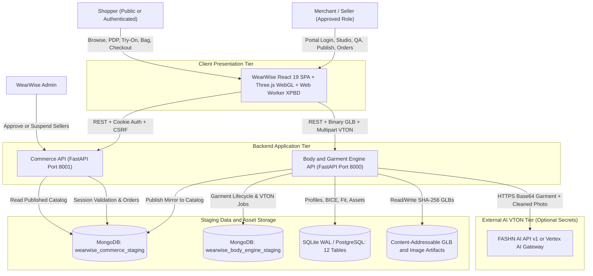

### 5.2 Four-Layer Unidirectional Backend Hierarchy

Inside `WEARWISE-BODY-ENGINE`, dependencies strictly point downward across four layers (`SYSTEM_ARCHITECTURE.md`): higher layers invoke lower abstractions via typed domain entities (`app/domain/entities`) and abstract Python `Protocol` interfaces (`AvatarEngine`, `ShapeEvaluationPort`, `LandmarkProvider`, `StorageProvider`), prohibiting domain modules (`app/bice`, `app/anthropometry`, `app/fit`) from importing PyTorch or NAVER Anny directly.

#### Diagram 2: Four-Layer Clean Dependency Architecture
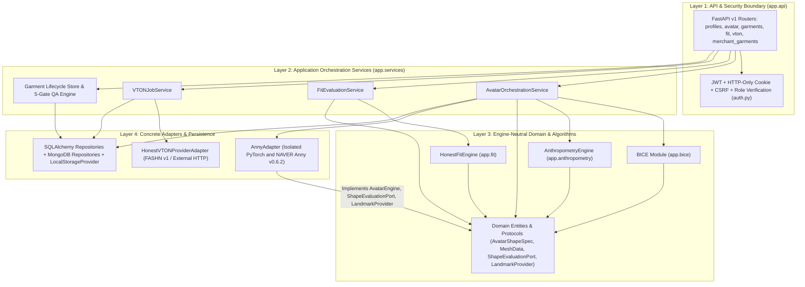

### 5.3 Phase 13 Portal Separation, Session Security & RBAC Flow

Phase 13 introduced end-to-end separation between Customer (`/login`, `/signup`, `ShopperRoute`) and Merchant (`/seller/login`, `/seller/register`, `SellerRoute`) workspaces enforced at both backend FastAPI dependencies (`backend/app/core/security.py` and `WEARWISE-BODY-ENGINE/app/api/auth.py`) and frontend portal wrappers (`AuthContext.tsx`, `SellerLayout.tsx`, `PortalAccessDenied.tsx`). Both services validate the same `HS256` JWT claims (`sub`, `role`, `principal_type`, `jti`, `iss`, `aud`, `exp`, `commerce_user_id`), verify HTTP-only cookie mutations via double-submit `X-CSRF-Token` headers matching `ww_csrf_token`, and check live revocation in `auth_sessions`.

#### Diagram 3: Portal Authentication, Cookie/CSRF & Cross-Service RBAC Flow
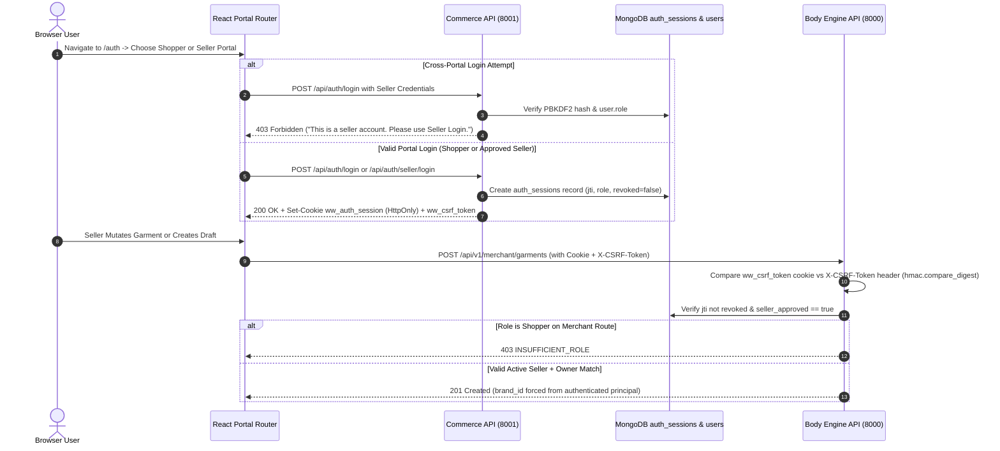

### 5.4 Body Calibration, Mesh Slicing & Avatar Pipeline Architecture

#### Diagram 4: Body Profile -> BICE -> Anny Closed-Loop Calibration -> Anthropometry Extraction Sequence
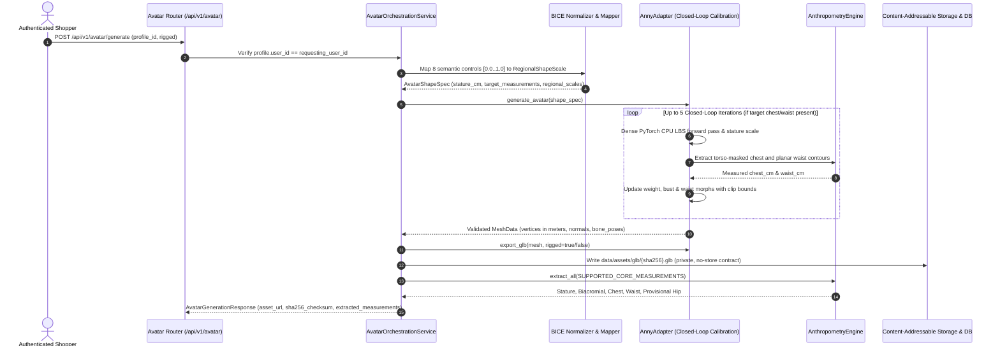

#### Diagram 5: Exact Triangle-Mesh-Plane Intersection & Degree-2 Graph Loop Stitching Flow
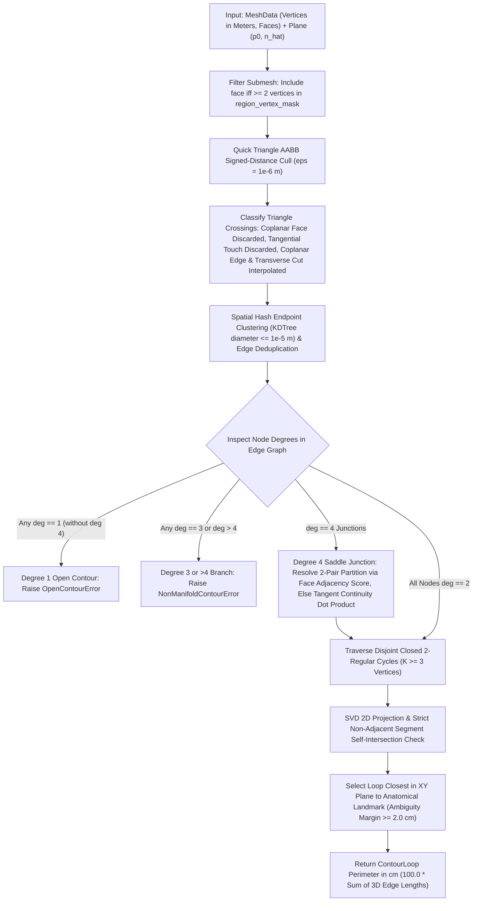

---

## 6. Detailed Subsystem & Module Implementation

### 6.1 Module 1 — Body Intelligence & Calibration Engine (`WEARWISE-BODY-ENGINE/app/bice/`)

BICE serves as the pure mathematical mediation boundary between shopper UI controls and concrete 3D body engines. Across `config.py`, `normalizer.py`, `validator.py`, `bounds.py`, `mapping.py`, `locality.py`, and `solver.py`, BICE maintains zero imports of `torch` or `anny`.

- **Bounded Semantic Control Space (`CONTROL_SAFE_RANGES`):** Eight normalized consumer controls (`default = 0.50`) restrict permissible ranges *inside* the `[0.0, 1.0]` UI domain to suppress non-local anatomical distortions discovered in Phase 0:
  - `shoulder_width`: `[0.10, 0.90]` → maps to region `"shoulders"` (`scale_x`, direction `+1.0`)
  - `chest_fullness`: `[0.10, 0.90]` → maps to `"torso_chest"` (`scale_y`, direction `+1.0`)
  - `belly_fullness`: `[0.10, 0.85]` → maps to `"waist_abdomen"` (`scale_y`, direction `+1.0`)
  - `waist_definition`: `[0.15, 0.85]` → maps to `"waist_abdomen"` (`scale_x`, direction `-1.0`)
  - `arm_fullness`: `[0.10, 0.90]` → maps to `"arms"` (`scale_x`, direction `+1.0`)
  - `hip_fullness`: `[0.15, 0.85]` → maps to `"hips"` (`scale_x`, direction `+1.0`)
  - `thigh_fullness`: `[0.20, 0.80]` → maps to `"thighs"` (`scale_x`, direction `+1.0`)
  - `calf_fullness`: `[0.15, 0.85]` → maps to `"calves"` (`scale_x`, direction `+1.0`)
- **Explicit Fail-Fast Bounds Policy:** `bounds.py` never silently clamps out-of-range `RegionalShapeScale` values. Instead, `validate_regional_bounds` checks each axis against `PROVISIONAL_REGIONAL_BOUNDS` (`thighs.scale_x ∈ [-0.50, 0.50]`, `waist_abdomen.scale_y ∈ [-0.50, 0.70]`, `shoulders.scale_x ∈ [-0.75, 0.75]`, others `[-1.0, 1.0]`) and raises `BICEBoundsExceededError` with explicit `violation_amount` diagnostics.
- **Cross-Measurement Consistency Rules (`validator.py`):** Accepts `stature ∈ [100.0, 230.0]` cm, `chest / waist / hip ∈ [30.0, 220.0]` cm, rejects `chest > stature * 1.5`, and rejects `waist > hip * 2.5`.
- **Anti-Exploit Locality Evaluator (`locality.py`):** Evaluates `ShapeEvaluationResult` over `ShapeEvaluationPort`. When target regional mean vertex displacement falls below $\epsilon_{\text{signal}} = 10^{-4}\text{ m}$ (`0.1 mm`), it rejects the step (`is_valid = False`) and assigns `MAXIMAL_LOCALITY_PENALTY = 10.0` rather than mistaking near-zero motion for `0.0` spillover.

### 6.2 Module 2 — NAVER Anny Avatar Engine & Closed-Loop Calibration (`app/avatar_engine/adapters/anny_adapter.py`)

`AnnyAdapter` satisfies three domain protocols (`AvatarEngine`, `ShapeEvaluationPort`, `LandmarkProvider`):

- **Lazy PyTorch Runtime Loader:** `_load_anny_runtime()` imports `torch` and `anny` lazily on demand rather than at FastAPI boot. If Windows Application Control blocks unsigned `torch_python.dll` (`[WinError 4551]`), `:8000` still serves `/api/v1/merchant/*`, `/api/v1/try-on/vton/*`, `/api/v1/fit/*`, and pre-built `.glb` assets with HTTP `200`, failing only live PyTorch generation cleanly.
- **CPU-Primary Dense LBS:** Uses `anny.Anny(local_changes="default", skinning_method="lbs")` on CPU rather than Warp GPU skinning (which triggers `warp.dll` blocks on Windows) or CUDA single-mesh runs (3.5x slower due to kernel launch overhead).
- **104-Bone Top-4 GLB Export (`export_glb(..., rigged=True)`):** Exports Y-up glTF 2.0 `.glb` containing `JOINTS_0` (`UNSIGNED_SHORT` VEC4) and `WEIGHTS_0` (`FLOAT` VEC4) retaining `99.532%` of total skinning weight across Anny's `104`-bone rig (sub-millimeter `0.000066 mm` median error vs native Python LBS at $0^\circ\text{--}90^\circ$ elevation).
- **Closed-Loop Calibration:** When `target_measurements` includes chest or waist girths, runs up to 5 forward-pass + `AnthropometryEngine` feedback iterations adjusting `weight`, `muscle`, `measure-bust-circ-incr`, `torso-scale-{horiz,depth}-incr`, and `measure-waist-circ-incr`.

### 6.3 Module 3 — Anthropometry Engine (`app/anthropometry/`)

Implemented in `engine.py`, `slice.py`, `geometry.py`, and `models.py` (`ALGORITHM_VERSION = "1.2.1-mesh-plane-graph"`):

- **Core Supported Dimensions:** `stature` (`bbox Z-extent * 100.0`), `shoulder_biacromial_breadth` (Euclidean distance `acromion_left` ↔ `acromion_right` with scaled sagittal bound $|Y| \le 0.05 \cdot (\text{stature}/156.83)\text{ m}$), `chest_circumference` (`sternum_lower` / fallback `0.72` height, eligible), `waist_planar_circumference` (`umbilicus` / fallback `0.6083` height, eligible), and `hip_circumference` (`sacrum_mid` / fallback `0.51` height, tagged `PROVISIONAL`).
- **Arm-Excluding Region Masks:** Submesh filtering includes a triangle iff $\ge 2$ of its $3$ vertices belong to the torso region mask, eliminating resting forearm capture (`+7.80 cm` waist inflation fixed down to `0.79 cm` delta vs native Anny geodesic waist).
- **Explicitly Unassessed Dimensions:** `torso_length`, `leg_thigh_circumference`, `inseam`, `sleeve_length`, and `neck_circumference` emit structured `UNASSESSED` records (`measurement = None`) rather than guessed approximations.

### 6.4 Module 4 — Honest Fit Engine (`app/fit/`)

Implemented in `rulebook.py`, `registry.py`, `models.py`, `engine.py`, and `port.py` (`RULEBOOK_VERSION = "1.2.1-provisional"`):

- **Measurement Transformation (`MeasurementCompatibilityRegistry`):** Transforms flat merchant dimensions via `DOUBLE_FLAT_WIDTH` ($2.0 \times w$), circumference girths via `IDENTITY`, shoulders via `SEAM_OFFSET`, and length via `COVERAGE_DELTA`, while explicitly tagging deferred dimensions (`garment_neck_circumference`, `garment_inseam_length`, `garment_sleeve_length`, `garment_front_rise`, `garment_leg_opening`, `garment_bicep_width`).
- **Orthogonal Discounting & Coverage Gating:** Provisional measurements (such as `hip_circumference`) receive $0.5\times$ reliability weight; `DISPUTED` or `REJECTED` records receive $0.0\times$. If effective coverage $C(s) < 0.70$, scoring aborts with `status = "insufficient_data"`.
- **Rigid Constriction Rejection:** When `not (stretch_direction != RIGID_ZERO and mechanical_stretch_pct >= 0.05)` and `ease < MINIMUM_WEARABLE_EASE[k]`, penalty hits `100.0` and status flips to `"rejected_unwearable"`.
- **Multi-Size Ranking Invariant (`HonestFitEvaluationPort`):** Ranks candidate sizes by `(status_priority, -composite_score)` and guarantees at most one primary `"recommended"` size, downgrading close runners-up to `"alternative"`.

### 6.5 Module 5 — Merchant Digital Garment Studio & Pattern-First 3D Builder (`app/services/garment_platform/`)

Replacing Phase 9/M2R-B scaling issues, M2R-C introduced pattern-first CAD synthesis (`pattern_garment_builder.py`, `pattern_engine.py`, `qa_engine.py`, `asset_manager.py`, `lifecycle_store.py`):

#### Diagram 6: Pattern-First M2R-C Digital Garment Creation & 5-Gate QA Lifecycle Pipeline
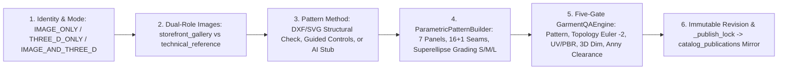

- **Seven Explicit Garment Panels:** `PANEL-FRONT-TORSO`, `PANEL-BACK-TORSO`, `PANEL-SLEEVE-L`, `PANEL-SLEEVE-R`, `PANEL-COLLAR-RIB`, `PANEL-HEM-BAND`, and overlaid `PANEL-POCKET-CHEST` (`3.5 mm` rim relief / `5.5 mm` interior relief).
- **6-Panel Structural Shell Welding:** During topology QA, `qa_engine.py` welds the 6 structural shell panels (excluding the surface patch pocket) into a connected shell verified to have **Euler characteristic $\chi = V - E + F = 3,002 - 8,860 + 5,856 = -2$** (topologically equivalent to a 4-boundary sphere with Neckline, Bottom Hem, Left Cuff, Right Cuff openings), zero degenerate faces (`< 1e-10`), zero non-manifold edges, zero self-intersections, embedded `2048x2048` PBR baseColor texture (`roughness = 0.62`, `metallic = 0.05`), and zero penetrating vertices against upright `anny_baseline_male.glb` (`>= 0.25 cm` torso/collar/hem/pocket clearance; `> 0.0 cm` strict sleeve clearance).
- **Concurrency-Safe Revision Store:** `lifecycle_store.py` tracks immutable revisions across 9 Body Engine Mongo collections + Commerce `catalog_publications`, guards publishing with `threading.Lock` (`_publish_lock`), marks downstream 3D assets stale if technical specs change post-generation, and allows `IMAGE_ONLY` preparation via `POST /prepare-image-tryon` without requiring 3D GLB assets.

### 6.6 Module 6 — Real-Time Browser Web Worker XPBD Cloth Simulation (`frontend/src/experimental_phase10/`)

#### Diagram 8: Browser Web Worker XPBD Cloth Simulation & Ping-Pong `ArrayBuffer` Protocol
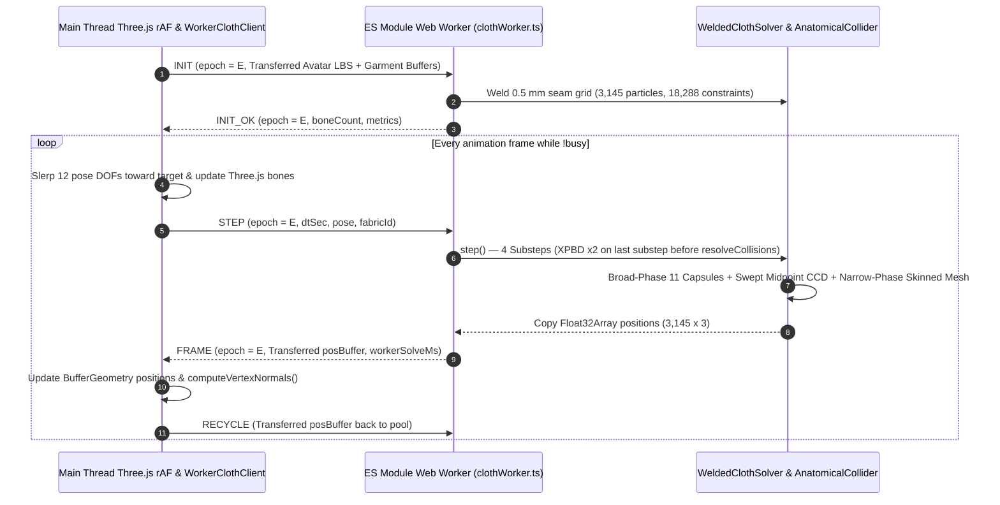

Key architectural mechanisms verified in `WorkerClothClient.ts`, `clothWorker.ts`, `WeldedClothSolver.ts`, `AnatomicalCollider.ts`, `ArticulatedPoseLibrary.ts`, and `FabricProfiles.ts`:
- **0.5 mm Topological Seam Welding:** Eliminates edge tearing completely (`seamSeparationMm = 0`) by hashing vertex coordinates on a $2000\text{ m}^{-1}$ integer grid (`Math.round(coord * 2000)`).
- **Epoch Fencing & Zero-Allocation Buffer Recycling:** Stale frames arriving after a `RESET` or size swap (`msg.epoch !== this.epoch`) are dropped and recycled immediately without GC stalls; automatic `main_thread_fallback` engages within `4000 ms` if Web Workers fail.
- **Dual Anisotropic Material Presets (`FabricProfiles.ts`):** Differentiates `waffle_knit_240` (`240 GSM`, `1.4 mm`, `stretchCompliance = 4.5e-6`, `bendCompliance = 5.5e-4`) vs `rigid_poplin_140` (`140 GSM`, `0.65 mm`, `stretchCompliance = 5.0e-7`, `bendCompliance = 4.5e-5`).

### 6.7 Module 7 — Dual-Mode Marketplace & VTON Integration (`products.py`, `vton_provider.py`, `person_image_service.py`, `vton_job_service.py`)

#### Diagram 7: Dual-Mode Marketplace Capability Gate (`tryOnCapabilities`)
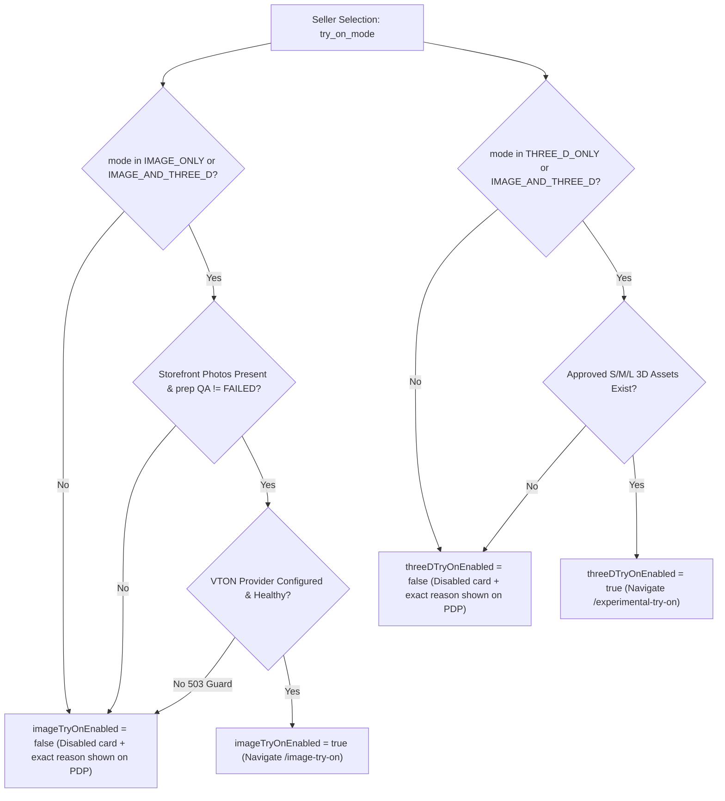

#### Diagram 10: Image-Based VTON Privacy, Consent, EXIF Stripping & Ephemeral Cleanup Flow
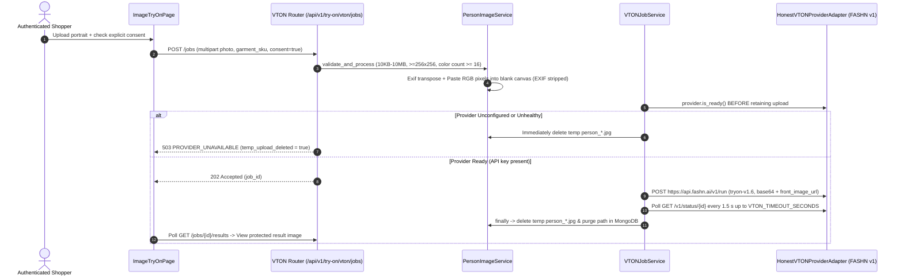

### 6.8 Module 8 — Separate Portals, Authentication & RBAC (`security.py`, `auth.py`, `seller.py`, React Portal Guards)

Phase 13 ensures complete separation of duties between **Shoppers** and **Sellers** across authentication, UI chrome, API permissions, and asset ownership:
- **Password & Token Security:** Salted `PBKDF2-HMAC-SHA256` (`120,000` iterations, `16`-byte random hex salt, plus `hmac.compare_digest` legacy SHA-256 fallback); shared `HS256` JWTs (`iss = "wearwise:auth"`, `aud = "wearwise:api"`, `240`-minute default Commerce TTL, unique `jti`).
- **Dual Portal UI Guards:** `/auth` splits Shopper and Seller onboarding; `/login` enforces `role === "shopper"` (`403` for sellers); `/seller/login` enforces `role === "seller" && seller_approved && status === "active"` (`403` for pending/suspended sellers or shoppers); `/seller/register` issues pending merchant applications (`status="pending"`, `is_active=false`). `<ShopperRoute>` renders `<PortalAccessDenied>` when signed in as seller; `<SellerRoute>` isolates `/seller/*` and `/merchant*` inside `<SellerLayout>`.
- **Cross-Service Revocation & Ownership:** Logout revokes `jti` inside Mongo `auth_sessions`; both `:8001` (`seller.py`, `wardrobe.py`, `saved.py`, `avatar.py`, `assistant.py`, `orders.py`) and `:8000` (`merchant_garments.py`) block cross-role access with HTTP `403`, enforce `brand_id` ownership from the JWT claims rather than client request payloads, and apply `X-CSRF-Token` validation to all state-changing cookie requests.

### 6.9 Module 9 — Shopper Discovery, PDP, Reviews, Bag & Demo Checkout (`catalogue.py`, `cart.py`, `orders.py`, `wardrobe.py`, `saved.py`, `assistant.py`)

#### Diagram 9: Shopper Discovery -> PDP -> Image/3D Try-On -> Canonical Bag (`ww-session-id`) -> Demo Checkout Sequence
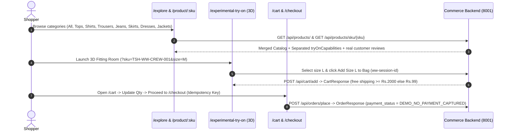

- **Catalog Merge & Honest Reviews:** `products.py` merges seeded curated items (`12` explore items rendered; static `PRODUCTS` base + published entries in `catalog_publications`), computes dynamic `rating_average` / `review_count` from `product_reviews` (displaying `"No customer reviews yet"` when zero reviews exist), rejects sellers from submitting product reviews (`403`), and contains **zero AI product recommendation injections**.
- **Remaining Support Routers:** `catalogue.py` (`/api/catalogue/{gender}` filtering men/women/boys/girls fixtures), `wardrobe.py` (user garment photo upload with category/MIME checks), `saved.py` (saved looks and deduplicated wishlist with `409` duplicate protection), and `assistant.py` (deterministic rule-based styling chat reply generator).

---

## 7. Core Algorithms, Mathematical Formulations & Pseudocode

### Algorithm A — BICE Normalization, Regional Scale Mapping & Locality Spillover Loss (`app/bice/`)

Given a semantic slider value $u_k \in [u_{k,\min}, u_{k,\max}] \subseteq [0.0, 1.0]$ centered at $u_0 = 0.50$, normalized offset $n_k \in [-1.0, +1.0]$ is piecewise-linear (`normalizer.py`):

$$n_k(u_k) = \begin{cases} 0.0, & u_k = 0.50 \\ \dfrac{u_k - 0.50}{u_{k,\max} - 0.50}, & u_k > 0.50 \\ \dfrac{u_k - 0.50}{0.50 - u_{k,\min}}, & u_k < 0.50 \end{cases}$$

Using mapping rule direction $d_k \in \{+1.0, -1.0\}$ and asymmetric regional axis bounds $[b_{\min}, b_{\max}]$ (`mapping.py`):

$$s_{\text{axis}}(n_k) = \begin{cases} n_k \cdot b_{\max}, & d_k > 0 \land n_k \ge 0 \\ n_k \cdot |b_{\min}|, & d_k > 0 \land n_k < 0 \\ -n_k \cdot |b_{\min}|, & d_k \le 0 \land n_k \ge 0 \\ -n_k \cdot b_{\max}, & d_k \le 0 \land n_k < 0 \end{cases}$$

For regional geometric locality (`AnnyShapeEvaluationPort` & `locality.py`), let $\bar{\Delta}_R$ denote the arithmetic mean vertex displacement magnitude (meters) in anatomical zone $R$ and $\Delta \mathbf{x}_v = \mathbf{x}_{v,\text{cand}} - \mathbf{x}_{v,\text{ref}}$:

$$\text{RMSR}_R = \frac{\bar{\Delta}_R}{\bar{\Delta}_{R_{\text{target}}}}, \qquad \text{PVSR}_R = \frac{\max_{v \in R} \|\Delta \mathbf{x}_v\|_2}{\max_{u \in R_{\text{target}}} \|\Delta \mathbf{x}_u\|_2}$$

$$\mathcal{L}_{\text{locality}} = \begin{cases} 10.0 \;(\text{reject}), & \bar{\Delta}_{R_{\text{target}}} < 10^{-4}\text{ m} \lor \neg \text{is\_plausible} \\ \max_{R \neq R_{\text{target}}} \text{RMSR}_R, & \text{otherwise} \end{cases}$$

---

### Algorithm B — Closed-Loop Anny Measurement Calibration (`AnnyAdapter.generate_avatar`)

When `target_measurements` provides chest circumference $C_{\text{target}}$ and/or waist circumference $W_{\text{target}}$, `AnnyAdapter` initializes phenotypic `weight` $w^{(0)} = \operatorname{clip}\!\left(0.5 + \frac{(C_{\text{target}} \lor 92.0) - 90.0}{55.0},\, 0.15,\, 1.0\right)$ and `muscle` $= \operatorname{clip}\!\left(0.45 + \frac{(C_{\text{target}} \lor 92.0) - 90.0}{80.0},\, 0.25,\, 0.85\right)$, then executes up to $T = 5$ proportional feedback iterations:

```text
ALGORITHM: ClosedLoopAnnyCalibration(t_chest, t_waist, stature_cm)
FOR t = 1 TO 5:
    local["measure-bust-circ-incr"]  <- clip(bust_cur, -1.0, 1.0)
    local["torso-scale-horiz-incr"]  <- clip(0.35 * bust_cur, -0.5, 0.5)
    local["torso-scale-depth-incr"]  <- clip(0.35 * bust_cur, -0.5, 0.5)
    local["measure-waist-circ-incr"] <- clip(waist_cur, -1.0, 1.0)
    verts_m <- AnnyForwardLBS(phenotype, local) * (stature_cm / 100.0) / delta_Z
    m_chest, m_waist <- AnthropometryEngine.extract_all(verts_m, ["chest_circumference", "waist_planar_circumference"])
    err_c <- t_chest - m_chest;   tol_c <- max(1.2, 0.015 * t_chest)
    err_w <- t_waist - m_waist;   tol_w <- max(1.2, 0.015 * t_waist)
    IF |err_c| <= tol_c AND |err_w| <= tol_w:
        BREAK (converged = true)
    bust_cur  <- clip(bust_cur  + 0.045 * err_c, -1.0, 1.0)
    w_cur     <- clip(w_cur     + 0.012 * err_c,  0.05, 1.0)
    waist_cur <- clip(waist_cur + 0.065 * err_w, -1.0, 1.0)
```

---

### Algorithm C — Exact Triangle-Mesh-Plane Intersection & Loop Stitching (`app/anthropometry/`)

For a cutting plane $(\mathbf{p}_0, \hat{\mathbf{n}})$, signed distance of vertex $\mathbf{v}_i$ is $d_i = (\mathbf{v}_i - \mathbf{p}_0) \cdot \hat{\mathbf{n}}$ snapped to `0.0` when $|d_i| \le \epsilon_{\text{plane}} = 10^{-6}\text{ m}$. Along any mixed-sign triangle edge $(\mathbf{v}_a, \mathbf{v}_b)$, exact linear interpolation places the crossing at:

$$\mathbf{p}_{ab} = \mathbf{v}_a + \frac{d_a}{d_a - d_b} (\mathbf{v}_b - \mathbf{v}_a)$$

Endpoints are clustered via lexicographic sweep + `KDTree` radius query ($r = \epsilon_{\text{snap}} = 10^{-5}\text{ m}$) enforcing bounded cluster **diameter** $\le 10^{-5}\text{ m}$ (blocking transitive chaining). After dropping `u == v` degeneracies and deduplicating `(min(u,v), max(u,v))`:
- Degree-1 nodes trigger `OpenContourError`; degree-3 or $>4$ trigger `NonManifoldContourError`.
- Degree-4 saddle junctions pair incident edges $(a,b),(c,d)$ first by topological adjacency score (`+2` shared mesh `face_adjacency`, `+2` shared cut edge, `+1` shared face), or secondarily via outward unit tangents $\hat{\mathbf{t}}_w$ minimizing $\max(|\hat{\mathbf{t}}_a \cdot \hat{\mathbf{t}}_b + 1|, |\hat{\mathbf{t}}_c \cdot \hat{\mathbf{t}}_d + 1|)$ subject to dot products $\le -0.75$ and margin $\ge 0.25$.
- Closed cycles ($K \ge 3$) undergo SVD planar projection (`2D` CCW non-adjacent segment check, $\epsilon = 10^{-12}$) and yield exact circumference:

$$P_{\text{cm}} = 100.0 \times \sum_{i=0}^{K-1} \left\|\mathbf{p}_{(i+1) \bmod K} - \mathbf{p}_i\right\|_2$$

---

### Algorithm D — Pattern-First Superellipse Torso & Conical Collar Geometry (`pattern_garment_builder.py`)

Each chest and hem horizontal cross-section uses a superellipse parameterized by exponent $p$ ($p = 2.6$ chest; $p = 2.8$ if hem $<51.0\text{ cm}$ else $2.6$), center $z_c$, and semi-axes $(a, b)$ with $b = \text{aspect} \cdot a$:

$$x(\theta) = a \cdot \operatorname{sgn}(\cos\theta)\,|\cos\theta|^{2/p}, \qquad z(\theta) = z_c + b \cdot \operatorname{sgn}(\sin\theta)\,|\sin\theta|^{2/p}$$

`_solve_superellipse_axes` solves $(a, b)$ over $N = 1200$ angular samples on $[0, \pi]$ so integrated arc length matches flat half-width $W_{\text{half}}$ numerically. Along `SEAM-COLLAR-JOIN`, `GarmentQAEngine` validates the geometric discrepancy between the frustum collar's 2D flattened outer seam ($l_{\text{2D}}$), 3D slant meridian ($l_{\text{3D}} = \sqrt{h^2 + \Delta r^2}$), and cutting perimeter ($\le 0.25\text{ cm}$ error while preserving $\ge 0.30\text{ cm}$ 2D–3D conical curvature difference).

---

### Algorithm E — Honest Fit Ease, Quadratic Loss & Normalized Composite Score (`app/fit/engine.py`)

For each dimension $k \in \mathcal{K}_{\text{eval}}$ mapped into body space ($G_k$ in cm, active body value $B_k$ in cm):

$$\text{Ease}_{s,k} = G_{s,k} - B_k$$

Given the shopper's target preference half-open interval $[L_k, H_k)$ from `PROVISIONAL_EASE_INTERVALS`:

$$\text{dev}_k = \begin{cases} L_k - \text{Ease}_{s,k}, & \text{Ease}_{s,k} < L_k \\ \text{Ease}_{s,k} - H_k, & \text{Ease}_{s,k} \ge H_k \\ 0.0, & \text{otherwise} \end{cases}$$

$$\text{Penalty}_k = \begin{cases} 100.0, & \text{rigid} \land \text{Ease}_{s,k} < E_{\min,k} \\ \min\!\left(100.0,\; \beta_k \cdot \text{dev}_k^2\right), & \text{otherwise} \end{cases}$$

where $\beta_{\text{shoulder}} = 12.0\text{ cm}^{-2}$ and $\beta_k = 2.0\text{ cm}^{-2}$ for all other dimensions. With orthogonal effective weight $w_k' = w_k$ (`ELIGIBLE`), $0.5 w_k$ (`PROVISIONAL`), or $0.0$ (`DISPUTED`/`REJECTED`):

$$C(s) = \frac{\sum_{k \in \mathcal{K}_{\text{eval}}} w_k'}{\sum_{j \in \mathcal{K}_{\text{required}}} w_j}, \qquad S(s) = \max\!\left(0.0,\; \min\!\left(100.0,\; 100.0 - \sum_{k \in \mathcal{K}_{\text{eval}}} \frac{w_k'}{\sum_{j \in \mathcal{K}_{\text{eval}}} w_j'} \cdot \text{Penalty}_k\right)\right)$$

Coverage gating aborts with `status = "insufficient_data"` whenever $C(s) < 0.70$. Otherwise sizes passing without rigid constriction classify as `"recommended"` ($\text{dev}_k = 0 \;\forall k$ and $S(s) \ge 85.0$), `"alternative"` ($S(s) \ge 60.0$), or `"poor_fit"` ($S(s) < 60.0$).

---

### Algorithm F — Web Worker XPBD Cloth Constraint Projection & Swapped Collision Pipeline (`WeldedClothSolver.ts` & `AnatomicalCollider.ts`)

Over `substeps = 4` per frame ($\Delta t_{\text{sub}} = \min(\Delta t, 1/30)/4$, inverse squared time step $\text{invDt2} = 1/\Delta t_{\text{sub}}^2$):

1. **Compliance Scaling:** $\tilde{\alpha}_{\text{warp}} = \frac{\alpha_{\text{stretch}}}{r_{\text{warp}}} \cdot \text{invDt2}$, $\tilde{\alpha}_{\text{weft}} = \frac{\alpha_{\text{stretch}}}{r_{\text{weft}}} \cdot \text{invDt2}$, $\tilde{\alpha}_{\text{shear}} = \alpha_{\text{shear}} \cdot \text{invDt2}$, $\tilde{\alpha}_{\text{bend}} = \alpha_{\text{bend}} \cdot \text{invDt2}$.
2. **Damped Verlet Prediction & Rest Guidance:** $\mathbf{v}_i = \gamma_{\text{damp}}(\mathbf{x}_i - \mathbf{x}_i^{\text{prev}})$, $\mathbf{x}_i \leftarrow \mathbf{x}_i + \mathbf{v}_i + [0,\, -1.65 g_{\text{scale}} \Delta t_{\text{sub}}^2,\, 0]^T$, blended softly toward skinned spine/arm delta transforms.
3. **XPBD Distance Constraint Projection (`solveConstraintsPass`):** For edge/bend pair $(a, b)$ with rest length $L_0$, $\mathbf{d} = \mathbf{x}_a - \mathbf{x}_b$, $l = \|\mathbf{d}\|_2$, inverse masses $w_a, w_b$, constraint $C = l - L_0$:

$$\Delta \lambda = \frac{-C - \tilde{\alpha}\,\lambda_c}{w_a + w_b + \tilde{\alpha}}, \qquad \lambda_c \leftarrow \lambda_c + \Delta \lambda, \qquad \mathbf{x}_a \leftarrow \mathbf{x}_a + w_a \frac{\Delta \lambda}{l}\,\mathbf{d}, \qquad \mathbf{x}_b \leftarrow \mathbf{x}_b - w_b \frac{\Delta \lambda}{l}\,\mathbf{d}$$

4. **Phase 11.5 Swapped Pass Ordering & Narrow-Phase Collision:** On final substep `s = 3`, a **2nd XPBD pass** runs *before* the final `resolveCollisions(..., pushFactor=0.96)`. `AnatomicalCollider.ts` evaluates:
   - **Broad-phase `11` bone-driven capsules** + **Swept Midpoint CCD** when $\|\mathbf{x}_i - \mathbf{x}_i^{\text{prev}}\|^2 > (0.0025\text{ m})^2$.
   - **Narrow-phase spatial hash (`5.5 cm` cells, `4096` buckets)** computing exact Voronoi closest triangle point $\mathbf{q}^*$ (`dist <= 2.5 cm`), signed distance $s_d = (\mathbf{x}_i - \mathbf{q}^*) \cdot \hat{\mathbf{n}}_{\text{tri}}$, and outward push $\Delta \mathbf{x}_i = \text{pushFactor} \cdot (\tau - s_d)\,\hat{\mathbf{n}}_{\text{tri}}$ whenever $-0.012\text{ m} < s_d < \tau$ ($\tau = \max(0.003, (\text{thickness}_{\text{mm}} + 2.2)/1000)$).

---

## 8. Complete Data Architecture & Schema Reference

WearWise operates a deliberate **dual persistence architecture** documented in `DBS-001` (`app/db/models.py`) alongside the Phase 5–13 MongoDB collections (`mongo.py`, `database.py`):

1. **Relational Core (`WEARWISE-BODY-ENGINE/data/wearwise_staging.db` — SQLite WAL locally, PostgreSQL 16+ target):** Holds **12 strictly normalized tables** (`body_profiles`, `profile_revisions`, `body_measurements`, `body_shape_controls`, `avatar_configurations`, `avatar_assets`, `garment_profiles`, `garment_revisions`, `garment_sizes`, `garment_measurements`, `fit_recommendations`, `asset_deletion_outbox`). Binary GLBs live in content-addressable filesystem storage (`data/assets/glb/{sha256}.glb`).
2. **Staging MongoDB (`wearwise_body_engine_staging` & `wearwise_commerce_staging`):** Persists merchant studio lifecycles (`digital_garments`, `garment_revisions`, `garment_generation_jobs`, `garment_assets`, `garment_qa_reports`, `garment_package_manifests`, `garment_approval_events`, `garment_publications`, `garment_audit_events`), AI VTON state (`vton_jobs`, `vton_results`), and Commerce data (`users`, `auth_sessions`, `catalog_publications`, `product_reviews`, `carts`, `orders`, `wardrobe_items`, `saved_looks`, `wishlist`, `avatar_profiles`, `tryon_sessions`, plus JSON fallback under `backend/data/`).

#### Diagram 11: Relational Database Entity Relationship Diagram (`WEARWISE-BODY-ENGINE` 12 SQL Tables)
```mermaid
erDiagram
    BODY_PROFILES ||--o{ PROFILE_REVISIONS : "maintains revisions"
    PROFILE_REVISIONS ||--o{ BODY_MEASUREMENTS : "records dimensions"
    PROFILE_REVISIONS ||--o{ BODY_SHAPE_CONTROLS : "records 8 sliders"
    PROFILE_REVISIONS ||--o{ AVATAR_CONFIGURATIONS : "generates config"
    AVATAR_CONFIGURATIONS ||--o{ AVATAR_ASSETS : "produces GLB meta"
    GARMENT_PROFILES ||--o{ GARMENT_REVISIONS : "versions SKU"
    GARMENT_REVISIONS ||--o{ GARMENT_SIZES : "defines S/M/L"
    GARMENT_SIZES ||--o{ GARMENT_MEASUREMENTS : "stores dimensions"
    PROFILE_REVISIONS ||--o{ FIT_RECOMMENDATIONS : "evaluates body"
    GARMENT_REVISIONS ||--o{ FIT_RECOMMENDATIONS : "evaluates garment"
    AVATAR_ASSETS ..o{ ASSET_DELETION_OUTBOX : "unconstrained async cleanup"
```

#### Diagram 12: Atomic Content-Addressable Blob Deletion Synchronization Sequence (`DBS-001`)
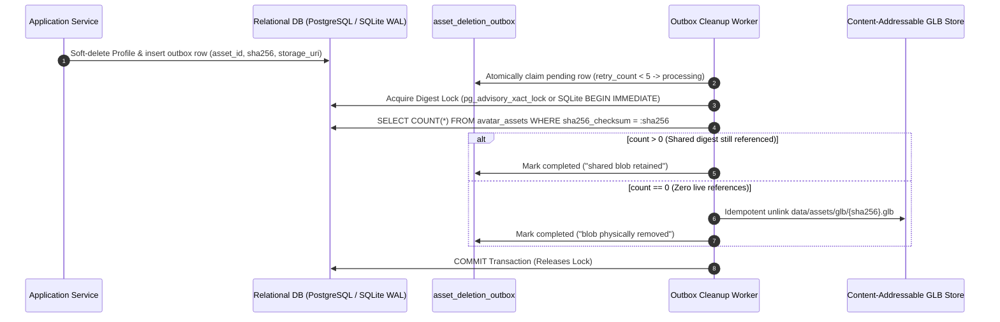

### 8.1 MongoDB Collections Inventory

| Database | Collection Name | Role & Key Document Fields |
| :--- | :--- | :--- |
| `wearwise_commerce_staging` | `users` | Account identity, PBKDF2 hash, `role` (`shopper`/`seller`/`admin`), `status`, `seller_approved`, `brand_id`, `store_name` |
| `wearwise_commerce_staging` | `auth_sessions` | Active & revoked JWT session registry (`jti`, `user_id`, `role`, `revoked`, `expires_at`) enforced by both `:8001` and `:8000` |
| `wearwise_commerce_staging` | `catalog_publications` | Published merchant listings mirrored with `sku`, `published_revision`, `try_on_mode`, `size_variants`, `storefront_images`, `qa_summary` |
| `wearwise_commerce_staging` | `product_reviews` | Customer ratings (`1..5`), written comments, `size_purchased`, `fit_feedback`, timestamp |
| `wearwise_commerce_staging` | `carts` | Persistent canonical `ww-session-id` bag items (`id`, `sku`, `size`, `color`, `quantity`, `price`) |
| `wearwise_commerce_staging` | `orders` | Checkout order records (`id`, `customer`, `items`, `paymentMethod`, `is_demo_checkout: true`, `payment_status: "DEMO_NO_PAYMENT_CAPTURED"`) |
| `wearwise_body_engine_staging` | `digital_garments` .. `garment_publications` (9 collections) | Drafts, immutable revisions, CAD/guided metadata, generation jobs, GLB asset checksums, 5-gate QA reports, manifests, approval/audit logs, publication snapshots |
| `wearwise_body_engine_staging` | `vton_jobs`, `vton_results` | Ephemeral VTON job tracking (`status`, `temp_upload_deleted`, `person_image_path` purged in `finally`) and result view paths |

---

## 9. Full API Contract Catalogue

All 4xx/5xx Body Engine errors conform to the structured JSON error envelope `{ "error": { "code", "message", "status_code", "timestamp", "details" } }`. Commerce endpoints return FastAPI standard `{ "detail": ... }` responses.

### 9.1 Commerce Backend Endpoints (`backend/` — Port `8001`)

| Domain | Method & Route | Auth / Role Guard | Core Behavior & Key Status Codes |
| :--- | :--- | :--- | :--- |
| **Auth** | `POST /api/auth/signup`, `POST /api/auth/register` | Public | Creates `shopper` account (PBKDF2-SHA256), issues `ww_auth_session` + `ww_csrf_token` + Bearer JWT (`400`, `409`). |
| **Auth** | `POST /api/auth/login` | Public (Shopper only) | Authenticates shopper (`401` invalid credentials; `403` if seller or inactive). |
| **Auth** | `POST /api/auth/seller/login` | Public (Approved Seller only) | Authenticates seller (`403` if shopper, pending/unapproved, or suspended). |
| **Auth** | `POST /api/auth/seller/apply` | Public | Submits pending seller registration (`status="pending"`, `is_active=false`, `seller_approved=false`). |
| **Auth** | `POST /api/auth/admin/login`, `GET/POST/PATCH /api/auth/admin/sellers*` | Public login / `require_admin` | Admin onboarding & seller approval/suspension management (`active`/`pending`/`suspended`). |
| **Auth** | `POST /api/auth/logout`, `GET /api/auth/me`, `PATCH /api/auth/profile` | Public revoke / `require_authenticated_user` / `require_shopper` | Marks `jti` revoked in `auth_sessions` & clears cookies; profile update enforces shopper role. |
| **Seller** | `GET /api/seller/dashboard`, `GET/POST/PATCH /api/seller/products*` | `require_active_seller` | Brand-scoped KPIs, product CRUD (`403` cross-brand denial, `409` duplicate SKU). |
| **Seller** | `GET /api/seller/orders`, `PATCH /api/seller/orders/{order_id}/status`, `GET/PATCH /api/seller/profile` | `require_active_seller` | Store-scoped order listing and status updates (`Confirmed`/`Packed`/`Shipped`/`Delivered`/`Cancelled`). |
| **Products** | `GET /api/products/`, `GET /api/products/sku/{sku}`, `GET /api/products/{product_id}` | Public | Returns merged catalog + real-time separated `tryOnCapabilities` + real review summaries. |
| **Reviews** | `GET /api/products/sku/{sku}/reviews`, `POST /api/products/sku/{sku}/reviews` | Public read / Authenticated Shopper write (`403` seller) | Real persisted customer reviews (`201`; `400` if comment `< 3` chars; `"No customer reviews yet"` UI when empty). |
| **Assets** | `GET /api/products/sku/{sku}/revisions/{rev}/assets/{size}`, `.../images/{filename}` | Public (Storefront only) | Streams verified GLB (`500` on SHA-256 mismatch) & storefront photos (`403` on non-storefront technical refs). |
| **Catalogue** | `GET /api/catalogue/{gender}` | Public | Static category/occasion/age-group catalogue filtering (`men`, `women`, `boys`, `girls`; `400` otherwise). |
| **Bag** | `GET /api/cart/{session_id}`, `POST /api/cart/add`, `PUT /api/cart/update`, `DELETE /api/cart/{session_id}*` | Canonical `ww-session-id` | Persistent shopping bag; free shipping at `>= ₹2,000`, otherwise `₹99`. |
| **Orders** | `POST /api/orders/place`, `GET /api/orders/my`, `GET /api/orders/{session_id}`, `GET /api/orders/detail/{order_id}` | Shopper / Session isolated (`403` seller) | Demo checkout (`DEMO_NO_PAYMENT_CAPTURED`) with `idempotency_key` dedup; `orders/my` requires `shopper`. |
| **Portal Tools** | `/api/wardrobe/*`, `/api/saved/*`, `/api/avatar/*`, `/api/tryon/*`, `/api/assistant/chat` | `reject_seller_portal_access` (on personal shopper endpoints) | Personal wardrobe uploads, wishlist/looks, onboarding questionnaire avatar prefs, legacy try-on, rule-based chat. |

### 9.2 Body & Garment Engine Endpoints (`WEARWISE-BODY-ENGINE/` — Port `8000`, Base `/api/v1`)

| Domain | Method & Route | Auth / Role Guard | Core Behavior & Key Status Codes |
| :--- | :--- | :--- | :--- |
| **Profiles & Controls** | `GET/POST /profiles`, `GET/PATCH /profiles/{id}`, `GET /profiles/{id}/revisions`, `GET/POST /profiles/{id}/measurements*`, `GET /controls/definitions`, `PUT /profiles/{id}/controls` | `get_current_user_id` (`user`/`shopper`/`customer`) | Versioned profiles with ownership check, optimistic revision locking (`expected_revision` -> `409`), canonical stature auto-creation (`stature_cm ∈ [100, 230]`), and `CONTROL_SAFE_RANGES`. |
| **Avatar** | `POST /avatar/generate`, `GET /avatar/{id}/status`, `GET /avatar/assets/{id}.glb` | `get_current_user_id` + profile owner | Synchronous avatar synthesis + extraction + private streaming (`Cache-Control: private, no-store`, `ETag` / `304`). *(Requires PyTorch/Anny runtime.)* |
| **Core Garments** | `GET/POST /garments`, `POST /garments/{id}/sizes`, `GET /garments/{id}*` | Public read / `get_current_brand_id` | Relational garment sizing chart ingestion (`brand_id` from JWT principal). |
| **Honest Fit** | `GET /fit/recommendations`, `POST /fit/recommend`, `GET /fit/recommendations/{id}` | `get_current_user_id` + profile owner | Deterministic ease classification, effective reliability weighting, `C(s) >= 0.70` coverage check, and single-recommendation enforcement. |
| **VTON** | `GET /try-on/vton/providers`, `POST /try-on/vton/jobs`, `GET/DELETE /try-on/vton/jobs/{id}*`, `GET /try-on/vton/images/{filename}` | Optional/Authenticated Shopper ownership + block `person_*` (`403`) | Provider availability check, photo consent/validation/EXIF strip (`422`), fail-closed `503` + immediate photo deletion, `202` async job, `delete_photo` in `finally`. |
| **Merchant Studio** | `GET /merchant/garments/presets/fabrics`, `GET /prototype-preview/{sku}*`, `GET /merchant/garments/{id}/shopper-asset` | Public storefront / preview | 8 fabric presets, Rev3 M2R-C pattern-first preview (`TSH-WW-CREW-001`), published shopper asset resolver (`403` if unpublished, `409` on revision mismatch). |
| **Merchant Studio (Protected)** | `GET/POST /merchant/garments*`, `/images*`, `/pattern/{upload,guided,export,ai-reconstruct}`, `/measurements`, `/fabric`, `/try-on-mode`, `/prepare-image-tryon`, `/generate`, `/qa-report`, `/approve`, `/publish`, `/rollback`, `/manifest` | `get_current_brand_id` (`brand`/`merchant`/`seller`) + `brand_id` owner match + CSRF on cookies | Full multi-stage studio workflow (`401` anonymous, `403` cross-role/cross-brand/missing CSRF, `409` duplicate SKU). |

---

## 10. Complete Technology & Dependency Inventory

### 10.1 Frontend (`frontend/package.json` — Verified Manifest)

| Package | Version Spec | Layer / Purpose |
| :--- | :--- | :--- |
| `react`, `react-dom` | `^19.2.8` | Component rendering & concurrent hooks UI |
| `react-router-dom` | `^7.18.2` | Multi-portal declarative routing & route guards |
| `three`, `@react-three/fiber`, `@react-three/drei` | `^0.187.0`, `^9.8.2`, `^10.7.9` | WebGL 3D mannequin + graded garment rendering & camera controls |
| `lucide-react` | `^1.78.0` | Crisp UI iconography across Shopper & Seller portals |
| `vite`, `typescript`, `vitest`, `jsdom` | `^8.2.2`, `^7.0.2`, `^5.1.1`, `^31.0.1` | Fast bundler/proxy, TypeScript strict checking (`tsc --noEmit`), and unit/UI testing |
| `@testing-library/react`, `eslint`, `puppeteer` | `^16.3.3`, `^10.9.0`, `^25.18.1` | Component behavioral testing, linting, and browser benchmark compatibility |

### 10.2 Backend Services (`requirements.txt` & Verified `.venv-anny` Runtime Audit)

| Component | Manifest Spec (`requirements.txt`) | Audited Runtime Version / License (`.venv-anny`) | Purpose & Observed Engineering Note |
| :--- | :--- | :--- | :--- |
| `fastapi`, `uvicorn[standard]` | `0.115.12` / `>=0.115.0`, `0.34.3` | Active in `.venv-anny` (MIT) | Async/sync REST services on `:8000` & `:8001` |
| `pymongo`, `dnspython` | `>=4.9.0`, `>=2.6.0` | Active (Apache-2.0 / ISC) | MongoDB Atlas staging & catalog/lifecycle/VTON persistence |
| `sqlalchemy`, `alembic`, `pydantic` | `>=2.0.0`, `>=1.14.0`, `>=2.10.0` | Active (MIT) | 12-table SQLite WAL / PostgreSQL ORM & v2 contract validation |
| `anny`, `torch`, `numpy`, `scipy` | `torch>=2.2.0`, `numpy>=1.26.0`, `scipy>=1.14.0` | `anny 0.6.2` (Apache-2.0), `torch 2.14.1+cu130` (BSD-3), `numpy 2.5.5`, `scipy 1.18.1` | Parametric body forward LBS (`torch` currently OS-blocked `[WinError 4551]` on local Windows host; lazily loaded) |
| `trimesh`, `pygltflib`, `roma`, `Pillow`, `ezdxf` | `trimesh>=4.5.0`, `pygltflib>=1.16.0`, `Pillow>=10.0.0` | `trimesh 5.2.2` (MIT), `pygltflib 1.16.5` (MIT), `roma 1.8.0` (Apache-2.0), `pillow 13.0.0` (HPND) | 3D slicing, glTF 2.0 export, 5-gate mesh topology QA, EXIF pixel sanitization, DXF validation |
| **Auth Crypto Stack Discrepancy (Observed!)** | `backend/requirements.txt` lists `python-jose==3.4.0`, `passlib==1.7.4`, `bcrypt==4.2.1` | Runtime `.venv-anny` uses **`PyJWT`** (`import jwt`) + Python stdlib **`hashlib.pbkdf2_hmac`** | **`passlib` and `bcrypt` are NOT installed inside `.venv-anny`**; active security (`security.py` & `auth.py`) deliberately uses stdlib `pbkdf2_hmac` + `PyJWT` (`HS256`) for Python 3.12 compatibility! |

---

## 11. Security, Privacy, Content Provenance & Ethics Engineering

### 11.1 Authentication, Cookies, CSRF & Cross-Merchant Tenant Isolation
- **Salted PBKDF2 Hashing (`security.py`):** New passwords hash with 120,000 iterations of `PBKDF2-HMAC-SHA256` and a 16-byte cryptographic hex salt (`pbkdf2_sha256$<salt>$<hex>`), verified via constant-time `hmac.compare_digest`.
- **Dual Transport (`HttpOnly` Cookie + Bearer Compatibility):** Commerce login issues `ww_auth_session` (`HttpOnly`, `SameSite=Lax`, `Secure` in production) plus readable `ww_csrf_token`, requiring an exact matching `X-CSRF-Token` header on all state-mutating (`POST`/`PUT`/`PATCH`/`DELETE`) cookie requests across both `:8001` and `:8000`.
- **Distributed Logout Revocation:** Signing out writes `revoked = True` to MongoDB `auth_sessions` keyed by JWT `jti`, immediately invalidating cached cookies across both services (`401 SESSION_REVOKED`).
- **Fail-Closed Ownership & Role Segregation:** Client requests cannot supply `user_id` or `brand_id`; endpoints derive identity exclusively from verified JWT claims, rejecting shoppers on merchant routes (`403`), rejecting sellers on shopper review/wardrobe/cart-order routes (`403`), and verifying `brand_id` ownership on every garment operation (`403`).

### 11.2 Private 3D Assets & Ephemeral Photo Hygiene (`SECURITY_AND_PRIVACY.md`)
- **Personalized Avatar Confidentiality:** `/api/v1/avatar/assets/{id}.glb` authenticates ownership *before* evaluating `If-None-Match` ETag headers and always sends `Cache-Control: private, no-store` so shared proxies/CDNs never cache shopper geometry.
- **VTON Image Sanitization (`person_image_service.py`):** Requires `user_consent == True`, `10 KB <= size <= 10 MB`, `JPEG`/`PNG`/`WEBP`, `>= 256x256` resolution, rejects flat graphics/avatars with `< 16` distinct colors, re-orients EXIF rotation, copies raw RGB pixel values into a fresh blank image buffer (completely stripping EXIF/GPS/camera metadata), checks `provider.is_ready()` before retaining bytes, and unlinks the temporary upload inside a `finally` block regardless of completion or `503` failure. `/api/v1/try-on/vton/images/{filename}` blocks all `person_*` filenames (`403`).

### 11.3 Ethics & Provenance Boundaries (`BICE-001`, `DBS-001`, `C2PA`)
- **Ban on Ethnicity Morphs & Model-Derived BMI:** Subjective ethnicity sliders are barred from `BICE`; Anny's buoyancy volume/density mass estimates (`~980 kg/m^3`) are barred from apparel ease calculations or clinical claims.
- **Truthful Labeling & C2PA Alignment:** Synthesized virtual try-on views remain explicitly framed as visual previews (supported natively by Google Vertex AI C2PA assertions in cloud production), and structural measurements clearly distinguish `user_reported`, `tape_measured`, `geometry_extracted`, and `provisional` reliability weights.

---

## 12. Testing, Benchmarking & Experimental Validation Results

### 12.1 Avatar Engine Hardware Benchmarks (`HARDWARE_BENCHMARKS.md`, 2026-11-23)

Target Hardware: AMD Ryzen 7 6800H (`8C/16T`), `15.19` GB RAM, NVIDIA RTX 3050 Laptop GPU (`4096` MiB VRAM), NAVER Anny v0.6.2 (`13,718` vertices, `27,420` faces).

| Benchmark Metric | CPU (`Ryzen 7 6800H`) | CUDA (`RTX 3050 4 GB`) | Observed Finding |
| :--- | :--- | :--- | :--- |
| **Model Init Time** | **`28.9 ms`** | `748.0 ms` | CPU initializes `25.9x` faster (`0` CUDA runtime overhead). |
| **Init Memory Delta** | **`+334.0 MB` RAM** | `+411.1 MB` RAM / `113.4 MB` VRAM | Peak VRAM consumes just `2.7%` of `4 GB` ceiling. |
| **Cold First Inference** | **`26.42 ms`** | `471.55 ms` | CUDA incurs kernel staging latency. |
| **50 Warm Inferences (Mean / p50 / p95)** | **`20.82` / `20.42` / `24.07 ms`** | `74.45` / `73.97` / `77.06 ms` | **CPU runs `3.58x` faster than GPU** for single-mesh inference. |
| **GLB Export & Size** | `4.14 ms` (`482.8 KB`) | `3.15 ms` (`482.8 KB`) | Sub-`0.5 MB` delivery over HTTP/REST. |
| **100-Run Stability** | `2.27 s`, `0` crashes (`+0.08 MB`) | `7.43 s`, `0` crashes (`+0.06 MB`) | Zero memory leaks or NaN/Inf vertices. |

### 12.2 WebGL Rigged GLB Top-4 Skinning Weight Audit (`artifacts/skinning_audit_metrics.json`)

Anny native weights span `1..9` bones per vertex (`mean = 2.4843`), where standard WebGL GLTF `JOINTS_0` / `WEIGHTS_0` keeps top-4 influences (**`99.532%` mass captured**). Across $0^\circ\text{--}90^\circ$ arm articulation:

| Articulation Angle | Mean Error (mm) | Median $p_{50}$ Error (mm) | $p_{95}$ Error (mm) | $p_{99}$ Error (mm) | Max Error (mm) |
| :--- | :--- | :--- | :--- | :--- | :--- |
| **$0^\circ$** | `0.017529` | `0.000066` | `0.086481` | `0.4029` | `1.8451` |
| **$30^\circ$** | `0.030646` | `0.000066` | `0.098476` | `0.7483` | `6.6163` |
| **$45^\circ$** | `0.038111` | `0.000067` | `0.101378` | `0.9311` | `9.7122` |
| **$90^\circ$** | `0.057918` | `0.000066` | `0.105114` | `1.2725` | `18.0679` |

### 12.3 Browser XPBD Substep Timing & Penetration Reduction (`xpbd_benchmark_reconciliation.json` & `Phase 11.5`)

| Substep Setting (`300` measured frames) | Median Solver (`ms`) | Median Collision (`ms`) | Mean Browser Frame (`ms`) | Sim Updates / s | Browser rAF FPS | Verdict |
| :--- | :--- | :--- | :--- | :--- | :--- | :--- |
| **`4` Substeps (Active Production Default)** | `0.2` (`p99 = 0.4`) | `0.0` (`p99 = 0.1`) | **`2.36 ms`** | `5,000` | **`60`** | Smooth 60 FPS interactive standard |
| **`6` Substeps** | `0.3` (`p99 = 0.6`) | `0.0` (`p99 = 0.1`) | **`2.49 ms`** | `3,333.3` | **`60`** | Smooth 60 FPS interactive standard |
| **`10` Substeps** | `0.5` (`p99 = 0.8`) | `0.0` (`p99 = 0.1`) | **`2.67 ms`** | `2,000` | **`60`** | Smooth 60 FPS interactive standard |

Executing the 2nd XPBD pass *before* the `0.96` final narrow-phase collision pass in Phase 11.5 cut residual penetrating garment particles (`3,145` total) across articulated test poses (`waffle_knit_240`):

| Pose Preset | Baseline Penetrations (Max Depth) | Fixed Phase 11.5 Penetrations (Max Depth) | Reduction | Worker Avg FPS |
| :--- | :--- | :--- | :--- | :--- |
| **`P0` (`0°` A-Pose)** | `4` (`5.78 mm`) | **`0` (`0.00 mm`)** | **`-100.0%`** | `51` |
| **`P3` (`90°` T-Pose)** | `66` (`10.86 mm`) | **`5` (`9.87 mm`)** | **`-92.4%`** | `50` |
| **`P6` (`60°` Elbows Flexed)** | `44` (`17.90 mm`) | **`17` (`5.62 mm`)** | **`-61.4%` (`-68.6%` depth)** | `49` |
| **`P8` (`85° + Elbows`)** | `95` (`9.39 mm`) | **`1` (`4.22 mm`)** | **`-98.9%`** | `48` |
| **`P11` (Combined Twist/Lift)** | `56` (`13.21 mm`) | **`5` (`8.80 mm`)** | **`-91.1%`** | `46` |

### 12.4 Closed-Loop Avatar Calibration & 5×3 Fit Matrix (`WEARWISE_PHASE11_5_CONSOLIDATED_REPORT.md`)

| Test Avatar Profile | Stature (`cm`) | Target → Extracted Chest (`Err`) | Target → Extracted Waist (`Err`) | Size `S` Fit | Size `M` Fit | Size `L` Fit |
| :--- | :--- | :--- | :--- | :--- | :--- | :--- |
| **`PROFILE_A_SLIM_MALE`** | `172.0` | `92.0 → 91.49` (`-0.51` / `-0.55%`) | `76.0 → 74.84` (`-1.16` / `-1.53%`) | **Close fit** | **Relaxed fit** | **Too loose** |
| **`PROFILE_B_ATHLETIC_MALE`** | `178.5` | `100.0 → 100.16` (`+0.16` / `+0.16%`) | `82.0 → 81.66` (`-0.34` / `-0.41%`) | **Too tight** | **Close fit** | **Regular fit** |
| **`PROFILE_C_BROAD_MALE`** | `184.0` | `110.0 → 109.96` (`-0.04` / `-0.04%`) | `94.0 → 90.59` (`-3.41` / `-3.63%`*) | **Too tight** | **Too tight** | **Close fit** |
| **`PROFILE_D_PETITE_FEMININE`** | `161.0` | `86.0 → 86.20` (`+0.20` / `+0.23%`) | `68.0 → 67.86` (`-0.14` / `-0.21%`) | **Regular fit** | **Relaxed fit** | **Too loose** |
| **`PROFILE_E_TALL_NEUTRAL`** | `180.0` | `96.0 → 97.06` (`+1.06` / `+1.10%`) | `80.0 → 79.40` (`-0.60` / `-0.75%`) | **Too tight** | **Regular fit** | **Relaxed fit** |

*\*Note: `PROFILE_C_BROAD_MALE` reaches Anny's anatomical waist cap at `90.59 cm` (`-3.41 cm` vs `94.0 cm` target); all other four profiles converge well inside the `< 2.0 cm / 2%` tolerance gate.*

### 12.5 Pattern-First M2R-C Rev3 Graded QA Verification (`summary_sml_qa.json`, `geometry_topology_qa.json`, `measurement_comparison.json`)

All three graded `TSH-WW-CREW-001` Rev3 sizes (`3,384` total vertices, `6,096` faces, welded shell: `3,002` vertices, `8,860` edges, `5,856` faces, **Euler characteristic $\chi = -2$**, `4` closed manifold boundary loops, `2048x2048` PBR texture) eliminated prior M2R-B collar penetrations (`-0.076 cm` -> positive clearance) and passed all 5 QA gates:

| Size | Bytes | Full Verified SHA-256 Checksum | Min Front Torso (`cm`) | Min Collar (`cm`) | Min Sleeve L/R (`cm`) | Penetrating Vertices |
| :--- | :--- | :--- | :--- | :--- | :--- | :--- |
| **`S`** | `249,156` | `8f9bd0c79c54d4f40e3354f729c5f236634acec3a06d33a1f0ec771b51e41690` | `0.601` | `0.449` | `1.152` | **`0`** (`0` inside) |
| **`M`** | `249,100` | `9b6212ff218ba6231000cdca1716f808fd501df4e843353655ec7ce4d7389769` | `0.358` | `0.739` | `1.112` | **`0`** (`0` inside) |
| **`L`** | `249,160` | `4bc1a0cbcb0cccbe3b4bd5646b614bc881a06d5db06ec44b0034a577e8101387` | `0.870` | `1.024` | `1.358` | **`0`** (`0` inside) |

Size `M` 3D assembled measurements matched targets well within contract tolerances: Chest `107.82 cm` vs `108.0 cm` (`0.18 cm` err, tol `1.5`), Back Length `67.0 cm` (`0.0` err), Shoulder `50.0 cm` (`0.0` err), Sleeve `17.0 cm` (`0.0` err), Collar `44.0 cm` (`0.0` err), Bottom Hem `105.94 cm` vs `106.0 cm` (`0.06 cm` err), Cuff `40.91 cm` vs `41.0 cm` (`0.09 cm` err).

### 12.6 Automated Test Suites & Phase 13 E2E Verification Summary

| Suite / Verification Command | Latest Observed Result | Scope & Exact Conditions |
| :--- | :--- | :--- |
| **Commerce Backend (`pytest backend/tests`)** | **`10 passed` in `13.43s`** | Phase 5, Phase 12 dual-mode `tryOnCapabilities` & reviews, Phase 13 portal login segregation, CSRF/session revocation, seller ownership & order isolation. |
| **Body Engine RBAC / VTON / Security (`pytest tests/api/...`)** | **`16 passed` in `27.63s`** | Cross-service cookie/CSRF/revocation (`test_phase13_body_engine_rbac.py`), VTON `503` fail-closed & temp unlink (`test_phase12_vton_and_capabilities.py`), ownership (`test_auth_security.py`), merchant publish lock (`test_merchant_lifecycle_m4_m5b.py`). |
| **Body Engine Non-PyTorch Regression** | **`375 passed`, `9` OS errors** (`49.10s`) | Ran `--ignore` on PyTorch avatar engine files; the `9` errors occurred strictly in `tests/anthropometry/test_real_extraction.py` because Windows App Control blocks unsigned `torch_python.dll` (`[WinError 4551]`). *(Note: `409 passed` in Phase 12.1 prior to the host DLL block.)* |
| **Frontend Vitest (`npm test -- --run`)** | **`8` files, `26` tests passed** (`1.93s`) | `WeldedClothSolver`, `SimplifiedUX`, Phase 12 storefront/PDP capability gating, and Phase 13 Portal & Auth guard tests. |
| **Frontend Build (`npm run build`)** | **Passed (`609ms`, `0` errors)** | `tsc --noEmit` + Vite production bundle cleanly compiled. |
| **Playwright Chromium E2E (`e2e_phase13.py`)** | **`E2E_PHASE13_PASSED` (`PAGE_ERRORS=0`)** | Desktop (`1440x900`) & Mobile (`390x844`) against staging `:8010`/`:8011`/`:4175`: verified `/auth`, cross-portal errors, Explore, Seller Dashboard/Products/Orders, `/experimental-try-on` Cherry Baby Tee, mobile overflow `<= 2px` (`10` screenshots archived). |

---

## 13. Honest Engineering Retrospective: Achievements, Limitations & Future Scope

### 13.1 Verified Achievements
1. Eliminated guesswork sizing across 3D garments via pattern-first `TSH-WW-CREW-001` Rev3 assets passing topological ($\chi = -2$), 3D dimensional ($\le 0.18\text{ cm}$), and avatar clearance QA (`0` penetrating vertices).
2. Achieved off-main-thread browser cloth physics (`2.36 ms` mean frame time, `60` FPS rAF) and cut articulated penetration by `61.4%–100%` across `P0–P11` via pre-collision XPBD constraint scheduling.
3. Enforced clean multi-portal Shopper/Seller separation (`ww_auth_session` HTTP-only cookies + double-submit `ww_csrf_token` + shared `auth_sessions` revocation) without splitting authentication databases.
4. Built an honest dual-mode marketplace separating seller choice (`try_on_mode`) from live external VTON readiness (`503` fail-closed + temp photo sanitization/deletion) and reduced workspace bloat cleanly (`1,125 -> 751` files in `WEARWISE_PROJECT_CLEANUP_REPORT.md`).

### 13.2 Observed Code-vs-Doc Discrepancies & Current Technical Limitations

Direct repository verification revealed concrete gaps and minor doc-vs-code mismatches that are documented transparently here:

1. **External VTON Credentials Unconfigured:** `.env` has blank `FASHN_API_KEY` and `VTON_API_URL`. Image try-on endpoints work end-to-end structurally (`422` validation, EXIF strip, `503` cleanup), while live photorealistic generation requires an external provider key or Vertex AI proxy.
2. **Windows `[WinError 4551]` PyTorch DLL Block on Current Host:** Windows Application Control blocks loading unsigned `torch_python.dll` inside `.venv-anny`, preventing on-the-fly `POST /api/v1/avatar/generate` and `tests/anthropometry/test_real_extraction.py` execution on this locked Windows machine until whitelisted or deployed to Linux/container runtime.
3. **Anatomical Broad-Waist Ceiling:** `PROFILE_C_BROAD_MALE` (`94.0 cm` target waist) hits Anny's built-in waist upper bound at `90.59 cm` (`-3.41 cm`).
4. **Provisional Ease Intervals & Axis Convention Notes:** `PROVISIONAL_EASE_INTERVALS` (`HFE-001` Rulebook v`1.2.1-provisional`) remain uncalibrated against human volunteer sizing trials; `HONEST_FIT_ENGINE_SPEC.md` omits the bottom-wear ease entries (`hip_circumference`, `leg_thigh_circumference`) that exist in `app/fit/rulebook.py`, and `"loose"` in `FitRecommendationRequest` falls back to `REGULAR` in `HonestFitEngine.get_target_interval`. Additionally, `AnthropometryEngine` extracts Z-up meshes directly from Anny whereas glTF exports are rotated Y-up.
5. **Garment Pattern & Reconstruction Scope:** Only `TSH-WW-CREW-001` (boxy drop-shoulder tee) has full 3D pattern synthesis (`PatternGarmentBuilder`). Non-tee categories (`Skirts`, `Dresses`, `Jeans`, `Jackets`, `Shirts`) rely cleanly on `IMAGE_ONLY` listing support; `CADPatternValidator` verifies uploaded DXF/SVG topology structurally without arbitrary contour 3D extrusion, and `AIReconstructionAdapter` is an explicitly labelled stub.
6. **Checkout & Auth Edge Notes:** Checkout is demo-only (`DEMO_NO_PAYMENT_CAPTURED`); `ExperimentalTryOnPage.tsx` uses client-side heuristic ease copy inside its Fit Summary card rather than calling `POST /api/v1/fit/recommend` dynamically when unauthenticated; physical iOS Safari WebGL performance testing remains deferred due to Windows-only runner availability.

### 13.3 Future Engineering Roadmap
- **External Volunteer Study & Fit Calibration:** Measure 20+ diverse volunteers (especially Indian body proportions) against physical S–XXL garments to replace `PROVISIONAL_EASE_INTERVALS` and resolve broad-waist bounds.
- **Vertex AI India VTON Deployment:** Provision GCP Vertex AI `virtual-try-on-001` behind `VTON_API_URL` (supporting INR/UPI/GST billing & C2PA provenance) alongside FASHN AI v1.
- **Multi-Category Parametric Garment Builders:** Extend `PatternGarmentBuilder` to shirts, dresses, skirts, and trousers (pairing lower-body avatar bone collisions cleanly).
- **Real-Time Live Avatar Linking & Containerized Linux Backend:** Connect `/my-fit` saved Anny profiles dynamically to `/experimental-try-on` and deploy Body Engine in Linux Docker containers free of Windows DLL policy restrictions.

---

## 14. Visual Evidence & Verified Screenshots

All figures below link directly to verified project artifacts and Playwright captures verified on disk in this workspace:

### 14.1 Phase 13 Portal Separation & RBAC Evidence (`artifacts/phase13/`)

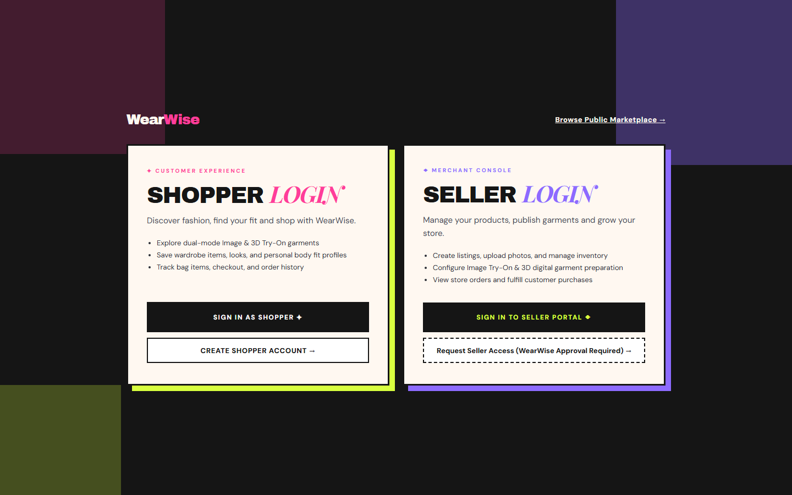
*Figure 1: Dual-portal `/auth` landing entrypoint explicitly separating Customer Experience (`Shopper Login`) from Merchant Console (`Seller Login` + approval notice).*

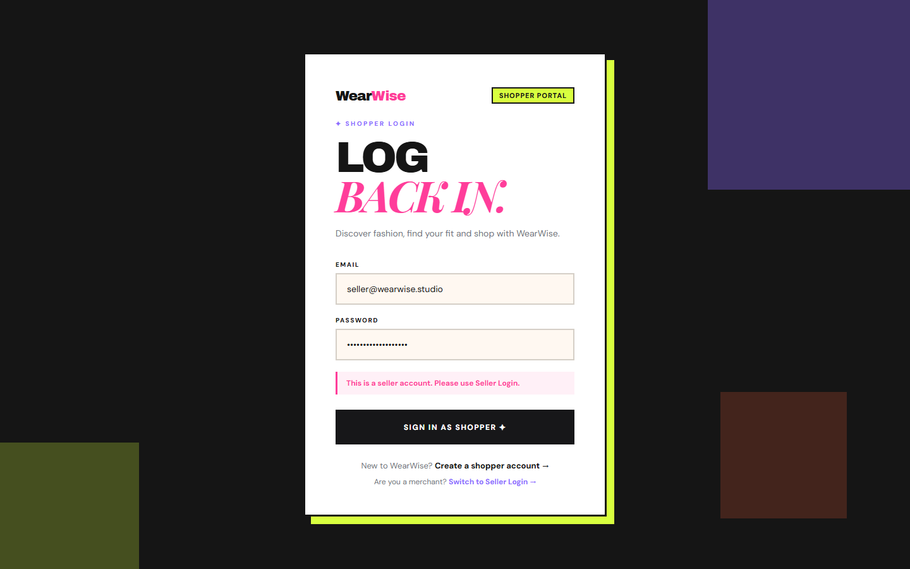
*Figure 2: Backend-enforced `403` portal segregation rejecting seller credentials (`seller@wearwise.studio`) at `/login` (`"This is a seller account. Please use Seller Login."`).*

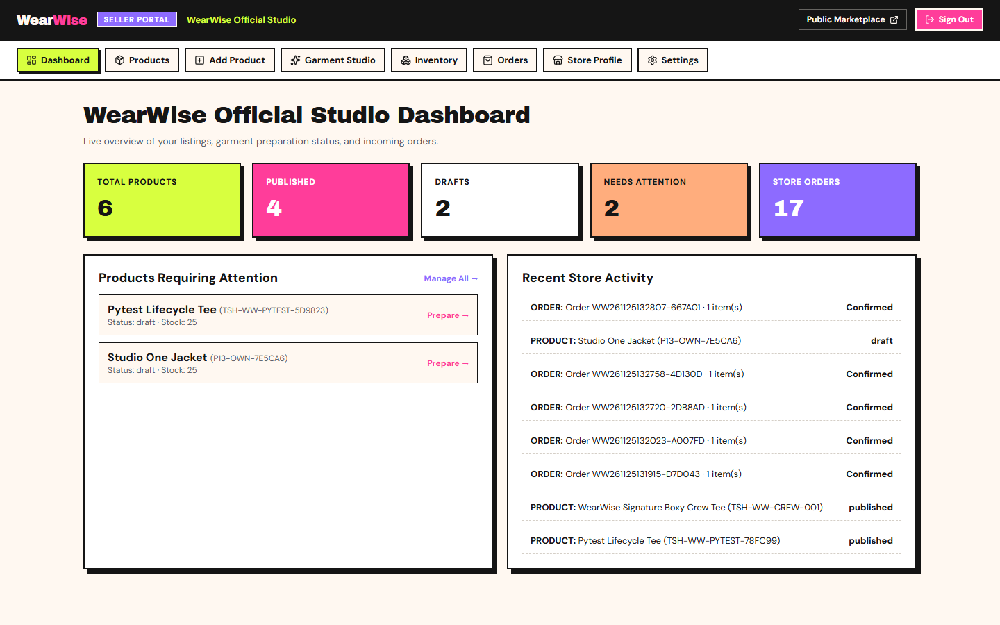
*Figure 3: Isolated Seller Portal Dashboard (`WearWise Official Studio`) displaying live product KPIs (`6` total, `4` published, `2` drafts), attention alerts, and incoming store order feed.*

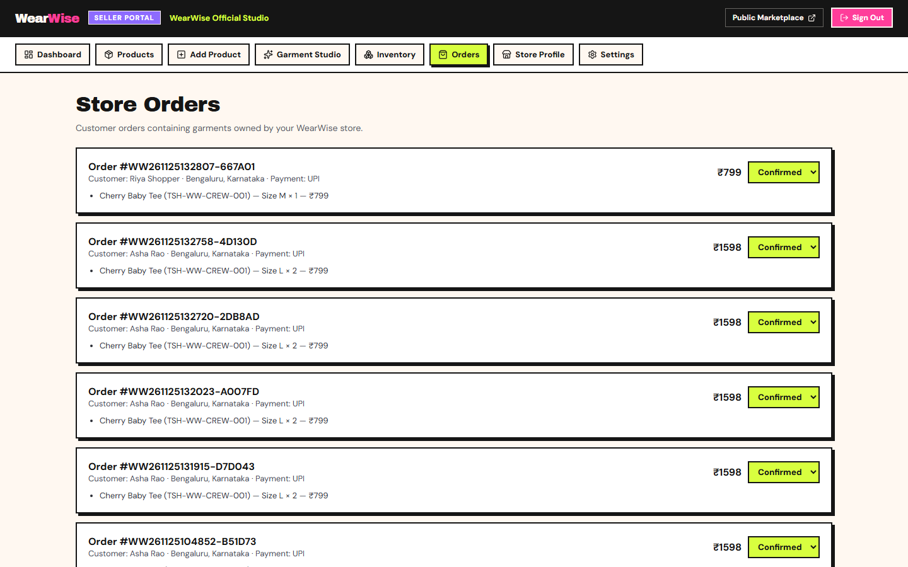
*Figure 4: Brand-scoped Store Orders console displaying customer fulfillment records (`Confirmed`) filtered exclusively to products owned by the authenticated seller.*

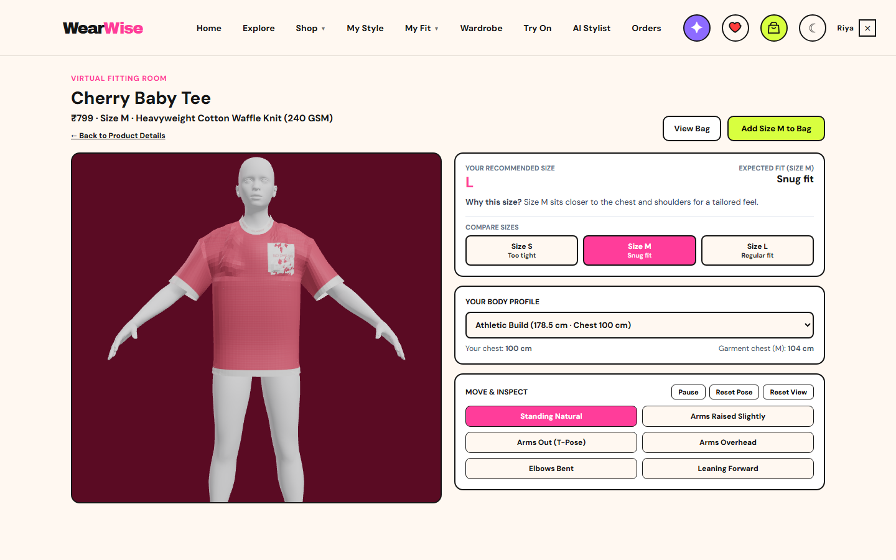
*Figure 5: Authenticated Shopper (`Riya`) inside `/experimental-try-on` rendering `Cherry Baby Tee` (`₹799`, Size M, Heavyweight Cotton Waffle Knit `240 GSM`) on the upright Anny avatar with zero engineering jargon and live Recommended Size (`L`).*

### 14.2 Phase 12 Dual-Mode Marketplace & Pattern-First 3D Evidence (`artifacts/phase12/` & `WEARWISE-BODY-ENGINE/`)

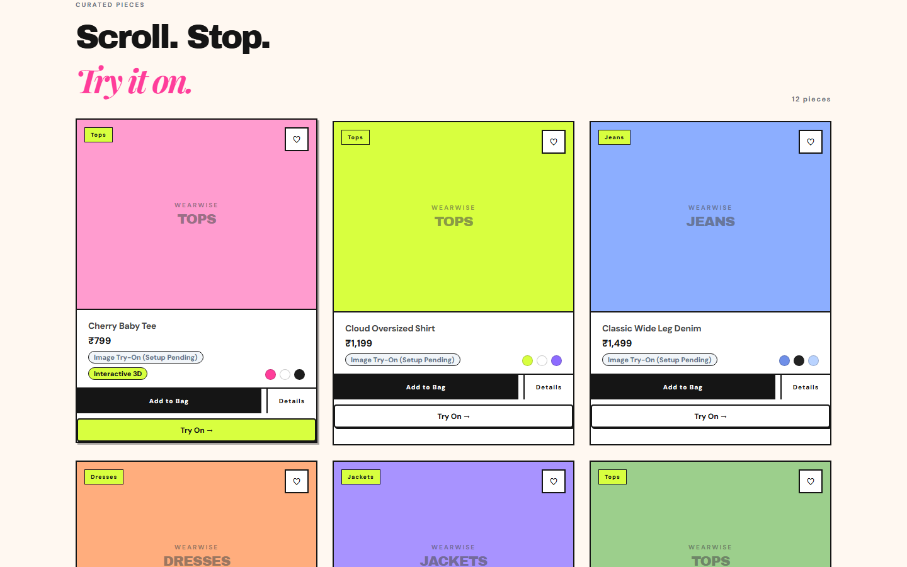
*Figure 6: Public `/explore` storefront displaying mode badges (`Image Try-On (Setup Pending)` alongside `Interactive 3D` for `Cherry Baby Tee`) and clean category navigation with zero fabricated AI recommendations.*

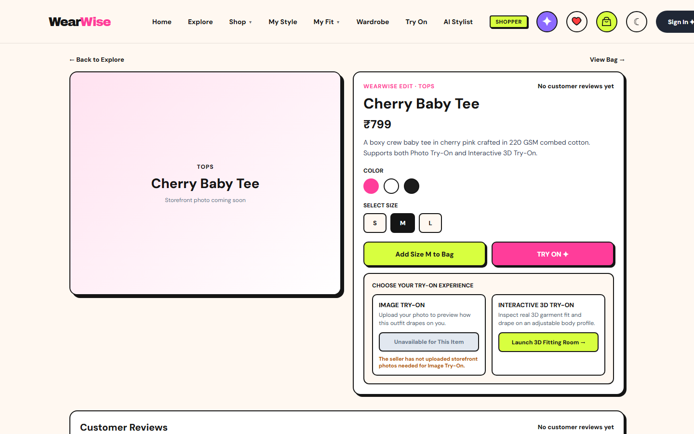
*Figure 7: Product Detail Page (`/product/TSH-WW-CREW-001`) showing honest capability selection prior to upload: disabled `Image Try-On` with exact missing-storefront-photo reason alongside enabled `Launch 3D Fitting Room`.*

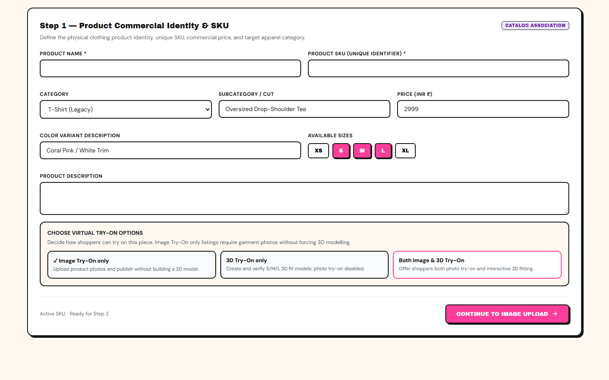
*Figure 8: Simplified Merchant Studio Step 1 featuring plain-language `Image Try-On only`, `3D Try-On only`, and `Both Image & 3D Try-On` toggles.*

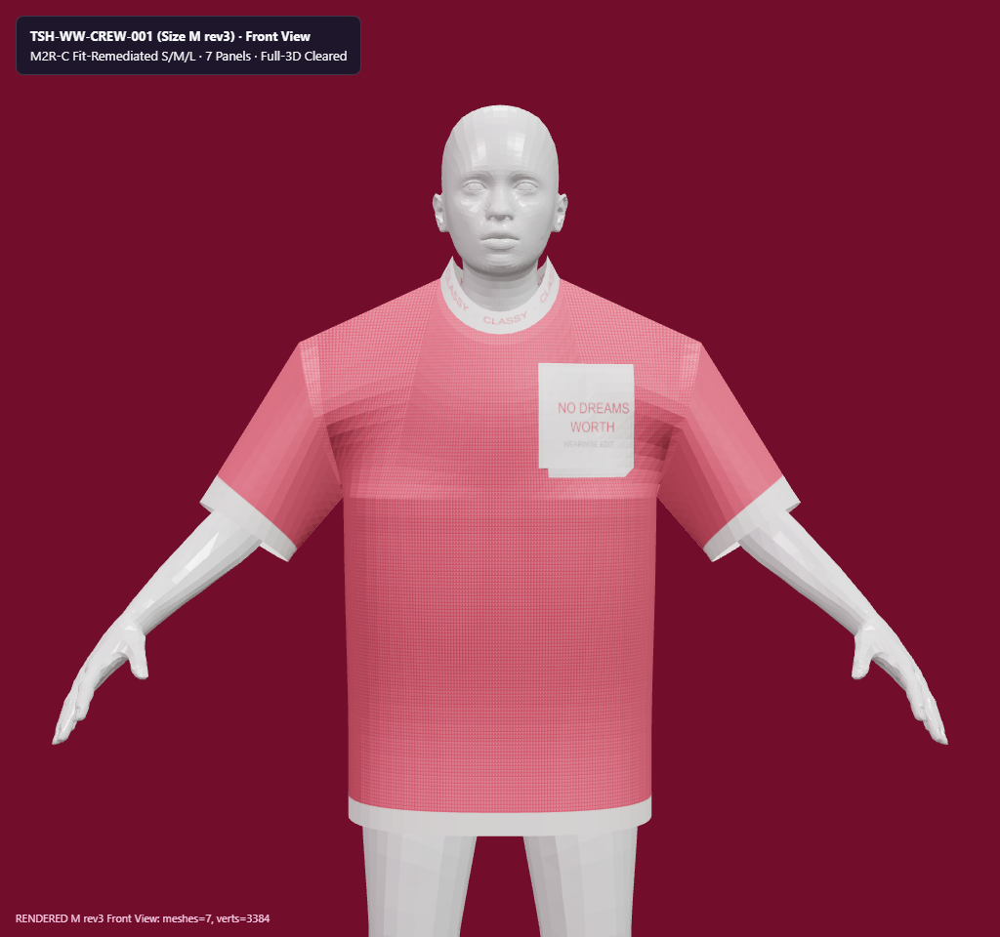
*Figure 9: Verified M2R-C Pattern-First `TSH-WW-CREW-001` Size `M` Rev3 7-panel render (`3,384` vertices, `0` penetrating vertices against upright Anny mannequin).*

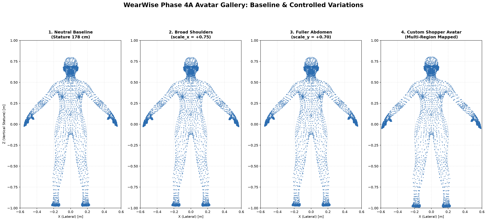
*Figure 10: Early Anny parameter locality verification gallery across Neutral (`178 cm`), Broad Shoulders (`scale_x = +0.75`), Fuller Abdomen (`scale_y = +0.70`), and Combined controls.*

---

## 15. Reproducible Developer Operations, Environment Configuration & Port Map

### 15.1 Environment Template Variables (`.env.example` — **No Secret Values Committed**)

Create `.env` at repository root (or export in PowerShell) using variable keys from [.env.example](file:///c:/Users/Lenovo/Documents/Major%20Project/WearWise/.env.example):

- **MongoDB Staging Overrides:** `MONGODB_URI`, `MONGODB_COMMERCE_DB=wearwise_commerce_staging`, `MONGODB_BODY_ENGINE_DB=wearwise_body_engine_staging`, `MONGODB_SERVER_SELECTION_TIMEOUT_MS=5000`, `APP_ENV=development`
- **JWT & Body Engine Config:** `JWT_SECRET_KEY`, `JWT_ALGORITHM=HS256`, `JWT_ISSUER=wearwise:auth`, `JWT_AUDIENCE=wearwise:api`, `JWT_EXPIRY_MINUTES=240`, `WEARWISE_ENV=development`, `ALLOW_DEV_AUTH=true`, `CORS_ALLOWED_ORIGINS` (defaults to `localhost` / `127.0.0.1` ports `3000`, `4173`, `5173`)
- **Optional External VTON Config (omit to keep Image Try-On safely `503` disabled):** `VTON_PROVIDER=fashn`, `FASHN_API_KEY`, `FASHN_MODEL_NAME=tryon-v1.6`, `VTON_API_URL`, `VTON_API_KEY`, `VTON_PROVIDER_MODE=auto`, `VTON_TIMEOUT_SECONDS=60`

### 15.2 Local Staging Startup Commands (Three Windows PowerShell Terminals)

**Terminal 1 — Body & Garment Engine (`:8000`):**
```powershell
cd "C:\Users\Lenovo\Documents\Major Project\WearWise\WEARWISE-BODY-ENGINE"
$env:MONGODB_BODY_ENGINE_DB="wearwise_body_engine_staging"
$env:MONGODB_COMMERCE_DB="wearwise_commerce_staging"
..\WEARWISE-BODY-ENGINE\.venv-anny\Scripts\python.exe -m uvicorn app.api.app:app --port 8000
```

**Terminal 2 — Commerce API (`:8001`):**
```powershell
cd "C:\Users\Lenovo\Documents\Major Project\WearWise\backend"
$env:MONGODB_COMMERCE_DB="wearwise_commerce_staging"
$env:MONGODB_BODY_ENGINE_DB="wearwise_body_engine_staging"
..\WEARWISE-BODY-ENGINE\.venv-anny\Scripts\python.exe -m uvicorn app.main:app --port 8001
```

**Terminal 3 — Frontend Vite Dev Server (`:5173` — proxies `/api/v1` -> `:8000`, `/api` -> `:8001`):**
```powershell
cd "C:\Users\Lenovo\Documents\Major Project\WearWise\frontend"
npm run dev
```

### 15.3 Staging Portal Accounts (`docs/DEVELOPMENT.md`)

| Account Email | Role | Staging Portal Behavior |
| :--- | :--- | :--- |
| `shopper@wearwise.test` | `shopper` | Allowed on `/login` (`Shopper`); rejected with `403` on `/seller/login` |
| `seller@wearwise.studio` | `seller` (`active`) | Owns Official Studio (`e4d9b2a1-5f3c-4b8a-9e1d-8f7a6b5c4d3e`); rejected with `403` on `/login` |
| `studio.two@wearwise.studio` | `seller` (`active`) | Secondary seller (`f7a1c3d2-4e5b-4a8c-9d1e-2b3c4d5e6f70`) for cross-brand `403` isolation checks |
| `pending.seller@wearwise.studio` | `seller` (`pending`) | Unapproved applicant; rejected with `403` until approved via Admin endpoint |

*(Passwords reside only inside local seeding scripts / developer docs and are omitted cleanly from security-reviewed tables.)*

### 15.4 Verification Commands

```powershell
# 1. Commerce Backend tests (10 cases)
WEARWISE-BODY-ENGINE\.venv-anny\Scripts\python.exe -m pytest backend\tests -q

# 2. Body Engine RBAC, VTON, Auth & Lifecycle tests (16 cases)
WEARWISE-BODY-ENGINE\.venv-anny\Scripts\python.exe -m pytest `
  WEARWISE-BODY-ENGINE\tests\api\test_phase13_body_engine_rbac.py `
  WEARWISE-BODY-ENGINE\tests\api\test_phase12_vton_and_capabilities.py `
  WEARWISE-BODY-ENGINE\tests\api\test_auth_security.py `
  WEARWISE-BODY-ENGINE\tests\api\test_merchant_lifecycle_m4_m5b.py -q

# 3. Frontend unit/UI tests + production TypeScript build
cd frontend
npm test -- --run
npm run build
```

---

## 16. University Major-Project Report Mapping, Appendices & Evidence Validation Summary

### 16.1 Mapping to Formal 13-Chapter University Thesis / Report Outline

| Thesis Chapter / Appendix | Core Contents & Direct Mapping to Dossier Sections |
| :--- | :--- |
| **Chapter 1: Introduction & Motivation** | Section 1 (`WearWise` triad) + Section 2.1 (fit return rates, vanity sizing, scan friction) |
| **Chapter 2: Literature Survey & Gap Analysis** | Section 3 (VITON -> IDM-VTON, SMPL/SMPL-X/FLAME -> Anny, PBD -> XPBD, ISO 8559, glTF 2.0, C2PA + 17 IEEE citations) |
| **Chapter 3: Problem Definition, Feasibility & Requirements** | Section 4 (FR/NFR tables, Ryzen 7 vs RTX 3050 CPU benchmark feasibility, India UPI vs USD VTON billing, `pip-licenses` audit) |
| **Chapter 4: System Architecture & Portal RBAC** | Section 5 (`Diagram 1–3`, service topology, 4-layer dependency hierarchy, HTTP-only cookies + CSRF) |
| **Chapter 5: Body Intelligence (BICE) & Anny Adapter** | Section 6.1–6.2 + Algorithm A & B (`CONTROL_SAFE_RANGES`, `RMSR`/`PVSR`, 5-iteration closed-loop controller) |
| **Chapter 6: Exact Mesh Anthropometry & Honest Fit Engine** | Section 6.3–6.4 + Algorithm C & E + `Diagram 4–5` (2-regular contour stitching, degree-4 resolution, `C(s) >= 0.70`, 6-tier intervals) |
| **Chapter 7: Pattern-First 3D Garment Twins & 5-Gate QA** | Section 6.5 + Algorithm D + `Diagram 6` (superellipse torso, conical collar contract, $\chi = -2$, Rev3 S/M/L verification) |
| **Chapter 8: Real-Time Web Worker XPBD Cloth Simulation** | Section 6.6 + Algorithm F + `Diagram 8` (`WeldedClothSolver`, `AnatomicalCollider`, swapped pre-collision pass, swept CCD) |
| **Chapter 9: Dual-Mode Marketplace, VTON Adapter & Commerce** | Section 6.7–6.9 + `Diagram 7, 9, 10` (`tryOnCapabilities`, `PersonImageService` EXIF strip, FASHN v1/`503` cleanup, bag/checkout) |
| **Chapter 10: Database Design & Asset Lifecycle Security** | Section 8 + `Diagram 11–12` (12 SQL tables, `pg_advisory_xact_lock`/`BEGIN IMMEDIATE` outbox, 11+ MongoDB collections) |
| **Chapter 11: Implementation Stack & API Specifications** | Sections 9–10 (`Commerce :8001` & `Body Engine :8000` REST tables, dependency inventory & observed differences) |
| **Chapter 12: Testing, Experimental Results & Visual Evidence** | Sections 12 & 14 (Hardware, Skinning, XPBD frame ms, `P0–P11` penetrations, Calibration matrix, M2R-C QA, Phase 13 E2E + Figs 1–10) |
| **Chapter 13: Conclusion, Limitations & Future Scope** | Section 13 (Achievements, Windows PyTorch DLL note, broad-waist ceiling, deferred non-tee 3D builders & volunteer fit study) |
| **Appendices A–F** | **A:** `.env.example` Config Matrix (Sec 15.1); **B:** Rev3 SHA-256 Registry (Sec 12.5); **C:** 4-Substep–10-Substep Frame Timing Logs (Sec 12.3); **D:** Staged Test Commands (Sec 15.4); **E:** Phase 12/12.1 Cleanup Metrics (`1,125 -> 751` files); **F:** Full IEEE Bibliography (Sec 3.6) |

### 16.2 Final Evidence Validation Summary

| Documentation Area | Repository / Tool Evidence Directly Checked | Confidence / Status |
| :--- | :--- | :--- |
| **Git State, Workspace Footprint & Hardware** | `git log -15`, `WEARWISE_PROJECT_CLEANUP_REPORT.md`, `HARDWARE_BENCHMARKS.md`, Windows `systeminfo` / `node -v` / `python --version` output | **Verified** (`c9ad918` committed + Phase 13 uncommitted working tree; Ryzen 7 6800H / RTX 3050 / `15.19` GB RAM) |
| **Dual-Portal Auth, Cookies, CSRF & RBAC** | `backend/app/core/security.py`, `backend/app/routers/{auth,seller}.py`, `WEARWISE-BODY-ENGINE/app/api/auth.py`, `frontend/src/App.tsx`, `test_phase13_body_engine_rbac.py`, `WEARWISE_PHASE13_CONSOLIDATED_REPORT.md` | **Verified** (Observed runtime uses `PyJWT` + stdlib `pbkdf2_hmac`, differing from `backend/requirements.txt` `passlib`/`bcrypt`) |
| **BICE, Anny Closed-Loop Calibration & Anthropometry** | `app/bice/*.py`, `app/avatar_engine/adapters/anny_adapter.py`, `app/anthropometry/*.py`, `app/services/avatar_service.py`, `BODY_INTELLIGENCE_DESIGN.md`, `ANTHROPOMETRY_SPECIFICATION.md` | **Verified** (Note: on-host PyTorch run currently hits `[WinError 4551]` DLL policy block cleanly mitigated via lazy loader) |
| **Honest Fit Engine & M2R-C Pattern-First QA** | `app/fit/*.py`, `app/services/garment_platform/*.py`, `HONEST_FIT_ENGINE_SPEC.md`, `graded_m2rc/summary_sml_qa.json`, `M/geometry_topology_qa.json`, `M/measurement_comparison.json` | **Verified** (Including doc-vs-code observations on `hip`/`thigh` spec table & `"loose"` fallback) |
| **Browser Web Worker XPBD Cloth Physics & Colliders** | `frontend/src/experimental_phase10/*.ts*`, `artifacts/xpbd_benchmark_reconciliation.json`, `artifacts/skinning_audit_metrics.json` | **Verified** (`2.36 ms` mean frame @ 60 FPS; `0–17` residual penetrations `P0–P11`) |
| **Dual-Mode Marketplace, VTON Provider & Commerce** | `backend/app/routers/{products,cart,orders,catalogue,wardrobe,saved,avatar,assistant}.py`, `backend/app/schemas/*.py`, `vton_provider.py`, `person_image_service.py`, `vton_job_service.py` | **Verified** (`503` fail-closed verified; live AI synthesis awaits `FASHN_API_KEY` or `VTON_API_URL`) |
| **Database Schemas, Benchmarks & Licensing** | `app/db/models.py` (12 SQL tables), `DATABASE_SCHEMA.md`, `lifecycle_store.py`, `LICENSE_AUDIT.md`, `RISKS_AND_LIMITATIONS.md` | **Verified** (34 permissive deps audited; dual SQL + MongoDB architecture documented accurately) |
| **Peer-Reviewed Academic Citations** | Web searches verifying exact titles, authors, venues, years, arXiv IDs & DOIs (`SMPL`, `SMPL-X`, `FLAME`, `ACGPN`, `VITON`, `CP-VTON`, `HR-VITON`, `IDM-VTON`, `Anny`, `PBD`, `XPBD`, `ISO 8559`, `glTF 2.0`, `C2PA`, `FASHN`, `Vertex AI`) | **Verified** (17 formal IEEE citations) |
| **Visual Evidence & Screenshots** | Direct inspection via `read_file` of all `10` screenshots referenced (`artifacts/phase13/`, `artifacts/phase12/`, `preview_M_front_rev3.png`, `wearwise_avatar_gallery_4panel.png`) | **Verified** (Every embedded path exists on disk and visually inspected) |
