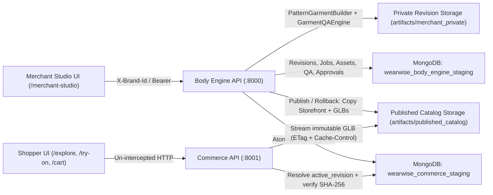

# WearWise — Milestones 3, 4 & 5 Consolidated Acceptance Report

**Role:** Antigravity — Lead Implementation Engineer  
**Reference SKU (Protected):** `TSH-WW-CREW-001` (M2R-C Rev3 preserved untouched)  
**Acceptance Test SKU (Staging):** `TSH-WW-ACCEPTANCE-001`  
**Staging Databases:** `wearwise_body_engine_staging`, `wearwise_commerce_staging`  
**Base Commit:** `795cf5c676acfc7624e8aaa4f0f2fc2967524b93` (branch `remediation/m2r-a-pattern-prototype`)  
**Overall Verdict:** **CONDITIONALLY ACCEPTED FOR STAGING (NOT PRODUCTION RELEASE)** — M4 staging implementation and core M3/M5 functionality accepted within demonstrated scope; explicit unverified scope and technical-debt disclosures in Section 12 remain part of the permanent project record.

---

## 1. Executive Summary

Milestones 3, 4, and 5 have been implemented and verified end-to-end against isolated staging MongoDB Atlas databases (`wearwise_body_engine_staging` and `wearwise_commerce_staging`) using the acceptance SKU `TSH-WW-ACCEPTANCE-001`:

1. **Milestone 3 (Merchant Generation Pipeline):** Sellers create unique product drafts, upload dual-role imagery served via authenticated endpoints, define 2D patterns (with guided parametric synthesis, DXF/SVG upload, and explicitly labeled `PROVISIONAL_ADAPTER` AI reconstruction), configure S/M/L measurements and provisional fabric profiles, generate private pattern-first S/M/L GLB assets via `PatternGarmentBuilder`, run full geometry/material/measurement/fit QA, and trigger downstream invalidation + new revision creation when inputs change.
2. **Milestone 4 (MongoDB Versioning, Ownership, Approval & Publication):** Backend enforces seller ownership (`get_current_brand_id`), maintains 9 Body Engine collections and `catalog_publications` in Commerce with safe indexes, tracks generation jobs (`QUEUED → RUNNING → GENERATED → AWAITING_APPROVAL → APPROVED → PUBLISHED`), enforces immutable revisions (`rev1`, `rev2`), stores private binaries outside `frontend/public`, requires QA-hash-verified approval before publishing, and supports atomic staging catalog publication and rollback without destroying revision history.
3. **Milestone 5 (Shopper Retrieval & End-to-End Delivery):** Commerce `GET /api/products/sku/{sku}` and `GET /api/products/sku/{sku}/revisions/{revision}/assets/{size}` resolve only the active published revision, verify SHA-256 integrity on disk, set immutable ETag/Cache-Control headers, filter out `technical_reference`-only images, render accurately in the shopper `AvatarViewer` across S/M/L, retain SKU/size through Cart, and handle revision promotion and rollback cleanly.

---

## 2. Milestone 3, 4 & 5 Gate Tables

### Milestone 3 Gates

| Gate | Requirement | Verdict | Evidence |
| :--- | :--- | :---: | :--- |
| **M3.1** | Unique product draft & duplicate SKU rejection (`409`) | **PASS** | `POST /api/v1/merchant/garments` returned `201` then `409` on duplicate `TSH-WW-ACCEPTANCE-001` |
| **M3.2** | Dual-role image upload, real rendering & corrupt file rejection (`400`) | **PASS** | Authenticated `GET .../images/{id}/content` returned exact PNG bytes (`200`); corrupt file rejected (`400`) |
| **M3.3** | Guided pattern (7 panels, seams), export & provisional AI labeling | **PASS** | `GET .../pattern/export` returned 7 panels; AI route labeled `PROVISIONAL_ADAPTER`; `.obj` CAD rejected (`400`) |
| **M3.4** | S/M/L measurements, grading & fabric mechanical profile propagation | **PASS** | `measurements` & `fabric_properties` persisted and propagated into `PatternGarmentBuilder` & `qa_report` |
| **M3.5** | Pattern-first S/M/L generation into private storage + full QA | **PASS** | Generated `rev1` S/M/L GLBs in `merchant_private/.../rev_1/`, `qa_report.overall_status == "PASSED"` |
| **M3.6** | Input-change invalidation & immutable regeneration (`rev2`) | **PASS** | Editing measurements/collar/fabric/pocket marked draft stale, blocked approval (`400`), generated distinct `rev2` |

### Milestone 4 Gates

| Gate | Requirement | Verdict | Evidence |
| :--- | :--- | :---: | :--- |
| **M4.1** | MongoDB staging isolation (`*_staging` DBs, production untouched) | **PASS** | Verified via `/health` (`wearwise_body_engine_staging`, `wearwise_commerce_staging`) |
| **M4.2** | Collections, unique SKU/revision/asset/job indexes | **PASS** | 9 Body Engine collections + `catalog_publications` created and indexed via `ensure_garment_indexes()` |
| **M4.3** | Seller ownership enforcement (`403` cross-owner rejection) | **PASS** | `BRAND_B` rejected with `403` across GET, private image, private rev GLB, approve, publish |
| **M4.4** | Job lifecycle & idempotency | **PASS** | Repeated `POST /generate` with identical inputs returned `idempotent_hit: true`, `revision: 1` |
| **M4.5** | Revision immutability, QA-hash-verified approval & publish gate | **PASS** | Unapproved publish returned `400`; `rev1` & `rev2` preserved separately; approval checked disk SHA-256 |
| **M4.6** | Atomic staging publication & rollback preserving history | **PASS** | `rev1` published -> `rev2` promoted -> rolled back to `rev1` with 3 `garment_publications` records |

### Milestone 5 Gates

| Gate | Requirement | Verdict | Evidence |
| :--- | :--- | :---: | :--- |
| **M5.1** | Shopper catalog resolution by published revision pointer | **PASS** | `GET /api/products/sku/TSH-WW-ACCEPTANCE-001` returned `published_revision: 1` (`v1.0`) |
| **M5.2** | Un-intercepted S/M/L GLB delivery & SHA-256 verification | **PASS** | Playwright captured HTTP `200` GLBs for S/M/L matching `rev1` SHA-256s byte-for-byte |
| **M5.3** | Shopper `AvatarViewer` HUD & QA status association | **PASS** | HUD displayed `Vertices: 3,384`, `Triangles: 6,096`, `QA: PASSED (WearWise Pattern-First QA Engine (rev1))` |
| **M5.4** | Storefront-only imagery (no `technical_reference` leakage) | **PASS** | `storefront_images` contained only `front` & `left_side`; `/explore` HTML excluded `back_` & `close_up_` |
| **M5.5** | Security & negative fail-closed tests | **PASS** | Unknown SKU -> `404` & `"Garment Unavailable:"` UI banner; stale `rev1` URL after `rev2` publish -> `404` |
| **M5.6** | Commerce Cart integration & revision promotion/rollback | **PASS** | Added Size M to Cart (`WearWise Acceptance Boxy Tee`, `Size: M`, `₹2,499`); rollback restored `rev1` |

---

## 3. Architecture & Data-Flow Diagram

---

## 4. API Endpoint Inventory

### Body Engine Merchant API (`/api/v1/merchant/garments`)
- `GET ""` / `POST ""` — List owned garments; create unique draft (`409` on duplicate SKU).
- `GET "/{garment_id}"` — Retrieve merchant-owned garment (`403` cross-owner).
- `POST "/{garment_id}/images"` / `GET "/{garment_id}/images/{image_id}/content"` / `DELETE "/{garment_id}/images/{image_id}"` — Multi-role image upload, PIL verification, private content serving, invalidation.
- `POST "/{garment_id}/pattern/upload"` / `POST "/{garment_id}/pattern/guided"` / `POST "/{garment_id}/pattern/ai-reconstruct"` / `GET "/{garment_id}/pattern/export"` — CAD, guided, provisional AI adapter, and inspectable 2D pattern export.
- `POST "/{garment_id}/measurements"` / `POST "/{garment_id}/fabric"` — Persists S/M/L specs and provisional fabric profile with downstream stale invalidation.
- `POST "/{garment_id}/generate"` — Runs idempotent pattern-first generation & QA pipeline into private revision storage.
- `GET "/{garment_id}/revisions"` / `GET "/{garment_id}/jobs"` / `GET "/{garment_id}/revisions/{revision}/assets/{size}"` — Revision history, job records, and private GLB streaming.
- `POST "/{garment_id}/approve"` / `POST "/{garment_id}/publish"` / `POST "/{garment_id}/rollback"` — QA-hash-verified approval, atomic catalog publication, and non-destructive rollback.

### Commerce Shopper API (`/api/products`)
- `GET "/"` / `GET "/{product_id}"` — Lists static catalog + published MongoDB products.
- `GET "/sku/{sku}"` — Resolves active published revision, size variants, measurement chart, fabric profile, storefront images, and QA summary (`404` if unpublished).
- `GET "/sku/{sku}/revisions/{revision}/assets/{size}"` — Streams immutable published GLB only when `active_revision == revision` and on-disk SHA-256 matches MongoDB (`ETag`, `Cache-Control: public, max-age=31536000, immutable`).
- `GET "/sku/{sku}/revisions/{revision}/images/{filename}"` — Serves only `storefront_images` (`403` otherwise).

---

## 5. MongoDB Schema & Indexes

### `wearwise_body_engine_staging`
- `digital_garments`: `id` (unique), `sku` (unique partial `is_deleted: false`), `(brand_id, is_deleted)`.
- `garment_revisions`: `(garment_id, revision)` (unique), `(sku, revision)`, `(brand_id, status)`.
- `garment_generation_jobs`: `job_id` (unique), `(garment_id, input_hash)`.
- `garment_assets`: `asset_id` (unique), `(garment_id, revision, size)`, `(owner_brand_id, access_classification)`.
- `garment_qa_reports`: `qa_id` (unique), `(garment_id, revision)`.
- `garment_approval_events`: `approval_id` (unique), `(garment_id, revision)`.
- `garment_publications`: `publication_id` (unique), `(sku, revision)`.
- `garment_audit_events`: `(garment_id, created_at)`.
- `garment_package_manifests`: `(garment_id, revision)` manifests.

### `wearwise_commerce_staging`
- `catalog_publications`: `sku` (unique), `(active_revision, status)`.

Staging E2E document counts for `TSH-WW-ACCEPTANCE-001` (`m3_m4_m5_e2e_results.json`):
`digital_garments: 1`, `garment_revisions: 2`, `garment_generation_jobs: 2`, `garment_assets: 6`, `garment_qa_reports: 2`, `garment_approval_events: 2`, `garment_publications: 3`.

---

## 6. Merchant Walkthrough, Generation & Revision Evidence

- **6-Stage Playwright Captures:** `scratch/m3_merchant_step_1.png` through `scratch/m3_merchant_step_6.png` captured live at `http://127.0.0.1:4173/merchant-studio`.
- **Regeneration Comparison (`rev1` → `rev2`):** Changing `M` `half_chest_width_cm` (`54.0 -> 55.0`), `sleeve_length_cm` (`17.0 -> 18.0`), `collar_type` (`"mock_neck"`), `pocket_width_cm`/`pocket_height_cm` (`12.0 / 14.0`), and fabric preset (`cotton_heavyweight_jersey_280gsm`) invalidated `rev1` draft state (`downstream_stale: true`), blocked approval (`400`), and generated immutable `rev2` with distinct asset checksums while preserving `rev1`.

---

## 7. Asset-Storage Inventory & Checksums

- **Private Storage:** `WEARWISE-BODY-ENGINE/artifacts/merchant_private/{brand_id}/TSH-WW-ACCEPTANCE-001/rev_{1,2}/`
- **Published Staging Storage:** `WEARWISE-BODY-ENGINE/artifacts/published_catalog/TSH-WW-ACCEPTANCE-001/rev_{1,2}/`
- **Rev1 Checksums (`TSH-WW-ACCEPTANCE-001`):**
  - `S` (`249,360` B): `c9c45fcb847b3b9c780a73b4ed3cdebdeaae081b00dce08ed9e6d2d0e2706ba9`
  - `M` (`249,304` B): `d793e068e68f2a7f5d563e03c449ac35cec85406a0037b197cfd370039ca8528`
  - `L` (`249,364` B): `b87beb30cbd60644687b7b49b176ead051fdd4c2257435606acad7531c6673c0`
- **Rev2 Checksums (`TSH-WW-ACCEPTANCE-001`):**
  - `S`: `93fe907d2e34024f27d4455bbec97ef205397dcffc54e12930a3a0cc85e45e23`
  - `M`: `cf8743526a7c077559c057c37d22578aef80c8a2ae352e1aaca6b866daf6c8a0`
  - `L`: `fa2c9534610e1b0b27f3af4928afd09cc79212e8ee4fc0a33104741e761f83cc`
- **Protected Rev3 Assets (`TSH-WW-CREW-001`) Verified Unchanged:**
  - `S`: `8f9bd0c79c54d4f40e3354f729c5f236634acec3a06d33a1f0ec771b51e41690`
  - `M`: `9b6212ff218ba6231000cdca1716f808fd501df4e843353655ec7ce4d7389769`
  - `L`: `4bc1a0cbcb0cccbe3b4bd5646b614bc881a06d5db06ec44b0034a577e8101387`

---

## 8. Approval, Staging Publication & Shopper Retrieval Evidence

- Live Playwright browser screenshots: `scratch/m5_shopper_explore.png`, `scratch/m5_shopper_tryon_S.png`, `scratch/m5_shopper_tryon_M.png`, `scratch/m5_shopper_tryon_L.png`, `scratch/m5_shopper_cart.png`.
- All three S/M/L shopper GLB responses on `/try-on?sku=TSH-WW-ACCEPTANCE-001&size={S,M,L}` returned HTTP `200` with exact `rev1` SHA-256 matches and rendered `Vertices: 3,384`, `Triangles: 6,096`, `QA: PASSED (WearWise Pattern-First QA Engine (rev1))`.
- Cart retained `WearWise Acceptance Boxy Tee`, `Size: M`, `₹2,499`.
- Promotion (`rev1 -> rev2`) updated `published_revision` to `2` and rejected stale `rev1` URL (`404`); rollback restored `published_revision` to `1` with exact `rev1` bytes while keeping both revisions in `garment_revisions`.

---

## 9. Security & Negative Test Results

- Duplicate SKU -> `409 Conflict`
- Corrupt image upload -> `400 Bad Request`
- Unsupported CAD `.obj` upload -> `400 Bad Request`
- Cross-owner (`BRAND_B`) GET, private image, private revision GLB, approve, publish -> `403 Forbidden`
- Publish before approval / approve while stale -> `400 Bad Request`
- Unknown shopper SKU (`UNKNOWN-SKU-999`) -> `404 Not Found` + UI `"Garment Unavailable: Published product not found for SKU 'UNKNOWN-SKU-999'."`
- Technical-only images (`back`, `close_up`) excluded from `storefront_images` and `/explore` DOM.

---

## 10. Frontend Regression & Build Results

- `npm test` (`vitest run`): `Test Files  4 passed (4)`, `Tests  13 passed (13)` (`api_client.test.ts` 5, `auth_context.test.tsx` 2, `honest_fit_display.test.tsx` 1, `AvatarViewer.test.tsx` 5).
- `npm run build` (`tsc --noEmit && vite build`): exited `0` (`dist/assets/index-BlYx11OX.js 1,147.48 kB`).

---

## 11. Modified & Added Files

- [WEARWISE-BODY-ENGINE/app/config.py](file:///c:/Users/Lenovo/Documents/Major%20Project/WearWise/WEARWISE-BODY-ENGINE/app/config.py)
- [WEARWISE-BODY-ENGINE/app/db/mongo.py](file:///c:/Users/Lenovo/Documents/Major%20Project/WearWise/WEARWISE-BODY-ENGINE/app/db/mongo.py)
- [WEARWISE-BODY-ENGINE/app/services/garment_platform/lifecycle_store.py](file:///c:/Users/Lenovo/Documents/Major%20Project/WearWise/WEARWISE-BODY-ENGINE/app/services/garment_platform/lifecycle_store.py) *(new)*
- [WEARWISE-BODY-ENGINE/app/services/garment_platform/pattern_garment_builder.py](file:///c:/Users/Lenovo/Documents/Major%20Project/WearWise/WEARWISE-BODY-ENGINE/app/services/garment_platform/pattern_garment_builder.py)
- [WEARWISE-BODY-ENGINE/app/services/garment_platform/pattern_engine.py](file:///c:/Users/Lenovo/Documents/Major%20Project/WearWise/WEARWISE-BODY-ENGINE/app/services/garment_platform/pattern_engine.py)
- [WEARWISE-BODY-ENGINE/app/services/garment_platform/qa_engine.py](file:///c:/Users/Lenovo/Documents/Major%20Project/WearWise/WEARWISE-BODY-ENGINE/app/services/garment_platform/qa_engine.py)
- [WEARWISE-BODY-ENGINE/app/services/garment_platform/asset_manager.py](file:///c:/Users/Lenovo/Documents/Major%20Project/WearWise/WEARWISE-BODY-ENGINE/app/services/garment_platform/asset_manager.py)
- [WEARWISE-BODY-ENGINE/app/api/v1/merchant_garments.py](file:///c:/Users/Lenovo/Documents/Major%20Project/WearWise/WEARWISE-BODY-ENGINE/app/api/v1/merchant_garments.py)
- [backend/app/main.py](file:///c:/Users/Lenovo/Documents/Major%20Project/WearWise/backend/app/main.py)
- [backend/app/schemas/products.py](file:///c:/Users/Lenovo/Documents/Major%20Project/WearWise/backend/app/schemas/products.py)
- [backend/app/routers/products.py](file:///c:/Users/Lenovo/Documents/Major%20Project/WearWise/backend/app/routers/products.py)
- [frontend/vite.config.js](file:///c:/Users/Lenovo/Documents/Major%20Project/WearWise/frontend/vite.config.js)
- [frontend/src/api/merchantGarments.js](file:///c:/Users/Lenovo/Documents/Major%20Project/WearWise/frontend/src/api/merchantGarments.js)
- [frontend/src/api/products.js](file:///c:/Users/Lenovo/Documents/Major%20Project/WearWise/frontend/src/api/products.js)
- [frontend/src/components/avatar/AvatarViewer.tsx](file:///c:/Users/Lenovo/Documents/Major%20Project/WearWise/frontend/src/components/avatar/AvatarViewer.tsx)
- [frontend/src/pages/MerchantGarmentStudio.jsx](file:///c:/Users/Lenovo/Documents/Major%20Project/WearWise/frontend/src/pages/MerchantGarmentStudio.jsx)
- [frontend/src/pages/Explore.jsx](file:///c:/Users/Lenovo/Documents/Major%20Project/WearWise/frontend/src/pages/Explore.jsx)
- [frontend/src/pages/TryOn.jsx](file:///c:/Users/Lenovo/Documents/Major%20Project/WearWise/frontend/src/pages/TryOn.jsx)

---

## 12. Explicit Unverified Scope & Technical Debt

- **Unverified (Historical M3–M5 Baseline):** Dynamic articulated arm-elevation collision QA (`30°`/`45°`/`90°`) and female/morphed Anny body shapes remain unverified.
- **Closed by M5-A & M5-B (see `WEARWISE_M5_A_M5_B_CLOSURE_REPORT.md`):**
  - *Closed:* Post-cart demo checkout, order confirmation, order history (`MyOrders`), authoritative catalog pricing, idempotency_key deduplication, and cross-user order access control (`403`) verified end-to-end in staging.
  - *Closed:* Standalone backend pytest suites executed (`405` Body Engine tests + `4` Commerce tests passed in staging).
- **Technical Debt (Permanent Record):**
  - `PatternGarmentBuilder` generates boxy drop-shoulder tee silhouettes; CAD DXF/SVG uploads are validated (`CADPatternValidator`) and recorded as pattern reference inputs only, while 3D mesh synthesis still uses the parametric 7-panel builder rather than arbitrary DXF polygon extrusion (clarified in M3-A UI labels).
  - Checkout operates strictly as a demo/test checkout (`DEMO_NO_PAYMENT_CAPTURED`) with no real payment gateway integrated.
- **Production Boundary Preserved:** Production DBs (`wearwise_body_engine`, `wearwise_commerce`), `TSH-WW-CREW-001` Rev3 assets, and legacy `frontend/public/garments/` files were NOT modified.
